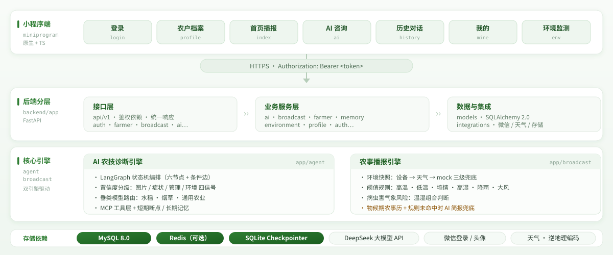
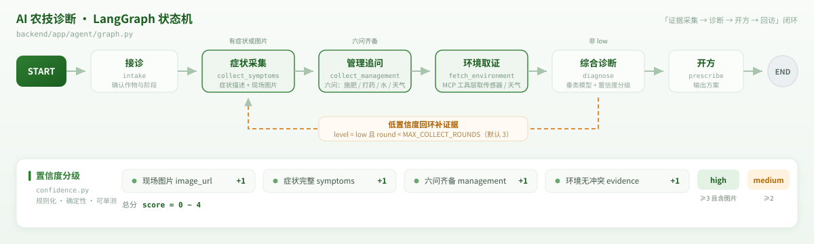
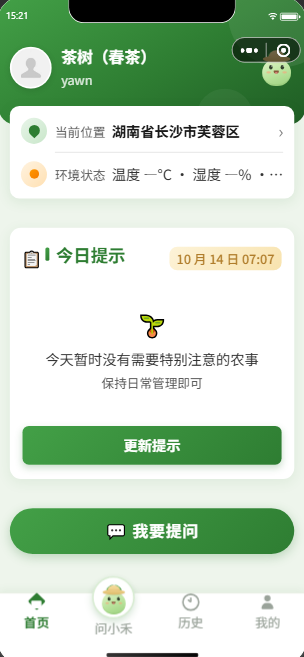
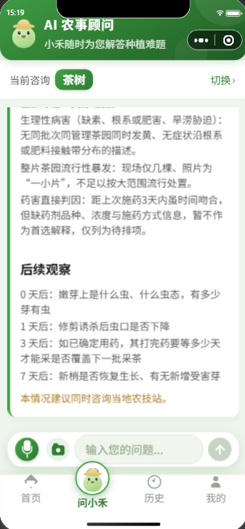
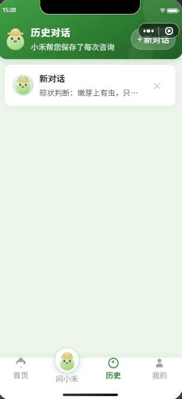
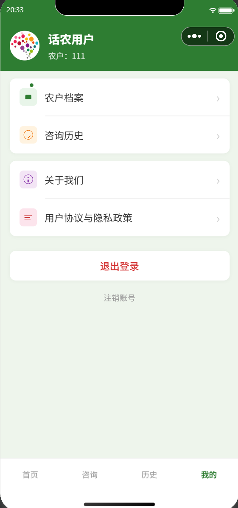

# 话农点金（HNDJ）

> 把一个**懂流程、守红线、可追溯**的 AI 农技员，装进农户的微信里。

面向农户与农技人员的微信小程序：农户用大白话描述庄稼或猪场的问题，AI 按**七条专业流程**分诊、看现场、问五情、查知识库、下判断、开处方——而每一张处方在到达农户之前，都必须先过一道**拥有否决权的安全闸门**。

这不是一个"套壳聊天机器人"。它要解决的是农业 AI 落地最难的三件事：

1. **瞎开药会出人命**——农药处方一旦错了，轻则绝收、重则农残超标。所以本项目把「生成」与「校验」在架构上物理隔离：处方由大模型产出，但能不能给农户看，由一套纯规则、可单测、零模型的**安全闸门**说了算。
2. **农户说不清楚**——"叶子黄了"不是一个可用的诊断输入。系统用流程配置驱动多轮问诊，把"五情"（种情/肥情/墒情/苗情/病虫情）逐个槽位问全，模型离线时整条链路仍可用规则兜底。
3. **模型挂了服务不能挂**——模型网关带熔断降级链，`ZERO_MODEL_MODE` 下一行配置即可切断全部模型调用，农事播报照发不误。



## 核心亮点

### 1. 受理即分流的诊断状态机

诊断不是一问一答的聊天，而是一条 LangGraph 编排的闭环链路：

**受理分流 → 看现场 → 问五情 → 查依据 → 下判断 → 开处方 → 安全校验 → 登记回访**



- 进入图后的**第一条边就是路由**：按入口提示或分诊结果直达七条流程子图之一（水稻 / 茶 / 油菜 / 辣椒 / 杂草 / 养猪 / 通用兜底），不存在"先聊三句再猜你在种什么"。
- 多智能体分工：分诊、现场采集、问诊、证据核查、判定、受限并行会诊、处方、报告守卫、转人工，各司其职。
- 流程差异不写死在代码里：七条流程由 `backend/app/process_config/seeds/*.yaml` 声明（必填槽位、追问顺序、术语大白话映射、紧急判定阈值、流程红线），支持版本化与热加载。

### 2. 安全闸门：唯一拥有否决权的组件

处方产出后必须过独立闸门子图，裁定 `allow / degrade / block` 三态，命中红线一律转人工：

- 10 条规则各自独立可测：药剂白名单、登记作物匹配、剂量区间与每季次数、安全间隔期、用药史冲突、地区适宜性、数字溯源、流程专属红线、红线加载校验、表述语气。
- 处方的剂量、间隔期等数字**只能从知识库条目照抄**（"模板出事实、模型只改写"），闸门的数字溯源规则会反向扫描最终展示文本——模型说出的每个数字都要在知识库里找到出处。
- 支持 `shadow`（灰度观察）/ `enforce`（全量拦截）两种模式，全部判定落审计表，block 事件自动触发知识条目复核工单。

### 3. 知识库：一条 SQL 完成混合检索

`pgvector` 向量相似度 + 元数据过滤（流程、地区、条目状态）在一条 SQL 内完成，配合**地区回退匹配**（县 → 市 → 省 → 全国逐级兜底）与重排序。知识条目上架必须经人工核准，运营白名单接口与农户侧完全隔离。

### 4. 规则优先的农事播报

播报不依赖模型在线：环境事实三级回退采集（传感器 → 天气服务 → 档案推断），阈值规则与病虫害气象风险规则先出文案，模型只做润色。快照幂等生成，按农户时区在最佳触达窗口内推送，额度、静默时段、失败归因全链路可观测。

### 5. 工程质量：被 CI 强制的架构约束

- **四条分层硬规则**由 `backend/scripts/check_layers.py` 检查，违反即构建失败：闸门不得依赖智能体层、智能体不得直接导入 ORM、模型网关不得反向依赖业务、任何模块不得直接 `db.query`。
- 全项目枚举只在一处定义；自由文本转枚举失败即抛异常，**禁止静默兜底**。
- 归属安全：`OwnedMixin` + `OwnedRepository` 基类保证任何接口拿不到别家农户的数据。
- 300+ pytest 用例：契约测试、图路径测试、闸门规则覆盖矩阵、离线评测集回归，测试环境用 mock LLM 与独立测试库，不碰真实大模型。

## 界面预览

<table>
  <tr>
    <td align="center" width="25%"><br><sub>首页 · 农事播报与环境摘要</sub></td>
    <td align="center" width="25%"><br><sub>AI 咨询 · 多轮农技诊断</sub></td>
    <td align="center" width="25%"><br><sub>历史对话 · 会话列表</sub></td>
    <td align="center" width="25%"><br><sub>我的 · 档案与设置</sub></td>
  </tr>
</table>

## 技术栈

| 层 | 技术 |
| --- | --- |
| 小程序端 | 原生微信小程序 · TypeScript · glass-easel · 自定义 tabBar · 适老化样式 token · 语音朗读/输入 |
| 后端 | Python 3.11+ · FastAPI（全异步）· SQLAlchemy 2.0（async）· Alembic · ARQ（异步任务） |
| 数据 | PostgreSQL 16+（pgvector 向量检索 · TimescaleDB 时序）· Redis 7 |
| AI | LangGraph 多智能体 · MCP 工具层 · PostgreSQL 检查点（断点续问）· DeepSeek 兼容模型 |

> 底座统一为 **PostgreSQL 单一栈**：知识检索一条 SQL、LangGraph 检查点 `AsyncPostgresSaver` 持久化，取代了早期的 MySQL + SQLite 组合。

## 目录结构

```
agriculuture-agent/
├── miniprogram/            # 微信小程序前端
│   ├── pages/              # 页面（login/profile/index/ai/history/mine/env）
│   ├── api/                # 后端接口封装
│   ├── custom-tab-bar/     # 自定义 tabBar
│   ├── styles/             # 公共样式 token（适老化，由门禁脚本守护）
│   └── utils/              # 请求、鉴权 guard、定位、语音
├── backend/
│   ├── app/
│   │   ├── agent/          # LangGraph 编排：state / contracts / agents / graph / prompts
│   │   ├── gate/           # 安全闸门：规则引擎 + 10 条可单测规则 + 审计
│   │   ├── process_config/ # 流程配置层：七条流程 YAML + 红线 + 版本化热加载
│   │   ├── knowledge/      # 知识库：索引 / 混合检索 / 地区回退 / 重排 / 种子 JSONL
│   │   ├── llm/            # 模型网关：供应商适配 / 路由档位 / 熔断降级 / token 计量
│   │   ├── broadcast/      # 农事播报：输入采集 / 规则引擎 / 文案 / 快照 / 触达
│   │   ├── services/ + repositories/ + api/ + models/ + schemas/
│   │   ├── events/         # 事务性发件箱
│   │   ├── main.py         # API 入口
│   │   └── worker.py       # ARQ 任务进程（发件箱投递 / 触达扫描 / 回访）
│   ├── alembic/            # 数据库迁移
│   ├── scripts/            # 分层检查、迁移校验、CI 脚本
│   └── tests/              # pytest：契约 / 图路径 / 闸门 / 评测集
├── docs/
│   ├── tasks/              # 115 项分阶段改造任务（六阶段，含验收标准）
│   └── photo/              # 架构与界面资源
└── project.config.json
```

## 快速开始

### 1. 后端

前置：PostgreSQL 16+（需 `pgvector` 与 `timescaledb` 扩展，推荐 `timescale/timescaledb-ha:pg16` 镜像）、Redis 7+。

```bash
cd backend

python -m venv .venv
# Windows
.venv\Scripts\activate
# macOS / Linux
source .venv/bin/activate

pip install -r requirements.txt

cp .env.example .env   # Windows: copy .env.example .env

# 初始化数据库（PostgreSQL 需先建库 huanong）
alembic upgrade head

# 启动 API 服务
uvicorn app.main:app --reload --host 0.0.0.0 --port 8000
```

启动后（`DEBUG=true` 时开放文档）：

- Swagger UI：<http://127.0.0.1:8000/docs>
- ReDoc：<http://127.0.0.1:8000/redoc>

`USE_MOCK_LLM=true`（默认值）时全部模型调用走确定性 mock，**不申请任何大模型 key 也能跑通完整诊断链路**；`WECHAT_APP_SECRET` 未配置时登录走 mock，不影响其余接口调试。

### 2. 后台任务进程（可选）

发件箱投递、触达扫描与回访登记由独立的 ARQ worker 承担：

```bash
cd backend
arq app.worker.WorkerSettings
```

### 3. 小程序端

1. 用微信开发者工具导入项目根目录（`project.config.json` 已配置 `miniprogramRoot` 为 `miniprogram/`）。
2. 后端地址在 [miniprogram/utils/config.ts](miniprogram/utils/config.ts) 中配置（默认本机 `http://127.0.0.1:8000`）。
3. 本地联调时在开发者工具「详情 → 本地设置」勾选「不校验合法域名」。

## 环境变量

完整配置见 [backend/.env.example](backend/.env.example)，关键项：

| 变量 | 说明 |
| --- | --- |
| `ENV` | `development` / `staging` / `production`，启动时校验 |
| `DATABASE_URL` / `CHECKPOINT_DB_URL` | 业务库（asyncpg）与 LangGraph 检查点库（psycopg v3）连接串 |
| `JWT_SECRET` | 令牌签名密钥（只放 `.env`，勿提交） |
| `GATE_MODE` | 安全闸门模式：灰度期 `shadow`，全量生产 `enforce` |
| `USE_MOCK_LLM` | `true` 时模型调用走确定性 mock（联调与测试默认） |
| `ZERO_MODEL_MODE` | `true` 时切断全部模型调用，仅用规则层能力产出文案 |
| `CORS_ORIGINS` | CORS 白名单，生产为空或含 `*` 时拒绝启动 |

密钥类变量只写入本地 `.env`，不要提交到仓库。

## API 一览

统一响应结构 `{ "code": 200, "message": "success", "data": ... }`，除登录外均需 `Authorization: Bearer <token>`。

| 分组 | 端点示例 | 说明 |
| --- | --- | --- |
| 认证 | `POST /api/login`、`POST /api/logout` | 微信登录、登出（令牌吊销） |
| 档案 | `GET/POST /api/farmer/profile`、`POST /api/location/set` | 农户档案与位置 |
| 播报 | `GET/POST /api/broadcast/snapshot` | 读取 / 生成当日提示快照（幂等） |
| 环境 | `GET /api/environment/summary`、`/detail` | 环境监测汇总与详情（来源标注） |
| AI 诊断 | `POST /api/ai/chat`、`GET /api/ai/history` | 图驱动多轮诊断、对话历史 |
| 台账 | `POST /api/ai/prescription/{card_id}/ledger` | 处方卡存入农事台账（幂等） |
| 设备 | 设备绑定 / 上报 / 列表解绑 | 传感器接入与字段映射 |
| 订阅 | `GET /api/subscription/quota`、`POST /grant` | 推送额度与订阅授权 |
| 运营 | `POST /api/knowledge/review/{knowledge_id}` | 知识条目核准（白名单隔离） |

## 质量门禁与测试

后端本地与 CI 共用一份门禁序列：

```bash
cd backend
bash scripts/ci.sh        # 1 ruff check → 2 format --check → 3 mypy → 4 分层依赖 → 5 迁移升降 → 6 gate → 7 graph → 9 其余测试
```

`scripts/ci.sh` 的第 1 至 7 项与 `.github/workflows/ci.yml` 的八项检查逐条一致
（用 `tests/test_ci_config.py` 做文本比对断言）；评测回归（第 8 项）默认不跑，需要时
`CI_RUN_EVAL=1 bash scripts/ci.sh`，或看独立的 `.github/workflows/eval-regression.yml`。

或单独运行测试：

```bash
cd backend
python -m pytest -q
```

- 测试使用 PostgreSQL 测试库（`TEST_DATABASE_URL`）与 mock LLM 隔离环境，不调用真实大模型。
- `scripts/check_layers.py` 强制四条分层依赖规则，白名单条目有上限且需登记失效任务编号；
  `scripts/check_no_noqa.py` 拦"用 `# noqa` 掩盖分层违规"与"CI 里 `continue-on-error` 降级检查"
  ——分层规则不允许行内豁免。
- 前端适老化样式由根目录 `scripts/check_wxss_tokens.mjs` 门禁校验（字号/行距/热区只允许定义在 `tokens.wxss`）。
- 离线评测集（`backend/tests/eval/`）对七条流程做加权一致率回归；一致率低于阈值或相对
  基线下降超过 1 个百分点即阻断发布（`scripts/compare_eval_reports.py`）。
- 发布前人工核对项与其自动化检查的映射见 [docs/release-checklist.md](docs/release-checklist.md)。

## 设计与任务文档

本项目按「任务驱动」方式改造，每个任务是一份自足的施工说明（做什么 / 依赖什么 / 改哪些文件 / 怎么验收），共 115 项、六个阶段：底座归位 → 流程与问诊重构 → 提示与触达 → 适老化 → 传感器接入 → 质量与交付。

- 任务总表：[docs/tasks/README.md](docs/tasks/README.md)
- 全局约定与执行规范（动手前必读）：[docs/tasks/00-全局约定与执行规范.md](docs/tasks/00-全局约定与执行规范.md)
- 产品说明书与技术实现方案见 `docs/` 目录

## License

见 [LICENSE](LICENSE)。
