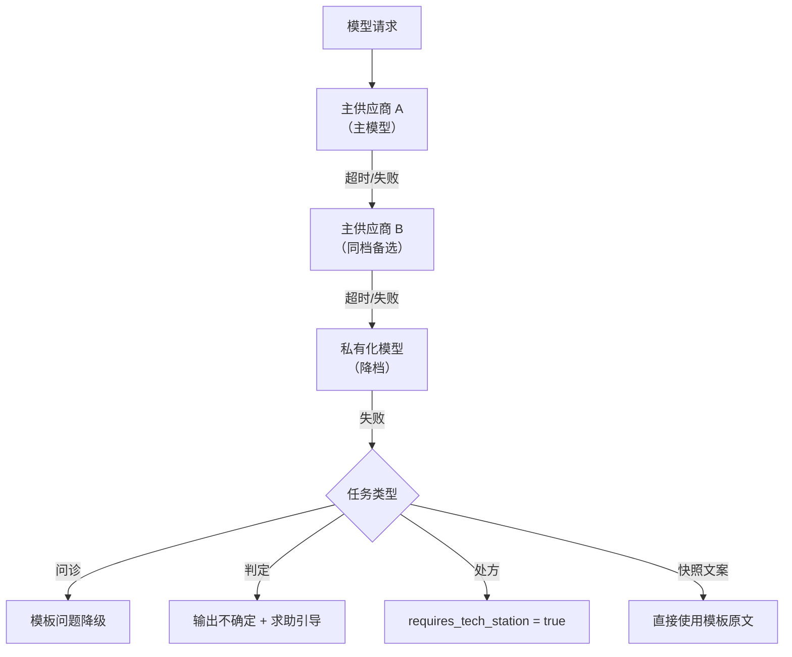

# T2-58 熔断器与降级链

## 这一项要做什么

在 `app/llm/circuit.py` 中实现按供应商独立的熔断器，并在网关的候选链之上实现方案 10.3 的完整降级链：主供应商 A 到主供应商 B 到私有化模型（降档）到按任务类型的降级出口。熔断器决定"某个供应商是否还能被打"，降级链决定"这一跳失败后往哪走"。

本项有一条不可动摇的约束：**规则层能力不依赖大模型**。快照生成器必须支持"零模型模式"，全部提示条目直接用模板原文输出，仅损失文案的口语化程度，不损失事实准确性。这意味着模板本身必须可读。

## 前置依赖

- 依赖 T2-55：必须已提供 `ModelGateway` 的调用编排与候选链遍历
- 依赖 T2-56：必须已提供适配器的错误分类（可重试与不可重试）
- 依赖 T2-57：必须已提供 `RoutingDecision.chain` 与 `is_degraded` 标记
- 依赖 T2-01：必须已提供 `TaskType`，按任务类型的降级出口以其为键
- 外部环境：Redis 可选（多进程共享熔断状态）；`USE_MOCK_LLM=true` 时供应商全部可用，不触发熔断
- 与 T3-05、T3-08 的关系：快照的"零模型模式"由提示与触达阶段调用，本项提供该模式的模型侧支持

## 参考章节

- 技术方案 第10章 10.3 降级链路（完整流程图）
- 技术方案 第10章 10.3 关键：规则层能力不依赖大模型（零模型模式与模板可读）
- 技术方案 第10章 10.1 管理职责之四超时熔断（按供应商独立熔断，熔断期间自动切换备选）
- 技术方案 第10章 10.4 私有化兜底的定位（确保红线链路在外部服务中断时仍可用）
- 技术方案 第10章 10.2 结构化输出的第三层（走该智能体的降级路径）
- 产品说明书 6.3 兜底三（规则层能力继续提供，智能问答暂时不可用）
- 全局约定 第六节（失败行为分两类，守卫类 fail-closed）

## 改动范围

| 类型 | 文件路径 | 说明 |
| --- | --- | --- |
| 新增 | `app/llm/circuit.py` | `CircuitBreaker`：按供应商的熔断状态机 |
| 新增 | `app/llm/fallback.py` | 按任务类型的降级出口定义与零模型模式开关 |
| 新增 | `tests/llm/test_circuit.py` | 熔断开启、半开、恢复、隔离的用例 |
| 新增 | `tests/llm/test_fallback_chain.py` | 降级链逐跳、降档标记、零模型模式的用例 |
| 修改 | `app/core/config.py` | 熔断阈值、冷却时长、零模型模式开关 |

## 实现要点

### 降级链流程图

按方案 10.3 的流程落到代码路径：



前两跳（A、B、私有化）在网关的候选链遍历里完成，由 T2-55 的循环驱动，本项提供熔断放行与降档标记。第三跳（按任务类型的降级出口）不在网关内实现——网关是通用组件，不知道各智能体的降级语义。网关全部候选失败后抛 `AllProvidersFailedError`，由智能体基类捕获并按 `TaskType` 分派到对应出口。本项定义出口的映射表与零模型模式，供基类与快照生成器读取。

### 按供应商独立的熔断器

```python
class CircuitState(str, Enum):
    CLOSED = "closed"       # 正常放行
    OPEN = "open"           # 熔断，拒绝请求
    HALF_OPEN = "half_open" # 半开，放行少量探针请求

class CircuitBreaker:
    """按供应商独立的熔断器。三态状态机。"""

    def __init__(self, *, failure_threshold: int, cooldown_seconds: int, half_open_probes: int) -> None: ...

    def allow(self, provider: str) -> bool:
        """是否放行一次调用。OPEN 且未到冷却期返回 False。"""
        state = self._state_of(provider)
        if state is CircuitState.CLOSED:
            return True
        if state is CircuitState.OPEN:
            if self._cooled_down(provider):
                self._set_state(provider, CircuitState.HALF_OPEN)
                return True
            return False
        return self._half_open_budget(provider)      # HALF_OPEN 只放行有限探针

    def record_failure(self, provider: str) -> None:
        """记录一次失败。CLOSED 达到阈值转 OPEN，HALF_OPEN 直接回到 OPEN。"""
        ...

    def record_success(self, provider: str) -> None:
        """记录成功。HALF_OPEN 连续成功转回 CLOSED。"""
        ...
```

三态的意义：`CLOSED` 正常；连续失败达阈值转 `OPEN`，在冷却期内直接拒绝请求（不打无效调用）；冷却结束后转 `HALF_OPEN`，放行少量探针；探针连续成功则回 `CLOSED`，失败则回 `OPEN` 重新冷却。

按供应商独立是关键：主供应商 A 故障不应让主供应商 B 也被熔断，否则降级链失去意义。熔断状态以供应商名为键，`record_failure` 只影响对应供应商。

`HALF_OPEN` 的探针要有数量上限（`half_open_probes`），否则供应商刚恢复时会被大量并发请求同时打过去，可能再次击垮它。

### 熔断状态的多进程共享

单进程内用内存字典保存状态即可；多进程部署时用 Redis 共享，键形如 `circuit:{provider}`，值含状态与失败计数，带 TTL 与冷却期对齐。是否启用 Redis 由配置决定，未配置时退化为进程内状态。进程内状态在网关进程数少时足够，且不引入 Redis 依赖。

无论哪种实现，熔断器对外接口一致（`allow`、`record_failure`、`record_success`），让单测可以注入内存实现，生产可以注入 Redis 实现。

### 按任务类型的降级出口

```python
class DegradeExit(str, Enum):
    TEMPLATE_QUESTION = "template_question"      # 问诊：模板问题
    UNCERTAIN_WITH_GUIDE = "uncertain_with_guide"  # 判定：不确定加求助引导
    REQUIRE_TECH_STATION = "require_tech_station"  # 处方：requires_tech_station=true
    TEMPLATE_TEXT = "template_text"              # 快照文案：模板原文

TASK_DEGRADE_EXIT: dict[TaskType, DegradeExit] = {
    TaskType.TRIAGE: DegradeExit.UNCERTAIN_WITH_GUIDE,   # 回退 general 并说明
    TaskType.INTERVIEW: DegradeExit.TEMPLATE_QUESTION,
    TaskType.DIAGNOSE: DegradeExit.UNCERTAIN_WITH_GUIDE,
    TaskType.PRESCRIBE: DegradeExit.REQUIRE_TECH_STATION,
    TaskType.SNAPSHOT_WRITER: DegradeExit.TEMPLATE_TEXT,
    TaskType.PANEL: DegradeExit.UNCERTAIN_WITH_GUIDE,       # 转单链判定
    TaskType.RETRIEVE: DegradeExit.UNCERTAIN_WITH_GUIDE,    # 返回空集
    TaskType.REPORT_GUARD: DegradeExit.UNCERTAIN_WITH_GUIDE,  # 有疑即报
}
```

这张表把方案 10.3 的四条出口与各 `TaskType` 对齐。四个出口的语义分别是：

| 出口 | 行为 | 事实来源 |
| --- | --- | --- |
| 模板问题降级 | 使用该槽位的模板问题（`why` 已在模板中写好） | 流程配置的槽位模板 |
| 不确定加求助引导 | 输出 `confidence_level=uncertain` 加观察与联系农技站建议 | 无模型，纯模板 |
| 处方转农技站 | `requires_tech_station=true` 加一条到站咨询的动作 | 无模型，纯模板 |
| 快照文案用模板原文 | 直接输出规则的模板原文，不做口语化改写 | 规则层的模板文本 |

四个出口全部是模板或规则产出，不需要模型。这正是"降级仍服务"能够成立的原因：模型只在"把话说顺"这一步有用，事实与结构都由代码提供。

### 零模型模式

```python
class ZeroModelMode:
    """零模型模式：所有模型调用走模板原文，用于外部服务中断或显式关闭模型。"""

    def __init__(self, enabled: bool) -> None:
        self._enabled = enabled

    def is_enabled(self) -> bool:
        return self._enabled

    async def render_snapshot_item(self, template_text: str) -> str:
        """快照条目的零模型渲染：直接返回模板原文。"""
        return template_text
```

方案 10.3 明确快照生成器必须支持"零模型模式"：全部提示条目直接用模板原文输出，仅损失文案的口语化程度，不损失事实准确性。产品说明书 6.3 的兜底三也要求"规则层能力（阈值提示、农事历提示）继续提供，界面提示智能问答暂时不可用"。

零模型模式的触发条件有两个：全局开关（如维护期主动关闭模型）与自动降级（网关候选链全部失败且任务是快照文案类）。两种触发都走到同一个"用模板原文"的实现。

实现上的硬要求是**模板必须本身可读**。若模板写成"{{metric}}超过{{threshold}}，建议{{action}}，详情咨询{{contact}}"，零模型模式下渲染出来就是一句含占位符的残句。因此模板的占位符设计要保证：即使不经过改写，替换掉占位符后的文本也是通顺、可读、无占位符残留的完整句子。

这条约束对文案模板（T3-07）有直接要求，本项负责把它写成可被断言的事实：

```python
def validate_template_readable(template_text: str) -> None:
    """零模型模式的前置校验：模板渲染后不得含未替换占位符与空字段。"""
    if re.search(r"\{\{[^}]+\}\}", template_text):
        raise UnreadableTemplate(f"模板存在未替换占位符: {template_text[:40]}")
```

校验在提示与触达阶段的模板加载时执行，发现模板在零模型模式下不可读即报错。这是"模板出事实"原则的延伸：模板不仅是给模型改写的素材，更是模型不可用时的最终输出。

### 熔断期间的行为

熔断期间网关跳过该供应商，但整个请求不一定失败：只要候选链上还有未熔断的供应商，问诊继续。只有当链上全部供应商熔断或失败时，才抛 `AllProvidersFailedError`，进入任务类型降级出口。这保证了"主供应商故障"通常是农户无感的（换到 B 或私有化），只有"全部故障"才可见降级。

指标上要区分三个层次：单供应商失败率、降级链跳过率、任务级降级出口触发率。第三个上升才说明系统真的到了"只能给模板"的状态，此时应触发运维告警。

## 验收标准

- `pytest tests/llm/test_circuit.py` 全部通过，至少含八条：连续 N 次失败后 `allow` 返回 False、冷却期未到时持续拒绝、冷却后首次 `allow` 返回 True 并进 `HALF_OPEN`、`HALF_OPEN` 探针数达上限后拒绝、`HALF_OPEN` 连续成功后回 `CLOSED`、`HALF_OPEN` 一次失败后回 `OPEN`、供应商 A 熔断不影响供应商 B 的 `allow`、`USE_MOCK_LLM=true` 下不产生熔断
- 断言失败阈值与冷却时长来自配置（构造时注入），源码无硬编码魔数
- `pytest tests/llm/test_fallback_chain.py` 全部通过，至少含八条：A 失败自动尝试 B、B 失败尝试私有化、私有化失败抛 `AllProvidersFailedError`、经过私有化的候选 `is_degraded` 为 True、`TaskType.PRESCRIBE` 的降级出口为 `REQUIRE_TECH_STATION`、`TaskType.INTERVIEW` 的出口为 `TEMPLATE_QUESTION`、`TaskType.SNAPSHOT_WRITER` 的出口为 `TEMPLATE_TEXT`、`TASK_DEGRADE_EXIT` 覆盖全部 `TaskType`
- 断言零模型模式下 `render_snapshot_item` 原样返回模板文本，不发起任何模型调用
- 断言 `validate_template_readable` 对含 `{{...}}` 的文本抛 `UnreadableTemplate`，对已渲染的完整句子通过
- 断言四个降级出口的产出均不依赖模型：以全部供应商不可用为前提，断言问诊出口产出模板问题、判定出口产出 `uncertain`、处方出口产出 `requires_tech_station=true`、快照出口产出模板原文
- 断言熔断期间至少有一个候选可用时，请求返回成功且 `ModelResponse.is_fallback` 为 True
- `ruff check`、`ruff format --check`、`mypy app` 三条命令返回 0
