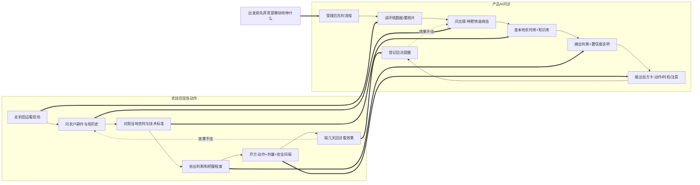
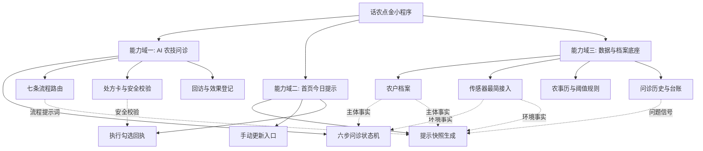
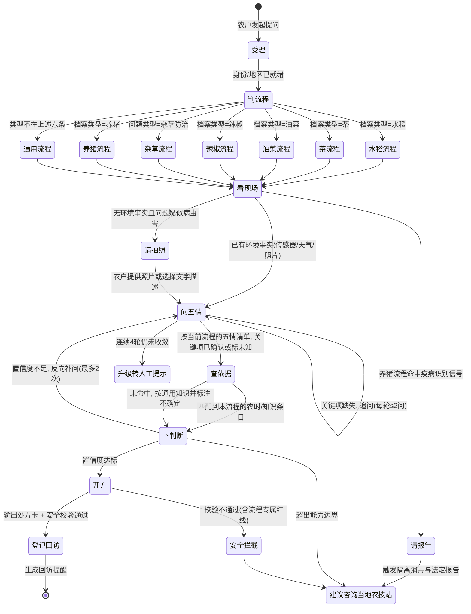
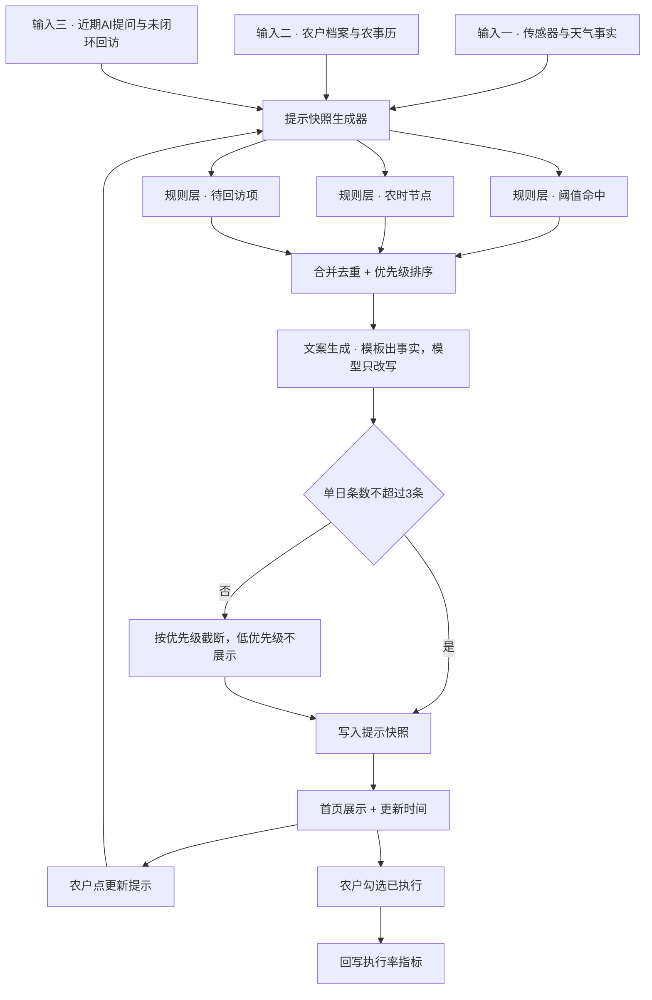
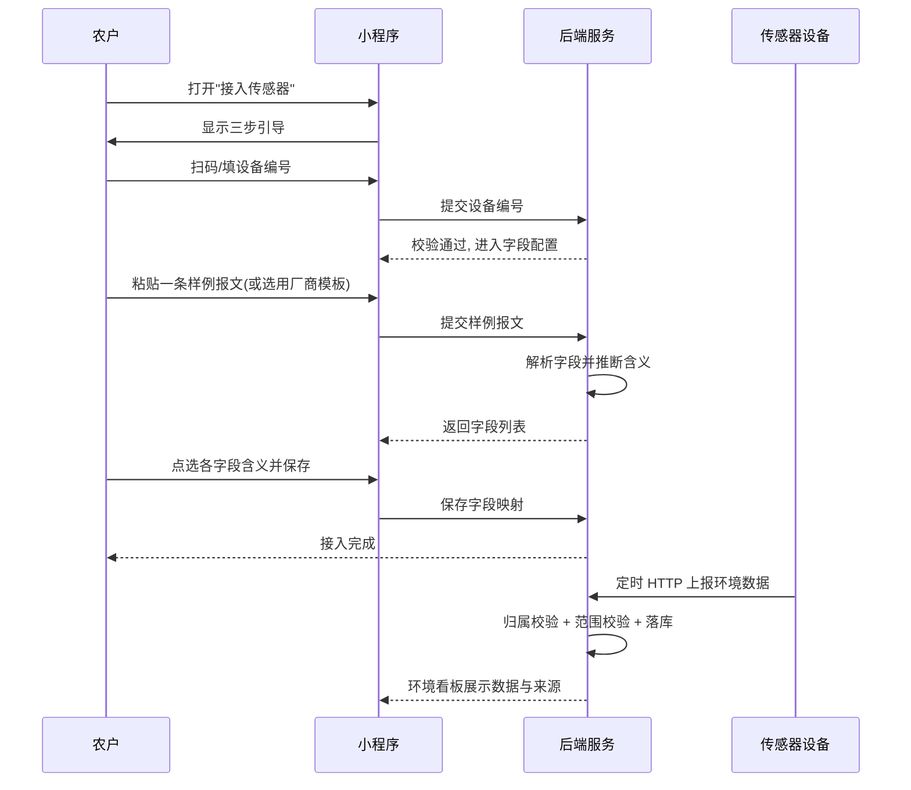
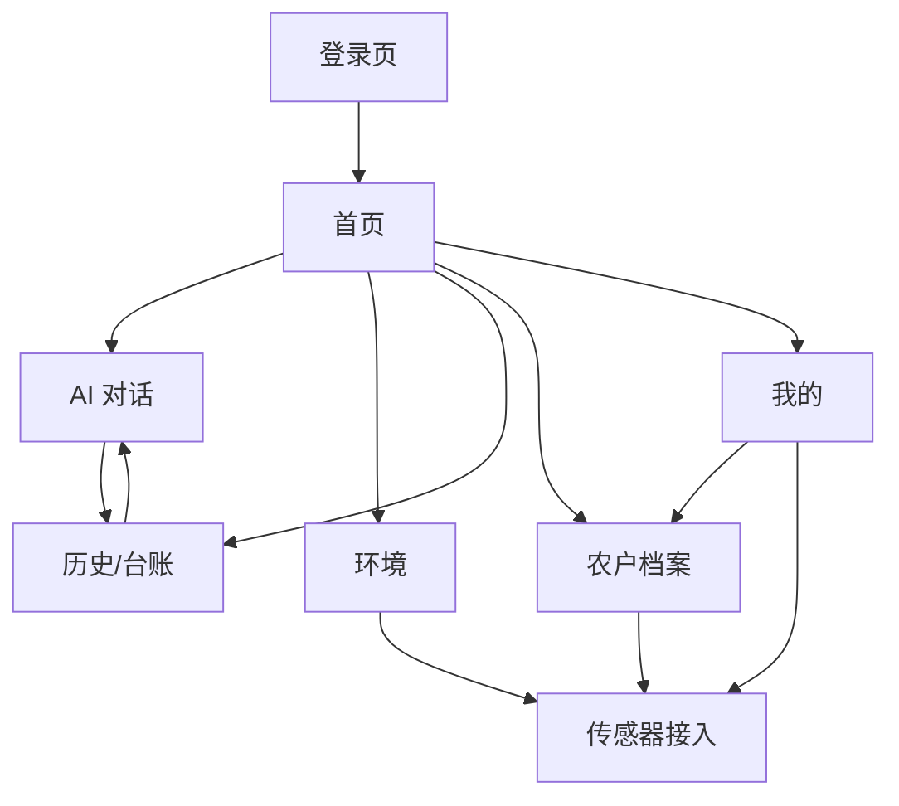

# 话农点金 · 产品说明书 v2.0

> 面向农户的微信小程序 AI 农技服务产品 · 重构指导版
>
> 文档版本：v2.0（重构基线）
> 编制日期：2026-09-23
> 定位：用于指导后端与小程序端架构重构的产品需求基线
> 前序文档：《话农点金项目详细分析报告》《农技人员指导农民全流程调研报告》《智慧农场传感器类型与小程序自助接入方案调研报告》《智慧农场语音播报流程调研报告》，以及水稻、茶树、辣椒、杂草防治、养猪五份专项流程调研报告

---

## 目录

- 一、需求背景
  - 1.1 产品现状
  - 1.2 现状暴露的核心问题
  - 1.3 本次重构的触发点（六条产品决策）
  - 1.4 调研依据
- 二、需求目标
  - 2.1 产品目标
  - 2.2 目标用户与使用场景
  - 2.3 效果衡量指标
- 三、产品定位与总体设计
  - 3.1 一句话定位
  - 3.2 核心设计理念：AI 诊断模仿农技人员指导流程
  - 3.3 三大能力域与功能地图
- 四、功能需求详述
  - 4.1 模块一：农户档案
  - 4.2 模块二：AI 农技问诊（核心模块）
  - 4.3 模块三：首页今日提示（手动更新）
  - 4.4 模块四：环境与传感器数据
  - 4.5 模块五：问诊历史与农事台账
  - 4.6 模块六：登录、订阅与消息触达
- 五、七条流程的提示词设计
  - 5.1 提示词的统一骨架
  - 5.2 水稻流程提示词
  - 5.3 茶流程提示词
  - 5.4 油菜流程提示词（待调研）
  - 5.5 辣椒流程提示词
  - 5.6 杂草防治流程提示词
  - 5.7 养猪流程提示词
  - 5.8 通用农业流程提示词
  - 5.9 提示词与首页提示的关系
- 六、AI 产品质量、评估与兜底
- 七、硬件与传感器接入（最简方案）
- 八、页面与交互原型
- 九、对后续架构重构的约束
- 附录 A：本次设计中的假设与待确认项
- 附录 B：文档使用建议

---

# 一、需求背景

## 1.1 产品现状

话农点金（HNDJ）当前是一款面向农户的微信小程序 AI 农事服务产品，由「后端服务 + 微信小程序」两部分组成。后端为 Python FastAPI 应用，内部包含四条主要能力线：农事播报生成、环境数据聚合、AI 农技问答（基于 LangGraph 的状态机编排）、用户与档案管理。小程序端包含首页、AI 对话、环境、历史、我的、登录与农户档案共 7 个页面，采用原生小程序 + TypeScript 开发。

产品当前已具备的最小闭环是：农户登录 → 完善档案 → 首页查看农事提示 → 进入 AI 对话提问 → 查看历史记录。环境数据通过天气服务与可选的外部传感器接入，作为播报规则与 AI 诊断的上下文。

从代码规模看，后端业务代码约 2 200 行、小程序端约 1 700 行，数据表 10 张、对外接口 15 个，属于可完整重构的体量。

## 1.2 现状暴露的核心问题

在详细分析中发现，现有实现与产品设想之间存在若干结构性偏差，这些问题正是本次重构需要消解的对象：

| 问题类别 | 具体表现 | 影响 |
| --- | --- | --- |
| AI 诊断链路未真正落地 | 诊断节点仅做单轮分类判断，追问轮次靠低置信度回环，缺少稳定的问诊脚本 | 农户体验上更像"一问一答的搜索"，不像"农技员问诊" |
| 播报与诊断是两套逻辑 | 播报走规则引擎 + 农事历，诊断走 LangGraph，两者互不引用 | 首页提示与农户刚问过的问题无关，缺乏连贯感 |
| 传感器接入为空壳 | `tools/sensors.py` 仅预留接口，无数据模型、无绑定流程、无厂商模板 | 无法交付"扫码即接入"的农户自助体验 |
| 作物模型路由不匹配业务 | 现有路由为「水稻 / 烟草 / 通用农业」三类 | 与目标流程结构（七条流程）不一致 |
| 各作物流程未分化 | 所有作物共用同一套问诊脚本与追问逻辑 | 无法承载各流程差异极大的问诊要点与安全约束 |
| 播报规则存在死代码 | 大风、降雨规则依赖从未被赋值的字段，实际永不触发 | 部分风险场景无提醒 |
| 播报不可控 | 无滞回抑制、无去重合并、无静默时段 | 提示噪音大，农户执行率低 |
| 前端交互断点 | 拍照入口进入后无法回到正常对话，且图片地址恒为空 | 图像辅助诊断能力形同虚设 |
| 平台能力预期偏差 | 长期订阅消息对农业类小程序默认不可开通 | 推送触达方案需重新设计 |

## 1.3 本次重构的触发点（六条产品决策）

本次重构不是推倒重来，页面结构与主流程保持稳定，重点是把"交互形态"和"内在编排"改造成更贴近农业生产实际的样子。以下六条是本次产品设计的硬性前提：

**决策一：AI 诊断要模仿农技人员给农民做指导的流程。**
农技员的指导不是一次问答，而是有固定动作顺序的：先看田（观察现场）、再问情（询问耕作与用药历史）、然后查证（对照当地农时与技术标准）、接着断症（给出判断和把握程度）、再开方（给出可执行动作 + 安全间隔期）、最后回访（确认效果）。AI 问诊必须把这套动作序列显性化，让农户感觉"有个懂行的人在问我"。

**决策二：首页提示由"传感器 + 农户档案 + AI 提问历史"共同生成，且必须用户点「更新」才刷新。**
提示不再是无差别推送，而是针对这一户、这一块地、这个阶段生成的。生成结果是"快照"而非"实时流"：进入首页看到的是上一次生成的内容与生成时间，农户主动点击「更新提示」才重新生成。这样既避免提示频繁变动带来的不信任，也把刷新动作的选择权交给农户。

**决策三：传感器接入取调研结论中的最简方案。**
不追求协议全覆盖，只做一条最短路径：设备通过 HTTP 直报把一段报文发到后端，农户在小程序里完成扫码/填编号、粘贴一条样例报文、点选每个字段的含义三件事即可完成接入。不做现场配网、不做协议逆向、不做驱动市场。

**决策四：有传感器和没传感器都不影响 AI 诊断流程运行，只是没有传感器时追问更详细。**
传感器是"增强项"而非"前置条件"。任何一个诊断节点都不得因为"缺少环境数据"而中断或降级为不可用；缺数据时改为向农户提问（例如"这块地最近三天大概浇过水没有"），并明确告诉农户"环境数据暂不可用"，绝不用推测值填空。

**决策五：按流程而非按作物组织 AI 能力，划分为七条独立流程（每条流程一套独立的问诊脚本与提示词）。**
产品详细调研了水稻、茶、辣椒、杂草防治、养猪五条流程，加上尚未调研的油菜、以及承接未知作物的通用农业，共确立七条流程。分流的依据不是"作物名称不同"，而是**每条流程的问诊要点、时机判据、安全约束三者差异过大，用一套脚本无法同时说对**。

**决策六：保留农户档案，并把从事的作物/养殖类型与七条流程对齐。**
农户档案是全部个性化能力的锚点，必须保留并加强。类型选择与流程一一对应，其中「杂草防治」是"问题类型"而非作物，需在数据模型上单独处理（详见 4.1）。

## 1.4 调研依据

本说明书的功能设计来自八份调研材料，其中五份为逐条流程的专项调研。

**农技人员指导农民全流程（总纲）**：一个完整年度包含八环节闭环——需求调研与年度方案编制 → 人员与示范主体遴选 → 示范基地建设与技术包准备 → 按农时技术指导 → 田间巡查与病虫害监测诊断 → 问题处置与回访 → 测产验收与效果评估 → 考核评价与档案管理。其中第 4~6 环节在生长季内高频循环，是农户感知最强的部分。农技员在单次田头指导中围绕"五情"展开：种情、肥情、墒情、苗情、病虫情。调研同时指出，现有公开流程缺少"提问脚本、信息充分性判据、下田触发规则、用药剂量与安全间隔期话术、回访规则"，这五处空白正是 AI 可以补位的地方。

**五条专项流程调研的关键结论**：这五份报告最有价值的发现是，**它们各自归纳出的流程骨架并不相同**——水稻与辣椒各为七环节，茶树为九环节（多出独立的"鉴别诊断"环），杂草防治为五步主线加药害鉴定、草情上报两个分支，养猪则是事件驱动的"报告—认定—处置"法定链，完全没有种植业的年度季节性循环。这直接证明各流程不能用同一套编排与提示词。五份报告的核心差异摘要如下：

| 流程 | 流程骨架 | 时机判据 | 核心安全约束 | 最独特之处 |
| --- | --- | --- | --- | --- |
| 水稻 | 七环节，含独立"上报与测报联动" | 生育期天数窗口（如破口前 3~5 天） | 抗药性暂停用药、稻渔稻鸭共养区药剂禁忌 | 一类病虫害法定分级管理、防治阈值高度量化 |
| 辣椒 | 七环节，含独立"专家会诊与上级复核" | 无天数型窗口，仅施药间隔 | 登记标签合规、安全间隔期与每季次数 | 土传病害占比高，处置须落到土壤（消毒/轮作/闷棚） |
| 茶 | 九环节，含独立"鉴别诊断" | 采摘节奏与安全间隔期倒推 | 安全间隔期 + 每季次数 + 残留限量三重约束，禁限用清单最长 | 多年生、鲜叶入口、采不了比减产更严重 |
| 杂草防治 | 五步主线 + 药害鉴定 / 草情上报两分支 | 耕作方式 + 作物叶期 + 杂草叶期 | 抗药性轮换、后茬长残留、激素类药剂禁飞防 | 跨作物、无生育期、以经济阈值决策 |
| 养猪 | 事件驱动链：报告—三级认定—处置 | 法定时限链（2h/1h/1h/4h） | 强制免疫、禁用兽药、不得替代官方兽医认定 | 法定义务优先于用户意愿、处置后果是扑杀 |

**传感器类型与自助接入**：行业事实标准为 RS485 + Modbus-RTU（9600、8N1、站号 01）。四种接入通道中，最简方案是"设备 HTTP 直报"——农户只需三件事即可完成接入。P0 优先级传感器为土壤温度、土壤水分、空气温度、空气湿度、降雨量，与现有播报阈值字段完全吻合；光照/风速为 P1，pH/EC 为 P2，CO₂/水质/图像为 P3。行业标准 NY/T 4375-2023 明确提出"即插即用"与"农户扫码查数据"，从标准侧验证了扫码绑定的合理性。需要注意的微信平台约束：请求域名必须预先备案、仅支持 https/wss、不接受 IP 与 localhost、必须完成 ICP 备案、端口需完全一致。

**语音播报流程**：播报文案结构为"呼告 → 级别 → 事实 → 影响 → 行动"，一句一个意思，行动句必须可执行；单条 30~60 秒、120~240 字；最佳触达时间为早晨 6:30~7:30 与傍晚 18:00~19:00，静默时段为 22:00~06:00，普通提示每天不超过 3 条。最重要的两条红线：一是规则/模板负责生成事实、大模型只做改写，绝不允许大模型直接生成植保处方（已有真实事故案例：有农户按 AI 生成的除草剂方案作业致上百亩作物绝收）；二是无数据支撑的数字一律不许出现，缺传感器就明说"环境数据暂不可用"。核心衡量指标为**执行率 = 已勾选执行的提示条数 / 总提示条数**，原则是"宁可少而准，不要多而虚"。平台层面，长期订阅消息对农业类小程序默认不可开通，需改用一次性订阅或其他替代路径；小程序退到后台后音频会暂停，因此小程序只能定位为"查看与回执入口"，不能承担现场扬声器播报。

---

# 二、需求目标

## 2.1 产品目标

**总目标**：把现有产品从"能问能答的农业聊天工具"，重构为"一位随身、懂本地农时、会追问、会回访的 AI 农技员"。

拆解为四个可落地的子目标：

1. **问诊像人**：AI 诊断的交互形态对齐农技员指导动作序列，形成稳定的"观察→询问→查证→判断→开方→回访"六步问诊，农户在任何一步都能感知到"现在在干什么、还差什么信息"。
2. **提示有据**：首页今日提示的每一条都可以追溯到三类来源之一（传感器/天气事实、农户档案与农时、近期 AI 提问），且生成动作由农户显式触发，内容在一次生成周期内保持稳定。
3. **接入极简**：农户自助接入传感器的最短路径压缩到三步，全程不需要理解协议、寄存器、字节序；未接入传感器的农户拥有完全等价的功能可用性。
4. **流程分化**：把 AI 能力从"一套通用脚本"改为七条独立流程，每条流程拥有自己的问诊脚本、时机判据、安全约束与提示模板，使问诊问得对、时机判得准、红线守得住。

## 2.2 目标用户与使用场景

**核心用户画像**：年龄 45 岁以上为主、智能手机使用熟练度中等偏下的种植/养殖户，以家庭经营为主，经营规模从几亩到几十亩，多数没有固定对接的农技员，遇到问题时靠经验、邻里或经销商判断。调研数据显示，55 岁及以上人员在农业生产经营人员中占比约三成，这决定了产品的核心交互必须低门槛：大字号、少层级、一步一问、可语音。

**四类典型场景**：

| 场景 | 农户诉求 | 产品应对 |
| --- | --- | --- |
| 突发问题求助 | 水稻叶片出现褐色斑点，想知道是什么病、要不要马上打药 | 拍照/描述 → AI 六步问诊 → 给出判断与可执行动作 |
| 每日风险预防 | 今天要不要灌水、要不要防高温、要不要提前防虫 | 首页今日提示（手动更新），基于环境 + 农时 + 档案 |
| 阶段性农事管理 | 油菜该追肥了、茶该修剪了、猪该做防疫了 | 农户档案生育期 + 农事历 → 提示条目 + 追问引导 |
| 事后确认与留痕 | 上次打药有没有效果、去年这时候怎么处理的 | 问诊历史 + 回访提醒 + 农事台账 |

## 2.3 效果衡量指标

参考调研中"执行率优先"的结论，本产品不选用"提问次数""日活"这类容易虚高的指标作为北极星，而采用：

**北极星指标：提示执行率 = 被农户勾选"已执行"的提示条目数 / 推送出去的提示条目总数。**

围绕北极星设置三组过程指标：

| 指标组 | 指标 | 说明与目标方向 |
| --- | --- | --- |
| 问诊质量 | 问诊收敛轮次 | 从提问到给出结论的平均轮次，目标 ≤ 4 轮 |
| 问诊质量 | 信息补全率 | 在无传感器情况下，通过追问拿到"五情"关键项的比例，目标持续上升 |
| 问诊质量 | 回访闭环率 | 结论给出后农户回填效果的比例 |
| 提示质量 | 单日提示条数 | 普通提示每日 ≤ 3 条，超出即视为设计失败 |
| 提示质量 | 提示被投诉/关闭率 | 越低越好，用于反向校准规则阈值 |
| 信任度 | 结论"有用"评价率 | 农户对诊断结论的显式好评比例 |
| 信任度 | 安全零事故 | 农残/药害类事故为 0，任何一起即触发规则全面复盘 |

---

# 三、产品定位与总体设计

## 3.1 一句话定位

**话农点金 = 农户口袋里的 AI 农技员：用农技员的问诊方式问清情况，用农户听得懂的话给出能立刻做的动作。**

它不是农业百科，也不是通用聊天机器人。它只回答一件事："我这一块地、这一季作物、今天这个情况，现在该做什么。"

## 3.2 核心设计理念：AI 诊断模仿农技人员指导流程

这是本次重构最核心的设计。农技员在田间指导时的动作序列是高度稳定的，产品把这条序列直接映射为 AI 问诊的状态机。



映射的关键点有四条：

- **"看田"对应"读环境 + 要照片"**：AI 先看已有事实（传感器、天气、档案），不急着问。有照片就读照片，没照片就明确请农户拍一张，而不是凭空推测。
- **"问情"对应"五情追问"**：种情（品种、播期、密度）、肥情（基肥追肥时间与用量）、墒情（近期灌溉与降雨）、苗情（长势与颜色）、病虫情（发生部位、面积、发展速度、是否用药）。这五项是判断依据的核心，AI 必须逐项确认或明确标注"未知"。
- **"五情"是共用框架，但每情之下问什么由流程决定**：农技员面对水稻和面对茶树，问的是两套完全不同的问题（前者问共养区与抗药性名单，后者问上一轮采摘时间与下一轮采摘计划）。因此产品在"问情"之前增加一个**判流程**节点，把七条流程各自的追问清单作为配置注入，详见 4.1.2 与第五章。**这是本次重构相对现有实现最根本的变化**：不是"所有作物共用一套问诊、最后换一张知识表"，而是"受理即分流，每条流程一套脚本"。
- **"开方 + 回访"必须成对出现**：只给判断不给动作，是搜索；只给动作不回访，是客服。两者都有才叫"指导"。

## 3.3 三大能力域与功能地图



设计要点说明：三大能力域不是并列的三个功能模块，而是"底座 + 两个前台"。数据与档案底座（传感器、档案、农事历、历史）同时向"问诊"和"提示"两条前台链路供给事实；两条前台链路之间有两条受控连线——**流程提示词**（同一条流程的问诊要点与提示模板共享术语与判据，避免两边说法不一致）与**安全校验**（处方卡的安全校验结果会约束提示条目的表达方式）。后一条连线的存在，是为了落实调研中的安全红线：**大模型可以改写话术，但不能生产植保处方，提示条目同样受此约束。**

---

# 四、功能需求详述

本章是文档主体，逐模块说明产品要做成什么样。每个功能点都写清楚三件事：面向谁、解决什么问题、做成什么样才算完成。

## 4.1 模块一：农户档案

### 4.1.1 模块目标

农户档案是整个产品的个性化锚点，也是 AI 问诊能够"少问几句就问对"的前提。它的作用不是收集信息本身，而是让 AI 在开口之前就已经知道：这位农户在哪儿、种了多少、种的是哪一类、处于什么阶段、以往遇到过什么。**没有档案，AI 只能给出通用建议；有了档案，AI 才能给出"你这一块地"的建议。** 这也是本模块不能沿用过简实现的原因——现有档案字段偏少，无法支撑农技员式的"查证"动作。

### 4.1.2 七条流程与类型体系（本次重构的关键变更）

产品把 AI 能力按**流程**而非按作物组织，共七条。分流依据不是名称不同，而是五份专项调研各自归纳出的流程骨架、问诊要点、时机判据、安全约束差异过大：

| 流程编号 | 名称 | 流程骨架 | 时机判据 | 档案中的角色 | 农事历粒度 |
| --- | --- | --- | --- | --- | --- |
| rice | 水稻 | 七环节（含上报与测报联动） | 生育期天数窗口 | 主体作物，绑定地块 | 育秧/移栽/分蘖/拔节/孕穗/抽穗/灌浆/成熟 |
| tea | 茶 | 九环节（含独立鉴别诊断） | 采摘节奏与安全间隔期倒推 | 主体作物，绑定地块 | 春茶/夏茶/秋茶 + 修剪/施肥/采摘窗口 |
| rapeseed | 油菜 | 待调研，参照水稻骨架 | 待调研，参照生育期窗口 | 主体作物，绑定地块 | 苗期/蕾薹期/花期/角果期 |
| chili | 辣椒 | 七环节（含专家会诊与上级复核） | 施药间隔与安全间隔期 | 主体作物，绑定地块 | 苗期/开花坐果/膨果/采收 |
| weed | 杂草防治 | 五步主线 + 药害鉴定/草情上报两分支 | 耕作方式 + 作物叶期 + 杂草叶期 | **问题类型**，不作主作物 | 不适用，转"识别 + 防除时机"知识 |
| pig | 养猪 | 事件驱动链：报告—三级认定—处置 | 法定时限链 | 主体养殖对象，绑定栏舍（非地块） | 日龄/阶段 + 防疫/饲喂/环境 |
| general | 通用农业 | 六步问诊简化版 | 无专属判据，按用户描述 | **兜底**，承接未知作物与养殖对象 | 无（不推生育期类提示） |

**设计说明一：为什么按流程而不是按作物分。** 五份专项调研给出的流程骨架互不相同——水稻与辣椒各七环节，茶树九环节，杂草防治是"五步主线 + 两分支"，养猪则是完全事件驱动的法定链，没有年度季节性循环。它们的问诊要点也几乎不重叠：水稻要问稻渔稻鸭共养区与抗药性暂停用药，茶树必须问"上一轮采摘时间"与采摘计划，辣椒要追问培土厚度与维管束是否有菌脓，杂草要问上下茬作物以防长残留药害，养猪要问存栏日龄与免疫档案。**如果共用一套脚本，必然出现"问了不该问的、漏了必须问的"，甚至在茶树上开出与采摘节奏冲突的方案。** 因此七条流程各自持有独立的问诊脚本、时机判据、安全约束与提示模板，这不是重复建设，而是准确性的前提。

**设计说明二：油菜为何单列。** 油菜属于你给定的类型清单，但目前尚未做专项调研，其流程细节未知。为避免"用通用脚本凑合"，产品先为它预留独立流程位，骨架与判据暂参照水稻（同为生育期驱动的粮油作物），标注为 **[假设，待确认]**，待补齐调研后替换为专属内容。

**设计说明三：通用农业是兜底流程，不是第七种作物。** 当农户选择的类型不在上述六条之内（或选择了自由输入的其他作物）时，走通用农业流程。它是七条流程中的最后一条，但性质与其他六条不同：其他六条是"我们做过调研的专线"，它是"我们还没做专线的部分如何兜住"。处理方式是：仍走完整的六步问诊，但问诊脚本采用不含作物专属术语的通用版本（围绕"五情"提问，不预设病虫害谱），并在结论中明确告知"当前按通用农事经验判断，建议咨询当地农技站确认"。**通用流程不是劣化处理，它的价值在于让未覆盖品类也能得到有依据的回答，而不是被拒绝；同时它也是后续扩展新专线的入口——农户选择"其他"时填写的作物名称，就是新流程优先级的判断依据。**

**设计说明四：杂草防治是问题类型而非作物。** 它在农业语义上是"要解决的问题"而不是"种什么"。如果把它当成和水稻一样的正式作物，会导致农事历、生育期、环境阈值全部无意义（杂草没有生育期）。而且它天然跨作物——同一草害可能长在水稻田也可能长在油菜田，防除时机取决于"耕作方式 + 作物叶期 + 杂草叶期"，与"某作物某生育期"无关。因此产品把它建模为**跨作物的问题类型/服务入口**：农户在档案里不选它作为主作物，但在提问入口和流程路由里可以直达"杂草识别与防除"这条链路，享受同等的问诊深度与安全约束（抗药性轮换、后茬长残留、激素类药剂禁飞防）。此处理属 **[假设，待确认]**，如后续业务确认杂草防治需要独立地块管理，可升级为一等公民。

### 4.1.3 七条流程的问诊差异对照

这一节是七条流程各自的"脚本骨架"，也是后续知识库建设与提示词编写的分工依据。内容全部来自五份专项调研，未调研部分标注待确认。**注意这里的差异只是骨架层面的对照，落到可执行的提示词配置（含术语表与输出模板）见第五章。**

**水稻流程**

问诊必须问清：症状与照片（病斑形态与部位、是否有菌脓/菌核/臭味）、品种（是否软米类等感病品种）、生育期（叶龄期、分蘖期、孕穗期、破口期、齐穗期）、发病时间与扩散速度、天气与温湿度、施肥与用药史、田块基础条件（含是否稻渔/稻鸭共养）。核心鉴别难点是"病害 vs 药害 vs 缺素 vs 虫害"，判据是靠菌脓、臭味、病斑是否受叶脉限制这类特征，而不是色泽。时机判据为天数型窗口：穗瘟在破口前 3~5 天预防，稻曲病在破口前 7~10 天。安全约束有两条专属：高抗区暂停使用氯虫苯甲酰胺等药剂，稻渔/稻鸭/种桑养蚕区需慎选药剂。专属量化指标最完备（病级/病指分级、百丛虫量阈值）。**禁用输出**：不得替代实验室鉴定与责任判定，不得发布病虫害预报（发布权属植保机构）。

**茶流程**

问诊必须问清：叶位（嫩叶/成叶/老叶，这是第一道筛子）、症状与照片、虫态与虫量、品种（是否黄化品种）、**上一轮采摘时间与下一轮采摘计划**、发生时间与扩散速度、天气与栽培管理、用药与施肥史。核心鉴别难点是"侵染性 vs 生理性（缺素/冻害/日灼/药害）"以及"农残合规问题 vs 病虫害问题"这两类分流。时机判据为采摘节奏与安全间隔期倒推。安全约束最严：药剂需同时满足"茶树上已登记 + 安全间隔期 + 残留限量"三重条件，禁限用清单最长。专属指标以"叶发病率"表述（如茶白星病叶发病率 6% 开始用药、茶云纹叶枯病 15%）。**禁用输出**：不得推荐未在茶树上登记的农药，不得触碰禁限用品种，不得开出与采摘节奏冲突（未核算安全间隔期与每季最多次数）的方案。

**辣椒流程**

问诊必须问清：露地还是大棚、茎基部与维管束是否有白点/褐变堵塞、挤压切口是否渗出乳白色菌脓、是否有霉层、生育期、田间发病比例、前茬作物、种苗来源地与调运情况、培土与灌溉方式、施药史与用药间隔。核心鉴别难点是"青枯病 vs 枯萎病"——前者是细菌性（保绿萎蔫 + 乳白色菌脓 + 维管束黄褐色），后者是真菌性（无菌脓 + 蓝白色霉状物）。时机判据没有天数型窗口，主要依靠施药间隔与安全间隔期。安全约束为登记标签合规（以农药登记标签为准）。处置有个突出特点：土传病害占比高，方案必须落到土壤层面（清除病株带离无害化处理 + 土壤消毒 + 轮作 + 高温闷棚 + 生石灰整地）。**禁用输出**：不得仅凭图像识别结果定性，不得省略土壤层面处置，用药必须以登记标签为准。

**杂草防治流程**

问诊必须问清：作物与栽培方式（机插/水直播/旱直播/移栽/抛秧/玉米墒情）、杂草种类与当前叶期、作物叶期与苗情、已施药时间与技术、天气（温度、墒情、风力）、**上下茬作物**（防长残留药害）、是否混配及混配品种、施药器械（无人机/喷杆）、历史用药与抗性表现。核心鉴别难点是稗草/稻稗/千金子/菵草/看麦娘/节节麦/雀麦之间的区分，以及"药效不佳"的四类归因（抗药性、用药时期不当、用药不规范、假冒伪劣药剂）。时机判据为"耕作方式 + 作物叶期 + 杂草叶期"，例如机插秧"插秧前 5~7 天"封闭、玉米"3~5 叶期、杂草 2~4 叶期"为黄金期且 6 叶以上禁全田喷雾。决策核心不是认病，而是对照经济阈值判断"是否需要防除"。安全约束包括抗药性轮换、后茬长残留限制、混配禁忌。**禁用输出**：不得推荐激素类除草剂用于无人机施药，不得忽视后茬影响，不得在无标签依据时编造安全间隔期。此外杂草防治有两个作物流程没有的分支：**药害纠纷鉴定**（求助从技术咨询跃升为法律事务，含固定证据、行政投诉、专家鉴定、责任认定四步）与**草情上报**。

**养猪流程**

问诊必须问清：养殖场（户）基本信息、**存栏规模与日龄**、发病数量与主要症状、**死亡数量与时间**、已采取的措施、免疫记录与用药记录、是否佩戴畜禽标识、档案是否完整、近期是否有出栏/调运/屠宰计划（涉及提前 3 天或 6 小时检疫申报）。识别信号为高热不退、皮肤出血点、妊娠母猪流产、卧地不起、无症状突然死亡；**个别猪只出现可疑症状同样触发报告义务**，不是只有群死群伤才需报告。这条流程的根本差异在于：**它首先是法定义务，其次才是用户求助**。《动物防疫法》要求发现染疫或疑似染疫应当立即向所在地主管部门或疫控机构报告，不得瞒报、谎报、迟报、漏报。时限链为县级 2 小时内报省级、省级 1 小时内报国家级、省级政府 4 小时内报国务院。**禁用输出**：不得替代法定报告，不得替代官方兽医的现场认定与出证，不得由非授权主体发布疫情信息（发布权仅属省级主管部门），不得建议禁用药物或给出导致兽药残留超标的方案。**必须触发的转人工分支**：一旦命中任一识别信号或出现群体发病、不明原因大量死亡，输出必须转为"立即隔离、消毒、报告"，并提供本地联系入口，而不是继续做技术讨论。

**油菜流程（待调研）**

暂按水稻骨架处理：生育期驱动（苗期/蕾薹期/花期/角果期）、问诊围绕"五情"、时机判据为生育期天数窗口。此条流程的专属问诊要点、病虫害谱、安全约束均 **[待补充]**，在完成专项调研前，其知识路由暂与水稻共用底层能力，但流程标识独立，便于后续替换而不影响其他流程。

**通用农业流程（兜底）**

承接不在上述六条内的作物与养殖对象。六步问诊保留，但问诊脚本为通用版本：围绕"五情"提问，不预设特定病虫害谱，不输出作物专属术语与量化阈值。提示方面不生成生育期类提示（因为无法确定其生育期模型），只生成环境风险类提示与回访类提示。结论输出必须带"通用农事经验"的明示标注，并建议咨询当地农技站。

### 4.1.4 功能点清单

**功能点 1：基础身份与地区信息。** 农户首次登录后需填写所在地区（省/市/县，可选到乡镇），用于解析当地农时与天气。地区信息的价值在于驱动"查证"环节：同样是四月，南方水稻已进入分蘖期，北方可能刚开始育秧，缺少地区信息就无法给出正确的生育期判断。地区可通过微信授权自动带出定位，也允许手动选择，避免定位失败时流程被阻断。此字段是播报阈值规则和农事历的输入依赖，缺失时系统需按上一级行政区回退，并在界面上明示"当前按 XX 市通用农时提示，填写到县级会更准确"。

**功能点 2：种植/养殖结构与规模。** 农户可添加一条或多条经营条目，每条包含：类型（七条流程之一，通用农业作为兜底选项）、面积或存栏规模、品种名称（选填）、播种/进舍时间（选填）。规模信息的用途是建议的适配——同一句"注意排水"，三亩田和三百亩田的操作方式完全不同；养殖场景下存栏规模还会影响防疫建议的强度。品种与时间若农户不填，AI 在问诊时需主动追问，不允许以默认值代填。此功能支持多条目是因为大量农户同时种水稻和油菜，或种养兼营，单条结构会迫使用户反复修改档案。

**功能点 3：经营阶段与农事历绑定。** 系统依据"流程类型 + 起始时间 + 地区"自动推算当前生育阶段，并在档案页直观展示"你现在的阶段 + 这个阶段该关注什么"。农户可手动修正阶段，修正结果回写档案并优先于自动推算。这一步是"看田→问情"之间的桥梁：AI 拿到阶段后，追问就能聚焦到该阶段的高频问题上，而不是漫无目的地从头问起。农事历内容按七条流程分别建立：水稻、油菜、辣椒按生育期，茶按采摘轮次，养猪按日龄阶段，杂草防治不建农事历（改为防除时机知识），通用农业不建农事历。这是知识库建设的重点投入。此功能对养猪流程有特殊要求：其"阶段"由日龄推算，且必须与强制免疫程序节点对齐，因为免疫节点直接决定检疫申报能否受理。

**功能点 4：历史用药与防治记录。** 记录农户最近一段时间使用过的药剂、使用时间、用量、以及是否出现过药害。这是农技员"问情"中最关键也最容易被农户忽略的一环——很多诊断错误的根源是农户已经在别处用过药，而 AI 不知道。该记录支持两种录入方式：手动填写，或从问诊产生的处方卡一键转入。此功能的直接价值有两点：一是避免重复用药与药剂冲突建议，二是当农户报告"打了药没用"时，AI 能第一时间核对用药时间是否已过安全间隔期、剂量是否达标，而不是盲目推荐换药。不同流程对这份记录的用法不同：水稻用它判断是否命中抗药性暂停用药名单，茶树用它核算安全间隔期与每季使用次数，辣椒用它判断是否已做过土壤消毒，杂草防治用它判断是否存在抗药性与混配禁忌，养猪用它核对免疫记录与用药是否影响检疫出栏。**此功能为安全红线的一部分，必须有，不可裁剪。**

**功能点 5：档案补全引导。** 档案不应做成一张"必须填完才能用"的表单——那会直接劝退中老年用户。产品采用渐进式补全：首次登录只需填地区 + 一类作物 + 规模三项即可开始使用；其余字段在合适时机以"问一问"的方式补全，例如在问诊时顺带确认品种、在生成提示前提示"补上播种时间能让提示更准"。档案完整度作为一个可见的进度指示（如"档案完整度 60%"）呈现，让农户有明确的补全动力，但不作为任何功能的强制性门槛。养猪流程需在此处做例外处理：存栏规模与日龄、免疫记录属于该流程的必填基础项，因为缺这两项无法进行任何有意义的判断，缺失时应在进入该流程前先引导补齐。

### 4.1.5 数据字段建议

| 字段 | 类型 | 必填 | 说明 |
| --- | --- | --- | --- |
| 用户标识 | 字符串 | 是 | 微信体系唯一标识，用于所有数据的归属隔离 |
| 地区 | 省/市/县三级 | 是 | 最少到市级，建议到县级 |
| 经营条目 | 列表 | 是（≥1） | 每条含流程类型、规模、品种、起始时间 |
| 流程类型 | 枚举（七选一） | 是 | 决定后续走哪条问诊脚本与哪套提示模板 |
| 当前阶段 | 枚举 | 自动 | 由流程类型 + 起始时间 + 地区推算，可人工覆盖 |
| 用药记录 | 列表 | 否 | 药剂名称、时间、用量、结果 |
| 档案完整度 | 数值 | 自动 | 用于展示补全引导，不阻碍功能 |
| 联系偏好 | 枚举 | 否 | 是否接受消息触达、偏好时段 |

关于流程类型的兜底规则：农户选择时提供七个明确选项（水稻、茶、油菜、辣椒、杂草防治、养猪、其他）。选择"其他"即进入通用农业流程，同时提示农户"填写具体作物名称可以帮助我们更快补充专线支持"，用于收集后续扩展流程的优先级依据。

## 4.2 模块二：AI 农技问诊（核心模块）

### 4.2.1 模块目标

这是本产品的核心价值所在，也是本次重构改动最大的模块。目标是把现有的"单轮问答 + 低置信回环"改造成**显式的六步农技问诊流程**，并且这条流程在进入时就已经被分流到七条流程之一，让农户在一次对话中感受到清晰的推进感："它在看我这里的情况 → 它在问我关键的事 → 它查了本地农时 → 它给了判断 → 它告诉我具体怎么做 → 它还会来看效果"。

### 4.2.2 六步问诊状态机



**关键设计规则**：

- **受理后第一件事是判流程，不是问问题**。流程判定优先取农户档案中的类型；若档案为空或农户问的对象与档案不符（例如档案是水稻但农户问"我这菜上的虫"），系统需先与农户确认对象，再进入对应流程。判定结果决定后续所有环节使用的问诊脚本、知识库、时机判据与安全规则。**这是本次重构相对现有实现最根本的变化：现有实现只有"水稻/烟草/通用"三条路由，且路由发生在诊断环节之后，等于不同作物先共用同一套问诊，再在最后换一张知识表。**
- **每条流程有专属的追问清单，不是共用的"五情"清单**。五情是提问的组织框架，但每情之下的具体问题由流程决定：水稻流程要问是否稻渔稻鸭共养、是否在抗药性暂停用药区；茶流程必须问上一轮采摘时间与下一轮采摘计划；辣椒流程要问培土厚度与维管束是否渗出乳白色菌脓；杂草流程要问上下茬作物与施药器械；养猪流程要问存栏日龄、死亡数量与时间、免疫档案。**问错问题的代价在茶叶上最直观——漏问采摘计划就可能开出与采摘节奏冲突的方案，茶农面临的不只是减产，而是"采不了"。**
- **每一步都要有"进度提示"**。界面上必须显式呈现当前进行到第几步（例如顶部进度条："正在了解情况 2/3"），让农户知道还剩多少问题，而不是陷入无限追问的焦虑。
- **每轮追问不超过 2 个问题**，且必须"贴着农户的回答问"。农技员问诊的特点是顺着农户的话往下问，而不是按清单逐条念。AI 若已经知道答案（例如档案里已记录播种时间），绝不能重复问。
- **"未知"是合法答案**。农户答不出时允许跳过，系统将其标记为未知并降低结论的确定性表述，不允许为了凑齐信息而反复逼问同一个问题。
- **养猪流程有一条独立的"请报告"出口，优先于问诊**。一旦命中疫病识别信号（高热不退、皮肤出血点、妊娠母猪流产、卧地不起、无症状突然死亡）或出现群体发病、不明原因大量死亡，问诊必须立即中止并转为"立即隔离、消毒、报告"，同时提供本地联系入口。**这条出口的存在意味着养猪流程的编排与其他六条不同：其他流程以"给答案"为目标，养猪流程以"不漏报"为最高目标。** 依据是《动物防疫法》要求发现染疫或疑似染疫应当立即报告，且不得瞒报、谎报、迟报、漏报；个别猪只出现可疑症状同样触发报告义务，不是只有群死群伤才需报告。
- **能力边界必须显式声明**。当问题超出知识库覆盖范围、或涉及高风险的农残与药害纠纷时，AI 必须明确建议"联系当地农技站"，而不是硬凑一个答案。

### 4.2.3 功能点清单

**功能点 1：自然语言提问入口。** 农户用口语描述问题即可发起问诊，支持文字输入与语音输入两种方式。语音输入对目标用户群体尤其重要——中老年农户打字慢，且农学术语（如"纹枯病""稻飞虱"）本身难以输入。系统需在用户表述模糊时主动澄清，例如农户只说"我的稻子有问题"，AI 应先问"是叶子、茎秆还是根部的问题"，而不是直接给出一个泛泛的结论。提问入口需要始终显示当前绑定的类型与地块（养殖流程显示栏舍），让农户确认"我问的是不是这个对象"，避免多地块农户问错对象。此功能同样接受"拍照 + 一句话"的混合输入。入口处同时提供"杂草防治"的直达按钮——因为它是跨作物的问题类型，农户常以"我要打除草剂"这类以问题为起点的表述进入，不应强迫他先选作物。

**功能点 2：带条件的追问引擎（核心）。** 这是把 AI 从"问答机器人"变成"农技员"的关键部件。追问引擎的行为规则包括：按"五情"组织问题（种情、肥情、墒情、苗情、病虫情），**每情下的具体问题由已判定的流程决定**（七条流程各自持有独立的问诊脚本），每轮最多问两问，问题必须具体且可回答（"叶片上的斑点是从下往上还是从上往下发展"优于"请描述一下症状"），必须根据已有信息动态跳过已知项，必须在追问过程中同步告知农户"为什么问这个"（例如"我问一下最近有没有下雨，是想判断是不是湿度太高引起的"）。**这是产品体验的分水岭**：当农户理解了 AI 为什么问，配合度会显著提升，而这直接决定了最终诊断的准确度。追问引擎还需处理一类特殊情形：农户的回答暴露了新的信息维度时，应允许在同一条流程内切换追问分支（例如茶农提到"今年还没采过"，就应转向霜冻与修剪相关的追问），而不是机械走完预设清单。

**功能点 3：图像辅助诊断。** 支持农户拍照或从相册选图，图片作为"看现场"环节的核心输入。产品需求明确要求：图片上传成功后必须返回可用的图片地址并在对话中可见，不能出现现有实现中"图片地址恒为空"的断点。图像识别能力采用分级策略：能识别的给出候选病名与相似度，不能识别的转为"请补充文字描述"，绝不给出无依据的判断。**图像识别的候选范围也按流程限定**：水稻流程只在水稻病虫害谱内给候选，避免出现"在稻田里识别出旱地作物病害"这类错误。图像识别结果同时进入问诊上下文，参与后续追问的生成——例如识别出疑似稻瘟病，追问就应该转向"最近是否连续阴雨""周围田块是否有同样症状"。

**功能点 4：判断输出与置信度说明。** 结论输出必须包含四项：判断结论（是什么）、判断依据（根据什么看出来的）、把握程度（很可能是/初步判断/不确定）、以及不确定性来源（缺少哪项信息导致把握不足）。**"把握程度"必须用农户听得懂的话表达**，不能显示百分比分数。这一设计要求直接来自农技员的沟通习惯：农技员会说"看样子像是稻瘟病，不过我建议你再观察两天"，而不是"置信度 0.73"。当把握不足时，正确做法是给出"观察 + 复查"的动作，而不是给一个模糊的答案让农户自己猜。**输出术语必须使用当前流程的规范说法**：茶流程用"叶发病率"而非"株发病率"，杂草流程用"经济阈值"而非"防治指标"，水稻流程用"病丛率""百丛虫量"这类测报口径。

**功能点 5：处方卡（可执行动作输出）。** 处方卡是问诊的交付物，必须以卡片形式呈现并可保存到农事台账。内容结构固定为：要做什么动作、什么时间做、具体怎么做（含部位、方式）、需要注意什么（含安全间隔期、禁忌搭配）、什么情况需要停止或求助。**安全红线在此处生效，且红线按流程取值**：涉及农药的处方必须来自本地植保知识库中已核准的条目，大模型只负责把专业表述改写成农户听得懂的话，不得自行生成药剂名称、配比或用量。当知识库中没有匹配条目时，正确输出是"建议联系当地农技站确认用药方案"，而不是让大模型即兴发挥。此处可以参考真实事故的教训：已有农户因按 AI 生成的除草剂方案作业，导致上百亩作物绝收。**流程专属红线举例**：茶流程的处方必须同时满足"茶树上已登记 + 安全间隔期 + 残留限量"三重条件，且不得触碰禁限用清单；杂草流程不得推荐激素类除草剂用于无人机施药、不得忽视后茬长残留；养猪流程不得输出任何用药方案替代执业兽医，且必须叠加隔离消毒与报告提示。

**功能点 6：无传感器时的增强追问策略。** 这是决策四"传感器有和没有都不影响流程"的落地方式。当系统检测到该农户未接入传感器、且天气服务数据也不可用时，问诊流程不中断，而是自动切换到**增强追问模式**：把原本可以直接读取的环境事实（土壤湿度、空气温湿度、降雨情况）转换为农户可回答的问题，并在问题中附带简单的判断辅助（例如"抓一把土，能捏成团吗"，让农户不需要仪器也能给出近似答案）。**增强追问的具体问题同样按流程取值**：水稻与油菜问水层与土壤软硬，茶树问遮阴度与蓬面湿度，辣椒问大棚内湿度与通风，杂草问墒情与施药时风速，养猪问栏舍温湿度与通风。同时界面必须明确标注"当前没有环境数据，以下判断基于你描述的情况"，让农户知晓结论的确定性边界。**缺少环境数据只影响追问的详细程度，绝不影响流程能否走完**——这是硬性要求，任何节点都不允许因为缺数据而返回失败。

**功能点 7：回访与效果确认。** 处方卡生成后自动登记一条回访提醒，在设定的时间点（依据流程与问题类型）通过小程序内的提示位或以今日提示的形式呈现给农户，询问"上次建议的做法效果如何"。**回访时点按流程取值**：水稻流程按生育期窗口（如两次施药之间），茶流程按安全间隔期结束与下一轮采摘计划，辣椒流程按药后 3~7 天，杂草流程按药后 7~15 天（含后茬观察），养猪流程按处置时限与检疫节点。农户的回答有三种价值：一是形成完整闭环，二是当反馈"没效果"时重新进入问诊（此时系统已知上次的建议和农户的处置，追问更有针对性），三是为知识库的正确性提供真实反馈数据，用于长期校准。**杂草防治流程还有一类特殊回访：药害纠纷的"保护现场"提示**，因为药害鉴定要求保留典型性状，错过表现期将无法鉴别起因。回访是区分"指导"和"搜索"的标志性功能，必须实现。

**功能点 8：七条流程的路由与知识支撑。** 问诊的知识支撑按七条流程分别建设，每条流程包含四项内容：本流程的专属问诊脚本（必须问清的清单与易混淆项）、本地农时/阶段节点与关键农事、已核准的处置措施（含量化安全信息与安全间隔期）、以及本流程的禁用输出清单。路由规则为：**先按农户档案中的类型判定，判定发生在整个问诊的开始而不是最后**；杂草防治类问题可由入口直达；类型不在六条之内时进入通用农业流程并降低确定性表述。当前实现中的"水稻/烟草/通用"三类路由需要按新的七条口径重建，其中烟草路由需评估保留或移除（它不在本次给定的类型清单内），这是架构重构中相对独立、可并行推进的工作。**油菜流程的知识库需在专项调研完成后补齐，在此之前复用通用农业的底层知识但保留独立流程标识**，避免与其他流程耦合。

### 4.2.4 与其他模块的接口关系

| 依赖来源 | 提供内容 | 缺失时行为 |
| --- | --- | --- |
| 农户档案 | 流程类型、规模、地区、阶段、用药史 | 缺类型/地区则先引导补齐；缺品种/时间则追问 |
| 环境与传感器 | 土壤温湿度、空气温湿度、降雨、光照、风速 | 切换增强追问模式（问题按流程取值），流程继续 |
| 农事历知识库 | 本流程当前阶段的关键农事与风险 | 回退通用知识，标注不确定；通用农业流程不查农事历 |
| 问诊历史 | 近期问过什么、上次建议是什么 | 无影响，仅少了上下文便利 |
| 植保知识库（已核准） | 药剂、剂量、安全间隔期、禁限用清单 | **禁止生成处方**，转建议咨询农技站 |
| 流程专属红线 | 每条流程的禁用输出清单 | **缺失即视为不可用**，不得降级为通用规则输出 |

## 4.3 模块三：首页今日提示（手动更新）

### 4.3.1 模块目标

首页提示回答农户每天最关心的问题："我今天该做什么、要注意什么"。与常见做法（后台定时推送、进入即刷新）不同，本产品的提示是一个**由农户手动触发的快照**。这不是技术妥协，而是产品判断：农业生产的变化是缓慢的，提示内容频繁变动只会让农户觉得"这东西不靠谱"；把刷新的主动权交给农户，反而能提升每一条提示的可信度与被执行的可能性。

### 4.3.2 生成逻辑

提示生成的三类输入，正是用户提出的设计要点：



**输入一：传感器与天气事实。** 命中阈值规则的生成风险类提示，例如土壤湿度过低触发灌溉提醒、气温异常触发防高温/防冻提醒。**这一路输入在无传感器时必须有等价替代**：回退到天气服务数据，天气数据也不可用时，该路提示条目**不生成**，而不是用推测值生成——这与语音播报调研中的红线一致：没有数据支撑的数字不许出现。

**输入二：农户档案与农事历。** 依据流程类型、当前生育阶段、地区，命中农时关键节点生成管理类提示，例如"水稻进入分蘖末期，需要晒田控制无效分蘖""油菜蕾薹期，注意追肥"。这一路输入完全依赖档案，因此档案完整度直接影响提示质量。**注意两条流程不参与这一路输入**：杂草防治流程没有生育期概念，通用农业流程无法确定生育期模型，两者都不生成农时节点类提示，只保留环境风险类与回访类提示。

**输入三：近期 AI 提问与未闭环回访。** 这是让首页"记得住农户"的关键。两个来源：一是农户近期在问诊中提出的问题，如果问题未得到明确解决或处于观察期，首页应给出跟进提示（"你前两天问的叶片斑点，现在情况如何"）；二是到期未回访的处方卡，转为今日提示中的回访条目。**这一路输入是本次新增的设计，也是让首页提示与 AI 问诊产生连贯感的唯一通道。**

### 4.3.3 功能点清单

**功能点 1：提示快照与手动更新。** 进入首页展示的是上一次生成的结果，并明确标注生成时间（例如"今日提示 · 9 月 23 日 07:12 更新"）。页面提供一个显式的「更新提示」按钮；农户点击后才重新执行生成逻辑并替换快照。同一自然日内多次点击更新，需有合并去重与合理的频次提示，避免农户因反复点击看到重复内容而失去信任。生成结果的稳定期默认为当日有效，跨日后标记为"昨日提示"并弱化展示，引导农户更新。此设计的选择权在农户手上，是提升提示可信度的重要手段。

**功能点 2：提示条目的标准结构。** 每条提示统一为五段式：呼告（对象，如"水稻田"）→ 级别（提醒/注意/紧急）→ 事实（依据，如"未来三天无有效降雨"）→ 影响（会怎样，如"分蘖期缺水会影响有效穗数"）→ 行动（要做什么，具体到动作）。**级别必须前置**，让农户在扫一眼时就能抓住重点。此结构直接复用语音播报调研中已被验证的文案结构，保证提示在文字阅读与后续语音播报两种形态下都成立。

**功能点 3：条数控制与优先级。** 普通提示每日不超过 3 条。当生成结果超过 3 条时，按"紧急程度 → 时效性 → 与农户当前关注点的相关度"排序截断，未展示的条目降级保存但不打扰农户。原则是"宁可少而准，不要多而虚"——一条被执行的提示，价值远高于五条被划过的提示。紧急级别提示不受 3 条限制，但必须严格控制判定条件，避免"紧急"贬值。

**功能点 4：执行回执。** 每条提示下方提供「已执行」勾选。这个动作看似简单，但它是北极星指标的数据来源，也是产品后续优化的唯一真实反馈。勾选动作必须极简（一次点击），且勾选后立即给出肯定反馈。未被勾选的提示是重要信号：连续多条提示未被勾选，说明提示内容与农户实际需求不匹配，需要复盘规则与文案，而不是加大推送力度。

**功能点 5：文案生成的安全约束。** 提示文案的生成遵循"模板出事实、模型只改写"的分工。数值、日期、阈值等事实性内容由规则模板直接产出；大模型仅负责把生硬的规则表述改写成符合农户语感的表达。**大模型不得新增任何未经模板提供的药剂、剂量、时间信息。** 当环境数据缺失时，相关提示条目在生成阶段即被拦截，不允许进入文案环节。

**功能点 6：静默与免打扰。** 提示的展示遵循时段约束：夜间 22:00 至次日 06:00 不产生新的主动提醒（农户主动查看不受限）；普通提示每日不超过 3 条。此约束来自调研中对农户作息与信息接受度的结论，目的是保护提示的稀缺性，让每次出现都值得被看见。

## 4.4 模块四：环境与传感器数据

### 4.4.1 模块目标

为问诊与提示提供环境事实输入，同时把接入门槛压到农户可自行为之的程度。本模块在架构上必须定位为**可选增强层**：所有下游能力在它缺席时都能正常工作。

### 4.4.2 数据来源与优先级

| 优先级 | 来源 | 提供内容 | 可用性 |
| --- | --- | --- | --- |
| 1 | 农户自有传感器 | 土壤温湿度、空气温湿度、降雨量（P0） | 依赖农户接入，非必需 |
| 2 | 天气服务 | 气温、湿度、降雨预报、风速、光照 | 默认可用，按地区获取 |
| 3 | 农户描述 | 通过追问获得的近似环境判断 | 兜底，永远可用 |

三级回退的规则是：优先使用更高优先级的数据；某一级缺失时自动降级，并在界面上**明确告知农户当前数据来源**（"数据来源：本地传感器" / "数据来源：公共天气" / "暂无环境数据，判断基于你的描述"）。这一透明度设计是建立信任的必要条件，也是安全红线的组成部分——农户有权知道 AI 的判断建立在什么之上。

### 4.4.3 功能点清单

**功能点 1：最简传感器接入流程（三步）。** 依据调研结论，采用"设备 HTTP 直报 + 农户小程序自助绑定"的最简路径，农户全程只需三步：第一步，扫设备上的二维码或手动填入设备编号；第二步，把设备说明书上的一条样例报文粘贴进来（或直接使用系统预置的厂商模板）；第三步，系统自动解析出字段，农户只需点选每个字段代表什么含义（例如"这个数字是土壤温度"），点击保存即完成接入。**全程不需要农户理解协议、寄存器、字节序或单位换算**。这是"参考调研结果出最简单的"这一要求的具体落地形态。此处理属**[假设，待确认]**：实际交付时需至少准备主流厂商的字段模板，使第二步的粘贴动作在多数情况下可省略。

**功能点 2：数据接收与校验。** 后端提供统一的数据接收入口，接受设备直报的报文，按农户设置的字段映射解析为标准化环境数据（温度、湿度、土壤水分、降雨量、光照、风速），写入时序数据存储。校验规则包括：数值范围合法性（如温度在合理区间内）、时间戳有效性、设备归属校验。**归属校验是必需的**：设备编号必须绑定到具体农户，避免不同农户的数据串号。异常数据（明显超范围）应被标记并排除在阈值判断之外，而不是直接丢弃或直接使用。

**功能点 3：数据新鲜度处理。** 环境数据必须带时间戳参与判断。规则为：数据在有效期内（如 30 分钟内）视为实时，可直接用于阈值判断与问诊；超出有效期但在合理窗口内（如 24 小时内）视为参考值，使用时需标注"数据为 XX 小时前"；超过窗口则视为不可用，回退到天气服务。**不允许用过期数据冒充实时数据**，这是调研中"无数据支撑的数字不许出现"红线的延伸。

**功能点 4：环境看板。** 展示当前各项环境指标的数值、单位、数据来源与更新时间。对未接入传感器的农户，看板展示天气服务数据并明确标注来源，同时提供一个不打扰的"接入传感器让提示更准"的说明入口（说明而非广告）。看板的设计要克制：农户需要的不是数据罗列，而是"这些数字意味着什么"，因此每个指标旁应有简短的状态标注（正常/偏高/偏低）。

**功能点 5：设备管理。** 支持查看已绑定设备列表、设备在线状态、最近上报时间。设备长期无上报时应有明确提示（"你的设备已 3 天没有上报数据"），帮助农户发现设备断电或断网问题。支持解绑与重新绑定。设备管理功能保持极简，不引入设备分组、远程配置等超出目标用户能力范围的功能。

### 4.4.4 传感器选型建议（P0 优先）

| 优先级 | 监测项 | 理由 |
| --- | --- | --- |
| P0 | 土壤温度、土壤水分、空气温度、空气湿度、降雨量 | 与现有提示阈值字段完全吻合，接入后无需改造提示逻辑 |
| P1 | 光照、风速 | 对设施农业与倒伏风险判断有价值 |
| P2 | 土壤 pH、EC | 对测土配方施肥有支撑，但农户自主使用频率低 |
| P3 | CO₂、水质、图像 | 面向高标准园区，不作为农户自助接入目标 |

行业侧事实标准为 RS485 + Modbus-RTU（9600、8N1），设备侧通过网关或直报固件统一转换为 HTTP 报文上行。**产品侧不实现 Modbus 协议栈，只消费标准化的 HTTP 报文**——这是"出最简单的"在架构上的体现。

## 4.5 模块五：问诊历史与农事台账

### 4.5.1 模块目标

让农户能回看"我问过什么、AI 说了什么、我做了什么、结果怎么样"，形成自有的一份农事记录。这既解决农户的记忆负担，也为回访与长期优化提供数据。

### 4.5.2 功能点清单

**功能点 1：问诊历史列表。** 按时间倒序展示历史对话，每条包含提问时间、流程类型、问题摘要、结论摘要与状态标识（观察中/已解决/待回访）。列表必须支持按流程类型与时间筛选——农户更习惯按"我那块稻田"来回忆，而不是按日期。点击进入可查看完整问诊过程，包括当时的追问与回答。**由于七条流程的问诊要点不同，历史详情页需按流程渲染对应的关键信息块**（例如茶流程高亮安全间隔期与采摘计划，养猪流程高亮免疫记录与报告提示），而不是用同一套详情模板。

**功能点 2：农事台账。** 将处方卡与已执行提示沉淀为按时间排列的农事记录，形成"这一季我做过什么"的完整视图。台账的价值在于沉淀：农户在下一季遇到类似问题时，可以直接回看去年怎么处理的、效果如何。台账支持按流程类型与阶段查看，并在生育期节点上做标记，让农户能清楚地看到"这个阶段我漏了什么"（杂草防治与通用农业流程无生育期节点，改为按防除/处置时间线呈现）。这是本模块相对现有实现需要新增的能力。

**功能点 3：回访管理。** 集中展示所有待回访条目，包括来源（哪次问诊）、约定时间、状态。到期的回访条目同时出现在首页今日提示中（作为 4.3 的第三类输入），形成双通道触达，避免农户错过。农户回填效果后，该条目在历史中标记为已闭环。

**功能点 4：数据归属与隔离。** 所有历史、台账、回访、设备数据必须严格按农户身份隔离。任何查询、更新、删除操作都必须校验数据归属，绝不允许通过遍历或猜测标识访问他人数据。**这是本次重构必须修复的既有缺陷**：现有实现中存在未校验归属的写入路径，属于明确的安全问题，重构中必须统一为"所有数据访问强制带归属条件"。

## 4.6 模块六：登录、订阅与消息触达

### 4.6.1 模块目标

完成身份建立与必要的消息触达，同时正视平台限制，不承诺产品做不到的事。

### 4.6.2 功能点清单

**功能点 1：微信登录与身份建立。** 通过微信授权完成登录并建立产品侧身份。**关键要求：生产环境必须走真实的微信登录校验，不得在配置缺失时静默降级为模拟登录。** 现有实现中存在"密钥未配置时使用模拟登录"的路径，这在开发环境是便利，在生产环境是严重风险，重构时必须通过环境隔离显式区分，且生产环境启动时若密钥缺失应直接失败而非降级。

**功能点 2：令牌管理与登出。** 登录后下发访问令牌，令牌需有明确的有效期与刷新机制。**关键的既有缺陷必须修复**：当前存在已定义但从未被调用的令牌吊销逻辑，导致登出后令牌仍然有效。重构要求登出必须使令牌真正失效，且令牌校验链路需支持吊销检查。

**功能点 3：消息触达的现实约束与替代方案。** 调研给出一个必须被产品正视的事实：微信长期订阅消息对农业类小程序默认不可开通，因此**产品不能承诺"每天定时主动推送"**。替代路径有三条：一是使用一次性订阅消息，需引导农户在关键节点（如生成提示、生成处方卡后）主动授权；二是把提示呈现收敛到小程序内的首页提示位，依靠农户的日常查看习惯；三是若后续有政府或村集体主体资质，可通过该主体申请更完整的触达能力。产品在设计上应把"触达"视为一种需要争取的资源，而不是默认拥有的能力，并据此设计交互——在合适的时机以清晰的理由请求订阅授权，而不是打扰式索要。

**功能点 4：语音播报的定位。** 依据调研结论，小程序退到后台后音频会暂停，且无法驱动田间扬声器，因此**小程序只能定位为"查看与回执入口"，不能承诺"到点自动响"的田间播报**。产品可以做的是：在农户主动打开小程序时，提供把提示读出来的能力，方便不便阅读的用户；真正的现场播报需依赖硬件设备或后续的独立终端形态。这一约束必须在产品说明中明确，避免上下游产生错误预期。

**功能点 5：异常与降级提示。** 当登录失败、网络异常、服务不可用时，界面需给出农户能理解的原因和下一步动作，而不是空白页或技术错误码。目标用户对技术错误信息的容忍度极低，一次失败就可能意味着流失。

---

# 五、七条流程的提示词设计

这一章是本次重构新增的核心内容，也是"每种流程的提示词不一样"这一判断的具体落地。七条流程各自持有一份提示词规格，它不是一句写给模型的指令，而是一套结构化配置，至少包含六个字段：**角色定位、必问清单、禁用输出、术语表、时机判据、输出模板**。下面逐条给出，编写实现时可直接作为配置项。

## 5.1 提示词的统一骨架

七条流程共用同一套骨架，差异体现在各字段的取值上。这样设计的好处是：编排层只有一套逻辑，新增流程只需增加一份配置，不需要改动代码结构。

| 字段 | 作用 | 是否按流程差异化 |
| --- | --- | --- |
| 角色定位 | 告知模型以什么身份说话（如"水稻植保农技员"） | 是 |
| 必问清单 | 该流程必须问清的信息，按五情分组 | 是（差异最大） |
| 禁用输出 | 该流程绝不允许出现的内容 | 是（安全红线） |
| 术语表 | 该流程的规范术语与易混淆项 | 是 |
| 时机判据 | 判断"什么时候该做什么"的依据 | 是 |
| 输出模板 | 处方卡与提示条目的填充格式 | 是（字段结构不同） |

**为什么必须差异化，而不是共用一套加条件判断。** 五份调研给出的流程骨架本身就不同（七环节/九环节/五步加分支/事件驱动链），问诊要点几乎不重叠，安全约束的取值域也不同（水稻是抗药性名单，茶是登记+间隔期+限量三重约束，杂草是抗药性轮换加后茬，养猪是禁用兽药加法定报告）。如果共用一套脚本再补条件分支，会出现三种失败：一是漏问（分支没覆盖到的情况直接跳过），二是术语串味（在茶农面前说"病株率"，在杂草场景说"防治指标"），三是红线失效（流程专属的禁用项在通用规则里没有对应条目）。**安全红线的失败是不可接受的**，这也是本章独立成章的原因。

## 5.2 水稻流程提示词

**角色定位**：水稻植保农技员，熟悉本地水稻病虫害测报规范与绿色防控技术。

**必问清单**：病虫情先问症状与照片（病斑形态与部位、是否有菌脓/菌核/臭味），再问发病时间与扩散速度、是否成片、有无发病中心；种情问品种（是否软米类等感病品种）；墒情问近期降雨、台风、田间湿度；肥情问氮肥用量与时间；管理问近期施药种类与器械、田块基础条件，**并必须确认是否稻渔/稻鸭共养、周边是否有种桑养蚕**（这两项直接决定药剂禁忌）。生育期必须精确到叶龄期、分蘖期、孕穗期、破口期或齐穗期，因为它决定防治适期。

**禁用输出**：不得替代实验室鉴定与责任判定（只能给"疑似的可能范围"）；不得发布或引用未授权的病虫害预报（发布权属植保机构）；不得推荐已列入高抗区暂停名单的药剂（如氯虫苯甲酰胺、阿维菌素在二化螟高抗区，稻飞虱暂停吡虫啉、噻虫嗪、噻嗪酮）；不得在稻渔/稻鸭/桑蚕区推荐对其有害的药剂而不加提示。

**术语表**：破口期、破口前 3~5 天、齐穗期、分蘖末期至孕穗期、剑叶叶枕与倒二叶叶枕齐平、苗瘟/叶瘟/穗瘟、病级/病指/病株率/病丛率/病叶率、虫口密度（百丛头数）、枯鞘丛率、枯心苗、白穗、穿顶、卷白、菌脓、菌核、云纹状病斑、"火烧"状、恶臭味、叶龄期。

**易混淆项（必须显式排除）**：病害 vs 药害 vs 生理性缺素 vs 虫害。判据是菌脓、臭味、病斑是否受叶脉限制，而不是色泽。白叶枯病与螟害的区分靠"切断茎基部挤压，切口是否溢出涕状黄白色菌脓"；细菌性基腐病与螟虫枯心的区分靠恶臭味。"成片发黄"不得直接判为立枯病（已有案例实为除草剂残留药害）。

**时机判据**：穗瘟在破口前 3~5 天预防，气候适温高湿时齐穗期二次施药；稻曲病、穗腐病在破口前 7~10 天（剑叶叶枕与倒二叶叶枕齐平）施药，多雨时隔 7 天二次施药；纹枯病在分蘖末期至孕穗期防治；白叶枯病等在出现发病中心即施药、重发区在台风暴雨前后预防。插秧或抛秧后 1~2 天为施药敏感期。

**输出模板**：判断 + 依据 + 把握程度 + **生育期与防治适期的对应关系** + 动作（含亩施药液量要求与是否需助剂）+ 安全提示（共养区禁忌、抗药性提示）+ 回访时点。

## 5.3 茶流程提示词

**角色定位**：茶叶植保技术员，熟悉茶树病虫害防控规范与茶叶农残限量要求。

**必问清单**：**先问叶位**（嫩叶/成叶/老叶）——这是第一道筛子，茶饼病、茶白星病、茶圆赤星病主要在嫩叶，茶炭疽病、茶轮斑病、茶云纹叶枯病主要在成叶和老叶。再问症状与照片（病斑形态、边缘是否有隆起线、霉层/小黑点）、虫态与虫量（虫体、虫粪、卷叶、缺刻、叶面白色细密斑点、煤污）、品种（是否黄化品种如"中黄3号"）、**上一轮采摘时间与下一轮采摘计划**（此项缺失则不得出用药方案）、发生时间与扩散速度、天气与栽培管理（降雨、低温、高温干旱、遮阴度、修剪清园、是否偏施速效氮肥）、用药与施肥史。

**禁用输出**：不得推荐未在茶树上登记的农药；不得触碰禁限用品种（乙酰甲胺磷、丁硫克百威、乐果、氰戊菊酯等，以及剧毒高毒农药）；**不得开出未核算安全间隔期与每季最多使用次数的方案**；不得使用 NY/T 4803 附录 B 所列农药；出口茶园不得忽略输入国标准。

**术语表**：安全间隔期、每季最多使用次数、防治指标、防治适期、**叶发病率**（本流程用叶发病率，不用株发病率）、百叶虫量、被害芽梢率、叶位（嫩叶/成叶/老叶）、驻芽、对夹叶、台刈、蓬面、遮阴度。

**易混淆项（必须显式排除）**：侵染性 vs 生理性（缺氮/缺钾/缺镁、冻害、日灼、药害、肥害）；嫩叶病害 vs 成叶老叶病害；大叶种 vs 小叶种（茶饼病感病性不同）；茶网蝽（叶面白色细密斑点、叶背黑色排泄物）vs 绿盲蝽（芽面红点后变枯死斑点）；药害枯萎 vs 缺素黄化（前者无发病中心、根茎疏导组织无褐变）。此外必须做一类分流：**农残合规问题 vs 病虫害问题**——前者是质量安全问题，判定依据是残留限量标准，不是症状诊断。

**时机判据**：由采摘节奏与安全间隔期倒推。灰茶尺蠖在第 1、2 代或 5、6 代低龄幼虫期；黑刺粉虱在越冬代成虫羽化始盛期与第 1 代幼虫孵化盛期；茶网蝽防控重点在越冬代。防治指标以叶发病率表述：茶白星病、茶圆赤星病叶发病率 6% 以上开始用药；茶云纹叶枯病成叶老叶发病率 15% 以上。

**输出模板**：判断 + 依据 + 把握程度 + 动作 + **安全间隔期与每季使用次数的明示** + **与下一轮采摘的时间关系** + 回访时点（安全间隔期结束时）。

## 5.4 油菜流程提示词（待调研）

**当前状态**：油菜尚无专项调研，本流程的提示词暂按水稻骨架近似填写，标注为 **[假设，待确认]**。已确定的框架为：生育期驱动（苗期/蕾薹期/花期/角果期），必问清单围绕五情展开，时机判据为生育期天数窗口，安全约束为常规登记合规。

**待补充项**：油菜专属病虫害谱、本地主要病害发生规律与防治指标、菌核病等关键病害的防治窗口、除草剂与后茬关系、安全间隔期数据。**在补齐之前，本流程不得输出药剂推荐类内容**，只能给出栽培管理类建议与"建议咨询当地农技站"的引导——这是遵循"宁可少而准"的原则，避免在知识未备齐时给出不可靠的用药建议。

## 5.5 辣椒流程提示词

**角色定位**：蔬菜植保农技员，熟悉辣椒病害鉴别与设施蔬菜土壤处理。

**必问清单**：先问**露地还是大棚**（这决定后续处置方式）；再问茎基部与维管束是否有白点或褐变堵塞、**挤压切口是否渗出乳白色菌脓**、是否有霉层；问症状细节（是否保绿萎蔫、是否花叶皱缩畸形枯顶）；问生育期、田间发病比例、前茬作物、**种苗来源地与调运情况**（用于责任追溯）；问培土与灌溉方式（培土过厚会影响根系给药）；问施药史与用药间隔。

**禁用输出**：不得仅凭图像识别结果定性；不得省略土壤层面处置（清除病株带离无害化处理 + 土壤消毒 + 轮作 + 高温闷棚）；用药必须以农药登记标签为准，不得给出未登记药剂或超出安全间隔期与每季最多次数的方案；不得把青枯病与枯萎病混为一谈。

**术语表**：青枯病、枯萎病、疫病（致病菌疫霉菌）、病毒病、炭疽病、白粉病、灰霉病、根腐病、白绢病、立枯病、猝倒病、茎基腐病、生理性沤根、土传病害、维管束变色、乳白色菌脓、蓝白色霉状物、茎基部白点、始花期、闷棚、土壤消毒、轮作、根区给药。

**易混淆项（必须显式排除）**：**青枯病 vs 枯萎病**——前者细菌性（叶片保绿而急速萎蔫、维管束黄褐色、挤压切口渗出乳白色菌脓），后者真菌性（无菌脓、维管束变色伴蓝白色霉状物）。这一对混淆是辣椒诊断中最常见的失误来源。另有猝倒病 vs 立枯病 vs 生理性沤根的区分；疫病与其他原因导致的"大面积死棵"需分离培养与分子检测确认；白粉病早期无症状、症状显现即入后期，判读时需提示农户这一特点。

**时机判据**：本流程没有天数型生育期窗口，主要依靠施药间隔与安全间隔期（例如病毒病化学防治 3~7 天喷雾一次，部分登记产品安全间隔期 10 天、每季最多 3 次）。方案层面必须包含长周期措施（轮作、高温闷棚、生石灰整地）。

**输出模板**：判断 + 依据（须含维管束/菌脓等特征性证据）+ 把握程度 + 处置动作（**必须含土壤层面处置**）+ 用药合规提示 + 回访时点（药后 3~7 天）。

## 5.6 杂草防治流程提示词

**角色定位**：农田杂草防除技术员，熟悉主要作物田杂草识别、经济阈值与抗药性管理。

**必问清单**：作物与栽培方式（机插/水直播/旱直播/移栽/抛秧/玉米墒情）；杂草种类与当前叶期；作物叶期与苗情；已施药时间与技术；天气（温度、墒情、风力）；**上下茬作物**（防长残留药害）；是否混配及混配品种；施药器械（无人机/喷杆）；历史用药与抗性表现。

**禁用输出**：不得推荐激素类除草剂（二氯喹啉酸、2 甲4 氯钠盐、氯氟吡啶酯等）用于无人机施药；不得忽视后茬影响（如莠去津超量使用）；不得忽视混配禁忌（烟嘧磺隆严禁与有机磷杀虫剂混用且间隔至少 7 天；氯氟吡氧乙酸不能与苯醚甲环唑等杀菌剂混用）；**不得在无标签依据时编造安全间隔期**（安全间隔期属农药标签法定内容）。另有一条方向性提示：官方明确不推荐使用植保无人飞机喷施除草剂，涉及飞防时必须提示这一风险。

**术语表**：封杀结合、土壤封闭、茎叶处理、两封一杀、一封一杀、一次封（杀）、对靶选药、二次稀释法、**经济阈值**、危害等级（三层三级）、密度/频度/多度、抗药性、长残留除草剂、激素类除草剂、除草反弹。

**易混淆项（必须显式排除）**：稗草/稻稗/千金子/菵草/看麦娘/节节麦/雀麦之间的区分（判据包括叶片主脉是否白色明显、有无叶舌叶耳、第一片真叶宽度、叶片表面是否有绒毛等）；"重杀轻封"的认知偏差（农户未做封闭只问茎叶处理）；药害 vs 缺素 vs 低温冻害；"药效不佳"的四类归因（抗药性、用药时期不当、用药不规范、假冒伪劣药剂）。

**时机判据**：由耕作方式 + 作物叶期 + 杂草叶期共同决定，不依据作物生育期。例如东北机插秧"两封一杀"：插秧前 5~7 天封闭、插秧后 10~12 天二次封闭、插秧后 20 天左右视草情茎叶处理；玉米在 3~5 叶期、杂草 2~4 叶期为黄金期，最晚不超过 5 叶一心，6 叶以上禁全田喷雾。施药条件也有硬约束：飞防亩药液量 3~5 升、风速不超过 3 级、飞行高度不超过 3 米、作业前后 24 小时无降雨；施药温度 15~25℃、避免 30℃ 以上。

**输出模板**：判断（是哪种草、当前处于什么叶期）+ 是否需要防除（对照经济阈值）+ 方案（封闭还是茎叶处理、药剂类别与轮换理由）+ **后茬与混配禁忌提示** + 施药条件（温度、风力、器械）+ 回访时点（药后 7~15 天）。

**特殊分支**：当农户描述的是"药害"而非"除草"时，本流程需切换到**药害纠纷鉴定**分支。此时首要输出的不是技术建议，而是**保护现场、固定证据**的提示，并说明鉴定申请的路径与时限要求。因为药害鉴定要求保留典型性状，错过表现期将无法鉴别起因——这一提示的时效性极强，必须第一时间给出。

## 5.7 养猪流程提示词

**角色定位**：动物防疫与养殖技术指导人员。**不定位为兽医**，因为诊疗开方权属执业兽医，产品不做诊断定性。

**必问清单**：养殖场（户）基本信息；**存栏规模与日龄**；发病数量与主要症状；**死亡数量与时间**；已采取的措施（是否已隔离、消毒）；免疫记录与用药记录；是否佩戴畜禽标识、档案是否完整；近期是否有出栏、调运、屠宰计划（涉及提前 3 天或 6 小时检疫申报）。

**禁用输出**：**不得替代法定报告**；不得替代官方兽医的现场认定与出证；不得由非授权主体发布或排除疫情信息（疫情信息发布权仅属省级主管部门）；不得建议禁用药物，不得给出可能导致兽药残留超标、影响出栏与检疫的用药方案；不得以"AI 判断"替代执业兽医开方。

**术语表**：养殖场（户）而非"农户"；**存栏、日龄、免疫程序/免疫记录、防疫档案、养殖档案、畜禽标识、消毒记录、用药记录**、发病数量、主要症状、死亡数量与时间、隔离、扑杀、无害化处理、检疫申报、官方兽医、疫区、可疑疫情/疑似疫情/确诊疫情。

**必须触发的转人工分支（本流程最高优先级）**：一旦命中任一识别信号——**高热不退、皮肤出血点、妊娠母猪流产、卧地不起、无症状突然死亡**——或出现群体发病、不明原因大量死亡，输出必须立即转为"立即隔离、消毒、报告"，并提供本地联系入口（包村农技员、乡镇畜牧兽医站、县级疫控中心、县级农业农村部门、保险公司、无害化处理场）。**必须纠正一个常见认知盲区**：不是只有群死群伤才需报告，个别猪只出现可疑症状同样触发报告义务。

**时机判据**：本流程不使用生育期概念，使用日龄阶段与法定时限。关键节点包括口蹄疫免疫（仔猪 28~60 日龄初免、间隔 1 个月加强、此后每 4~6 个月加强、调运前 21~28 天可强化免疫）与法定时限链（县级疫控机构 2 小时内报省级、省级 1 小时内报国家级、省级政府 4 小时内报国务院；检疫申报提前 3 天、屠宰提前 6 小时；运输到达 3 日内报告；病死猪无害化处理 48 小时内完成）。

**输出模板**：**风险提示优先**（是否命中识别信号）→ 若有风险，隔离消毒与报告指引 + 本地联系入口 → 若无风险，常规管理建议 + 强制免疫节点提醒 + 检疫申报要求 + 档案完整性提示。**注意模板顺序与其他六条流程不同：风险判断在最前，技术建议在后**，因为这条流程首先要确保的是"不漏报"，而不是"解答得对不对"。

## 5.8 通用农业流程提示词

**角色定位**：通用农业技术顾问。不使用任何具体作物的专属身份，避免造成"我们懂这个作物"的误导。

**必问清单**：围绕五情提问的通用版本——作物或养殖对象是什么、处于什么阶段、问题出现在哪个部位、出现多久、扩散速度、近期天气、近期用药与管理措施。**不预设病虫害谱**，因此不给出基于特定病害的追问。

**禁用输出**：不得输出任何具体药剂名称、配比与用量（因为缺少该作物的已核准知识库）；不得给出量化防治阈值（因为不知道适用标准）；不得使用作物专属术语冒充专业度；**不得省略"当前按通用农事经验判断"的明示标注**。

**术语表**：仅使用通用农业词汇（长势、墒情、虫口、发病情况、扩展速度），不引入任何专线流程的术语。

**时机判据**：无专属判据，按农户描述的时间线判断；不生成生育期类提示。

**输出模板**：判断（并明示为通用经验判断）+ 依据 + 把握程度（本流程默认不给出高把握度表述）+ 观察建议 + **建议咨询当地农技站**（本流程的引导比例应显著高于其他流程）+ 回访时点。

## 5.9 提示词与首页提示的关系

七条流程的提示词不仅服务于问诊，也服务于首页提示的文案生成。关系是：**首页提示的文案模板从当前流程的提示词配置中读取术语表与输出模板**，这样同一件事在对话里和首页上的说法是一致的。

举例：同样是"土壤湿度偏低"，水稻流程的提示会说"田面已见干，建议上午灌一次浅水"，茶流程会说"蓬面土壤偏干，结合下一轮采摘安排灌溉"，养猪流程会说"栏舍内湿度偏低，注意通风与饮水"——因为三类对象的实际含义完全不同。**如果共用一套文案模板，就会出现"给茶树灌浅水"这种明显不对的表述**，这会直接损害农户对产品的信任。

流程判定在此处的规则是：首页提示按农户档案中的主流程生成；多条目农户则按条目分别生成，再统一合并去重与排序。杂草防治不生成农事历类提示（它没有生育期），只生成环境风险类与回访类提示。通用农业流程只生成环境风险类与回访类提示，且文案中不得出现任何具体作物的专属表述。

---

# 六、AI 产品质量、评估与兜底

## 6.1 准确性如何定义

农业场景下的"准确"不能只看诊断结论是否正确，需要分三层定义：

| 层次 | 含义 | 判定方式 |
| --- | --- | --- |
| 结论正确性 | 诊断的病名/问题判断与实际情况一致 | 由农户回访结果 + 抽样人工复核判定 |
| 安全性 | 给出的动作不造成药害、农残超标或经济损失 | 硬性红线，一次违规即为不合格 |
| 有用性 | 建议可执行、可理解、与农户实际条件匹配 | 农户评价与执行率 |

**三层之中，安全性优先级最高，且不接受任何用"准确率"来换的取舍。** 宁可多给一句"建议咨询当地农技站"，也不允许出现一次越界的用药建议。

## 6.2 评估体系

评估由三个层次构成，从离线到线上形成闭环：

**第一层：离线评测集。** 按七条流程分别构建问诊用例集，每条用例包含典型的农户表述、应触发的追问、应得到的结论范围与应遵守的安全约束。评测时重点检查两类错误：一是"漏问"（关键信息未确认就下结论），二是"越界"（输出了知识库未核准的药剂或剂量）。**越界类错误为零容忍**，出现即阻塞发布。**评测集必须按流程分开维护、分开判定**，不能用一套用例覆盖所有流程——同一条错误在辣椒流程是"漏问施药间隔"，在茶流程是"漏问安全间隔期"，在杂草流程是"漏问作物叶期"，判据本身就不一样。

**第二层：安全校验闸门。** 所有涉及植保用药的输出必须经过独立的安全校验环节，校验内容包括：药剂是否在已核准清单内、剂量是否在合理区间、安全间隔期是否明确、是否与档案中记录的近期用药存在冲突，以及**是否命中当前流程的专属红线**（茶流程的登记作物与安全间隔期、杂草流程的抗药性轮换与后茬长残留、水稻流程的抗药性暂停用药名单与共养区禁忌）。校验不通过时，输出降级为"建议联系当地农技站"，而不是修改后输出。**这一环节必须独立于生成环节实现**，不能依赖大模型自我约束。**流程专属红线缺失即视为该流程不可用**，不得降级为通用规则继续输出。

**第三层：线上指标监控。** 持续跟踪北极星指标（提示执行率）与过程指标（问诊收敛轮次、信息补全率、回访闭环率、结论有用率）。**上述指标需按流程分别统计**：各流程的收敛轮次天然不同（杂草流程依赖叶期确认、养猪流程可能一步跳到报告义务），混在一起统计会掩盖单条流程的退化。当某条流程的执行率持续偏低时，应复盘该流程的提示词配置，而不是增加提示数量。当回访中出现"没效果"占比上升时，应触发该流程对应知识条目的复核。

## 6.3 兜底机制

产品必须明确定义"做不到时怎么办"，共四类兜底：

**兜底一：环境数据缺失。** 不回退为虚构数据，而是切换为增强追问模式，界面明确标注"暂无环境数据，判断基于你的描述"。流程继续运行。

**兜底二：知识未覆盖。** 输出"暂时无法确定 + 建议咨询当地农技站"，并给出农户可自行观察的要点（"接下来两天注意看新叶有没有继续扩展"），把不确定转化为可执行的观察动作，而不是一句"我不知道"。

**兜底三：模型服务不可用。** 规则层能力（阈值提示、农事历提示）继续提供，界面提示"智能问答暂时不可用"。**不允许整体页面不可用**，因为提示能力本身不依赖大模型。

**兜底四：超出能力边界。** 涉及大面积绝收、药害纠纷、疫病防控等高风险议题时，直接引导至当地农技站或主管部门，产品不做判断。这是对产品边界的清醒认知，也是对农户利益的保护。需要说明的是，**杂草防治流程的"药害纠纷鉴定"与养猪流程的"疫情报告"不是兜底，而是正常分支**：前者输出的是农户可自行完成的现场固定动作（保护现场、拍照记录、留存药剂与包装），后者输出的是法定义务提示与报告对象，两者都不做出责任或疫情的最终认定。

## 6.4 内容安全红线（不可协商）

以下四条来自调研结论，属于硬约束，任何迭代不得突破：

1. **不生成未经核准的植保方案**。药剂名称、配比、用量必须来自已核准知识库，大模型只做话术改写。
2. **不输出超出当地气候与作物适宜性的内容**。建议必须与农户所在地区、当前生育阶段匹配。
3. **不输出可被理解为强制命令的表述**。建议是建议，涉及用药与安全时应提示农户结合实际或咨询专业人员。
4. **不出现无数据支撑的数字**。缺少数据依据时明确说明数据不可用，绝不用推测值填充。

除上述四条全局红线外，每条流程还持有自己的禁用输出清单，作为生成时的附加约束（详见第五章各流程提示词中的"禁用输出"项）。典型如：茶流程不得推荐未在茶树上登记的药剂、不得忽略安全间隔期与每季使用次数；杂草流程不得推荐长残留药剂而不提示后茬影响、不得对激素类除草剂给出无人机施药方案；养猪流程不得替代官方兽医出具疫情认定、不得提供任何兽药用法用量替代方案。**全局红线与流程红线是叠加关系，不是替代关系。**

---

# 七、硬件与传感器接入（最简方案）

## 7.1 方案取舍

调研给出了四种接入通道，产品选择最简的一种：**设备 HTTP 直报**。理由有三：一是农户侧动作最少（仅三步），不需要现场配网或调试工具；二是后端实现最轻，只需一个接收端点与字段映射，不需要实现多种工业协议；三是可兼容未来扩展——若后续接入网关设备，只需在设备侧完成协议转换，产品侧接口不变。

明确**不做**的能力（本次重构范围内）：不做 Modbus 协议栈、不做现场 Wi-Fi 配网引导、不做设备远程配置与固件升级、不做多协议驱动市场、不做设备控制（执行器反向控制）。这些能力在农户自助场景下投入产出比过低，且会显著增加农户的操作负担。

## 7.2 接入流程



## 7.3 数据与配置模型

| 数据对象 | 作用 | 关键内容 |
| --- | --- | --- |
| 设备配置 | 记录农户已绑定的设备 | 设备编号、绑定农户、在线状态、最近上报时间、协议类型 |
| 字段映射 | 把设备原始字段翻译成标准环境指标 | 原始字段名、标准指标、单位、缩放系数、字节序 |
| 环境时序数据 | 存储标准化后的环境读数 | 农户、地块、指标、数值、单位、采集时间、来源 |

设计要点：字段映射与设备配置分离，使得同一品牌的设备可以共用一套预置模板，农户粘贴报文后由系统推荐模板、农户仅做确认。这样第二步的实际操作量可以进一步降低。**厂商模板的建设是本模块投入的重点**，覆盖主流型号即可覆盖多数农户。

## 7.4 平台与合规约束

接入方案必须满足微信平台与行业标准的要求，这些是硬约束：

- 请求域名必须预先在微信后台备案，仅支持 https，不接受 IP 地址与 localhost，必须完成 ICP 备案，端口需与配置完全一致。
- 设备上报入口与小程序请求入口的域名策略需一并规划，避免后期因域名未备案导致功能不可用。
- 遵循传感器相关行业标准中关于"即插即用"与"农户可自主查询数据"的要求，保障农户对自有数据的知情权（这正是环境看板与数据来源标注的必要性依据）。
- 数据传输与存储需做基本的加密与访问控制，设备上报需校验设备归属，防止数据串号或被伪造。

---

# 八、页面与交互原型

本章用线框图说明页面结构与交互顺序。**整体页面结构沿用现有产品**：首页、AI 对话、环境、历史、我的、登录、农户档案，共 7 个页面，不新增一级入口，只调整各页面的内容与交互。

## 8.1 信息架构



## 8.2 首页

```
┌──────────────────────────────────────┐
│  话农点金                    水稻 · 3亩│
├──────────────────────────────────────┤
│  黄冈市 · 晴转多云 24℃ / 空气质量良    │
│  数据来源：公共天气                    │
├──────────────────────────────────────┤
│  今日提示                             │
│  ─────────────────────────────────   │
│  [提醒] 水稻田 · 分蘖末期              │
│  近三日无有效降雨，田面已见干          │
│  → 今天上午灌一次浅水，灌后自然落干     │
│                          [ 已执行 ☐ ]  │
│  ─────────────────────────────────   │
│  [注意] 天气 · 未来两日高温 35℃        │
│  抽穗期遇高温会影响结实率              │
│  → 建议傍晚灌水降温，避开中午          │
│                          [ 已执行 ☐ ]  │
│  ─────────────────────────────────   │
│  [回访] 你 3 天前问的叶片斑点          │
│  现在情况如何？                        │
│            [ 已好转 ]  [ 没变化 ]      │
│  ─────────────────────────────────   │
│  · 9月23日 07:12 更新      [ 更新提示 ]│
├──────────────────────────────────────┤
│    首页     问诊     环境    我的       │
└──────────────────────────────────────┘
```

**交互说明**：① 顶部显示当前绑定对象与规模，让农户确认对象（养猪流程显示"栏舍·存栏头数"，杂草防治显示"杂草防治"）；② 环境条显示来源，未接入传感器时明确标注"公共天气"；③ 提示条目五段式呈现，级别前置，行动句加粗；④ 每条提示带一次点击的执行勾选；⑤ 回访条目就地确认，不需跳转；⑥ 底部固定显示更新时间与「更新提示」按钮——**只有点击后才重新生成**，未点击时内容保持不变。

**关于七条流程的差异**：本章线框图以水稻流程为例绘制。页面结构与信息层级对七条流程完全一致（不为一流程新建页面），差异只体现在三处文案与组件上：顶部对象标注（作物/栏舍/杂草防治）、提示条目的术语与措辞（由当前流程的提示词配置决定，见 5.9）、以及问诊页的追问内容与处方卡字段。**其中养猪流程的首页与问诊页需额外承载"报告"入口与免疫节点提醒**，这是唯一在组件层面有新增的流程。

## 8.3 AI 问诊对话页

```
┌──────────────────────────────────────┐
│  ← 稻子叶子有褐斑           水稻·3亩   │
├──────────────────────────────────────┤
│  进度：了解情况 2/3                    │
│  ▓▓▓▓▓▓▓▓░░░░░░                        │
├──────────────────────────────────────┤
│  ┌────────────────────────────────┐  │
│  │ 稻子叶子上有褐色斑点，越来越多  │  │
│  └────────────────────────────────┘  │
│                                       │
│  ┌────────────────────────────────┐  │
│  │ 我先了解几个情况。              │  │
│  │ 斑点是先从下部叶片开始，        │  │
│  │ 还是上部叶片先出现？            │  │
│  │                                │  │
│  │ [下部先有] [上部先有] [看不清] │  │
│  └────────────────────────────────┘  │
│                                       │
│  ┌────────────────────────────────┐  │
│  │ 最近一周连着下雨，田里湿度高，  │  │
│  │ 这类病害容易发生。你之前打过   │  │
│  │ 药吗？什么时候打的？            │  │
│  │ [打过] [没打过] [记不清]        │  │
│  └────────────────────────────────┘  │
│                                       │
│  ⚠ 暂无环境数据，以上判断基于你的描述  │
├──────────────────────────────────────┤
│  [ 📷 拍照 ]   输入问题…        [发送]│
└──────────────────────────────────────┘
```

**交互说明**：① 顶部显示当前作物与地块，避免问错对象；② 进度条明确告知还剩多少问题；③ **AI 每条追问都解释"为什么问这个"**，这是建立信任的关键；④ 回答提供快捷选项，降低农户输入负担，同时保留自由输入；⑤ 环境数据缺失时在对话流中显式标注，不隐藏；⑥ 拍照入口必须能正常返回对话并显示已上传的图片。

## 8.4 处方卡（对话内呈现）

```
┌──────────────────────────────────────┐
│  初步判断：疑似水稻纹枯病              │
│  ─────────────────────────────────   │
│  判断依据：下部叶片先出现椭圆形斑，    │
│  田间湿度高，符合纹枯病特征            │
│  把握程度：不确定（缺用药史与实地确认）│
│  ─────────────────────────────────   │
│  建议动作：                           │
│  1. 先排水晒田 2 天，降低田间湿度      │
│  2. 摘一片病叶到当地农技站确认         │
│  3. 若两天后病斑继续扩展，            │
│     携病叶请农技站确认用药方案         │
│  ─────────────────────────────────   │
│  · 我不建议现在自行用药                │
│  · 用药需由当地农技站或植保部门确认     │
│                                       │
│  [ 存入我的农事台账 ]  [ 3天后提醒我 ] │
└──────────────────────────────────────┘
```

**交互说明**：结论、依据、把握程度三段分明；把握不足时给出的动作是"观察 + 求助"而非模糊答案；用药建议在知识库未核准时**主动拦回**，并解释原因（"我不建议现在自行用药"），这正是安全红线的可见形态；处方卡可一键存入台账并登记回访。

## 8.5 环境页

```
┌──────────────────────────────────────┐
│  环境数据                  数据来源：  │
│                            未接入设备  │
├──────────────────────────────────────┤
│  空气温度      26℃        正常         │
│  空气湿度      72%        偏高         │
│  降雨（预报）  未来3天无   注意         │
│  风速          2 级       正常         │
│  ─────────────────────────────────   │
│  土壤温度      —          暂无数据      │
│  土壤水分      —          暂无数据      │
├──────────────────────────────────────┤
│  ┌────────────────────────────────┐  │
│  │ 接入传感器后，土壤湿度、地温等  │  │
│  │ 数据可直接读取，提示会更贴合    │  │
│  │ 你这一块地的情况。              │  │
│  │            [ 了解如何接入 ]     │  │
│  └────────────────────────────────┘  │
└──────────────────────────────────────┘
```

**交互说明**：① 缺失指标明确显示"暂无数据"，而非隐藏或填默认值；② 每个指标带状态标注，让数据有意义；③ 传感器接入入口采用"说明"而非"广告"的语气，不打扰未接入的农户；④ 已接入时切换为显示设备数据，并标注设备名称与上报时间。

## 8.6 传感器接入页（三步）

```
┌──────────────────────────────────────┐
│  ← 接入传感器          第 1 步 / 共 3 步│
├──────────────────────────────────────┤
│                                       │
│        扫描设备上的二维码              │
│        或手动输入设备编号              │
│                                       │
│      ┌────────────────────────┐      │
│      │  设备编号：SN-2024-001  │      │
│      └────────────────────────┘      │
│                                       │
│           [ 扫一扫 ]                  │
│                                       │
│           [ 下一步 ]                  │
└──────────────────────────────────────┘

第 2 步：把设备说明书上的一条数据样例粘贴进来
┌──────────────────────────────────────┐
│  {"t1":26.3,"h1":72,"sm":38,"rain":0} │
│                        [选用厂商模板]  │
└──────────────────────────────────────┘

第 3 步：告诉我们每个数字是什么
┌──────────────────────────────────────┐
│  t1  →  [ 空气温度 ▾ ]                │
│  h1  →  [ 空气湿度 ▾ ]                │
│  sm  →  [ 土壤水分 ▾ ]                │
│  rain→  [ 降雨量   ▾ ]                │
│                        [ 完成接入 ]    │
└──────────────────────────────────────┘
```

**交互说明**：三步向导，每步只做一件事；第二步优先引导使用厂商预置模板，减少粘贴操作；第三步所有字段由系统解析后以点选方式确认，农户不需要打字或理解单位。

---

# 九、对后续架构重构的约束

本章把前述需求转化为架构层面的硬性约束，供重构实施时对照。

## 9.1 分层与依赖

| 层次 | 职责 | 约束 |
| --- | --- | --- |
| 接口层 | 路由、参数校验、身份校验 | 不写业务逻辑；所有数据访问必须带归属条件 |
| 服务层 | 业务编排、事务边界 | 环境、档案、播报、问诊各自独立，通过明确接口交互 |
| 领域层 | 问诊状态机、流程路由、提示生成器、知识路由 | 不直接依赖数据库 ORM；可单测；**七条流程各自一份配置，配置与编排代码分离** |
| 集成层 | 天气、存储、微信、模型调用 | 全部可替换，支持 Mock，配合环境隔离 |
| 数据层 | 表结构、迁移 | 使用真实迁移链路，禁止依赖启动时自动建表 |

**关键约束：流程配置必须是数据而非代码分支。** 每条流程的角色定位、必问清单、禁用输出、术语表、时机判据、输出模板应作为可配置项加载，新增或调整一条流程不应改动问诊状态机的编排逻辑。现有实现中"先诊断、后路由"的顺序必须反转——路由发生在受理之后、追问之前，这是本次重构在架构上最不可妥协的一点。

## 9.2 必须修复的既有缺陷（重构验收项）

1. AI 诊断的数据写入未校验归属，存在越权风险——**必须修复**。
2. 令牌吊销逻辑已定义但从未被调用，登出无效——**必须修复**。
3. 生产环境在密钥缺失时降级为模拟登录——**必须通过环境隔离消除**。
4. 图片上传后地址恒为空，且拍照进入后无法返回对话——**必须修复**。
5. 提示规则中存在依赖未赋值字段、永不触发的死规则——**必须修复或删除**。
6. 提示生成不幂等、无去重合并、无条数上限——**必须按 4.3 重建**。
7. 历史列表存在逐条查询的性能问题——**必须优化**。
8. 数据库会话异常时缺少回滚——**必须添加**。
9. 跨域配置宽松、头像上传缺少校验——**必须收紧**。
10. 前端存在定时器未清理与表达式优先级错误——**必须修复**。
11. 模型路由发生在诊断之后，且现有路由仅覆盖水稻、烟草、通用三类——**必须重构为受理即分流**，并按 4.1.2 建立七条流程的路由表。

## 9.3 关键能力边界（重新确认）

- **传感器是可选增强层**：任何下游能力不得将其作为前置条件。
- **大模型不生成植保处方**：生成与安全校验必须分离实现。
- **小程序不是现场播报终端**：不承诺自动响铃或后台播放。
- **长期订阅消息默认不可用**：触达方案需按 4.6.2 功能点 3 提供的三条替代路径设计。
- **提示由农户手动更新**：不实现后台定时自动刷新首页提示。
- **流程专属红线不可缺省**：某条流程的红线配置缺失时，该流程应处于不可用状态，禁止以通用规则代替。

## 9.4 数据模型建议调整

| 调整项 | 说明 |
| --- | --- |
| 新增设备配置、字段映射、环境时序三张表 | 支撑最简传感器接入 |
| 新增流程配置表 | 七条流程各自的角色定位、必问清单、术语表、时机判据、输出模板，与编排代码解耦 |
| 新增流程红线表 | 每条流程的禁用输出与安全校验规则，供安全校验闸门独立读取 |
| 作物字典按七条流程重建 | 对齐 4.1.2 的流程体系；杂草防治作为问题类型单列，并保留"其他"兜底到通用农业流程 |
| 新增处方卡与回访表 | 支撑 4.2.3 功能点 7 的回访闭环与 4.5 台账 |
| 提示增加条数、优先级、执行状态字段 | 支撑 4.3 的条数控制与执行率指标 |
| 关键关联补充外键约束 | 现状为无外键设计，需评估补齐以保障一致性 |
| 迁移改用真实迁移链路 | 现状首次迁移实际依赖启动建表，需重建 |

## 9.5 重构推进建议

按依赖关系分为四步，前一步不稳不进入后一步：

**第一步：底座归位。** 修复数据归属、令牌、登录降级、会话回滚、迁移链路等基础问题，把数据模型按 9.4 调整到位。这一步不产生用户可见变化，但决定了后续所有功能的安全性。

**第二步：流程与问诊重构。** 先把七条流程的配置表与路由建立起来（含各自的红线配置），再在其上实现六步问诊状态机、追问引擎、图像上传链路、处方卡与安全校验、回访登记。这是本次重构的核心，也是工作量最大的部分，可与第一步的知识库建设并行。**建议按流程分批交付**：先做调研最充分的五条（水稻、茶、辣椒、杂草防治、养猪），油菜流程待调研补齐后接入，通用农业流程作为兜底与之一并上线。

**第三步：提示重构。** 实现三类输入的提示快照生成、手动更新、条数控制、执行回执，并把问诊回访接入首页。此步依赖第二步的处方卡与回访数据，且提示文案需按流程分别生成。

**第四步：传感器接入。** 实现三步接入流程、数据接收与校验、环境看板、设备管理。放在最后是因为它是增强项，缺席不影响前三步的可用性——这也从实施顺序上印证了决策四。

---

## 附录 A：本次设计中的假设与待确认项

| 编号 | 假设内容 | 影响范围 |
| --- | --- | --- |
| A1 | 杂草防治作为跨作物的问题类型而非独立作物，但在 AI 能力上单列为一条流程 | 流程体系、农事历、知识路由、提示词配置 |
| A2 | 首页提示快照当日内有效，跨日弱化展示 | 提示生成与展示逻辑 |
| A3 | 普通提示每日不超过 3 条，紧急级不受限 | 提示条数控制与优先级 |
| A4 | 回访时间点按流程预设（水稻看生育期窗口、茶看安全间隔期与采摘计划、辣椒看药后 3~7 天、杂草看药后 7~15 天、养猪看处置时限与检疫节点），暂不开放自定义 | 回访调度 |
| A5 | 语音播报仅做"农户主动打开时朗读"，不做后台播报 | 交互设计与用户预期 |
| A6 | 传感器接入以主流厂商模板覆盖为主 | 字段映射与模板建设投入 |
| A7 | 油菜流程暂按"结构待调研"占位，先复用通用农业流程能力，待专项调研补齐后独立 | 流程配置、知识库建设排期 |
| A8 | 通用农业流程是兜底而非正式流程，不建农事历、不做流程专属术语与阈值 | 路由规则、提示生成 |
| A9 | 现有"烟草"模型路由的保留或移除尚未决定 | 路由表、知识库清理 |

## 附录 B：文档使用建议

本文档是重构的功能基线，实施过程中若出现需求与实现的判断分歧，以本文档第四章的功能描述、第五章的流程提示词配置与第六章的内容安全红线为准；若业务方对附录 A 中的假设给出明确答复，应同步更新本文档对应章节，保持文档与实现一致。

