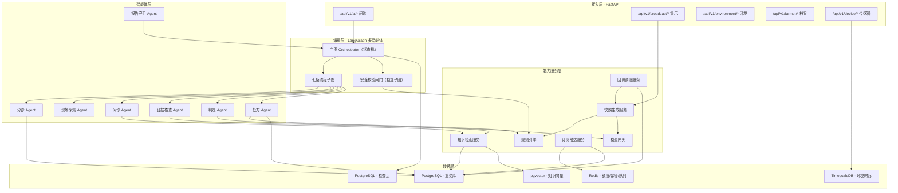
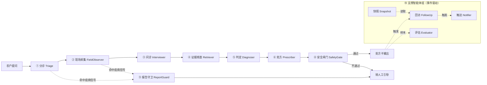

# 话农点金 · 多智能体协同技术实现方案

> 面向《话农点金_产品说明书_v2.0》的技术实现落地文档
>
> 文档版本：v1.0
> 编制日期：2026-09-23
> 技术方向：多智能体协同（Multi-Agent Collaboration）
> 后端主语言：Python 3.11+
> 上游依据：《话农点金_产品说明书_v2.0》（以下简称"产品说明书"）、《话农点金项目详细分析报告》

---

## 目录

- 一、文档说明
- 二、现状基线与改造范围
- 三、总体技术架构
- 四、技术选型总表
- 五、智能体职责与契约
- 六、协同机制设计
- 七、LangGraph 编排实现
- 八、安全校验闸门
- 九、流程配置与知识库
- 十、模型接入网关
- 十一、提示快照与主动触达
- 十二、数据模型设计方案
- 十三、接口设计
- 十四、质量评估与可观测性
- 十五、部署与工程规范
- 十六、实施路线图
- 十七、风险与对策
- 附录 A：核心 Schema 定义
- 附录 B：流程配置样例
- 附录 C：术语对照

---

# 一、文档说明

## 1.1 文档定位

本文档回答一个问题：**产品说明书要求的"六步问诊、七条流程、手速手动快照、安全红线不可协商"，用多智能体协同的方式在 Python 后端怎么落地。**

它不是概念综述，而是可直接进入开发的实现级方案，包含：智能体清单与边界、智能体之间的契约、编排图结构、安全闸门的规则实现、数据模型、接口清单、评测方案与实施顺序。

## 1.2 与产品说明书的对应关系

| 产品说明书要求 | 本文档对应章节 |
| --- | --- |
| 4.2 六步问诊状态机 | 六、七章（编排与协同） |
| 4.1.2 七条流程、受理即分流 | 七章 7.6、九章（配置化） |
| 4.2.3 功能点 5 处方卡 + 安全红线 | 八章（安全校验闸门） |
| 4.2.3 功能点 7 回访与效果确认 | 六章 6.5（事件驱动） |
| 4.3 首页提示快照与手动更新 | 十一章 |
| 4.6 一次性订阅消息与推送额度 | 十一章 11.4 |
| 4.4 传感器最简接入 | 十二章（数据模型）、十三章（接口） |
| 6.2 三层评估体系 | 十四章 |
| 9.1 分层与依赖约束 | 三章、十五章 |
| 9.2 十四条验收项 | 二章 2.3、十六章 |
| 9.4 数据模型调整 | 十二章 |

## 1.3 术语约定

| 术语 | 含义 |
| --- | --- |
| 智能体（Agent） | 一个有明确职责、明确输入输出契约、明确权限边界的执行单元 |
| 编排器（Orchestrator） | 决定"下一步谁执行"的控制权威，本方案中为 LangGraph 状态机 |
| 确定性节点 | 不调用大模型、由代码/规则完成的节点（路由、校验、落库） |
| 自治节点 | 调用大模型、在受限空间内做判断的节点（问诊、判定、改写） |
| 契约（Contract） | 智能体之间传递的结构化数据结构，由 Pydantic 模型强约束 |
| provenance（溯源） | 每条事实/数字的来源标识，用于审计与拦截 |
| fail-closed | 校验不通过时默认拒绝输出，而非默认放行 |
| 流程红线 | 每条流程专属的禁用输出清单，缺失即该流程不可用 |

## 1.4 设计三原则

**原则一：编排确定性优先于智能涌现。** 本产品的核心风险不是"回答得不够聪明"，而是"给出了一次越界的用药建议"。因此路由权、安全否决权、流程推进权全部交给确定性代码，大模型只在被划定的空间内自治。

**原则二：智能体之间传结构，不传自然语言。** 自然语言只出现在最终面向农户的展示层。链路内部一律使用 Pydantic 模型约束的结构化数据，避免"下游误解上游"这类不可测试的失效。

**原则三：红线与生成物理隔离。** 安全校验闸门不与被校验的生成节点共享会话上下文，不共享提示词，只读取生成结果与事实源做规则比对。让生成者自己校验自己，等于没有校验。

---

# 二、现状基线与改造范围

## 2.1 现有技术栈盘点

| 层 | 现状 | 评价 |
| --- | --- | --- |
| Web 框架 | FastAPI + Uvicorn | 保持 |
| ORM / 迁移 | SQLAlchemy 2.0 + Alembic | 保持，迁移链路需重建 |
| 数据库 | MySQL（主库）+ SQLite（LangGraph 检查点） | SQLite 检查点需替换 |
| 缓存 | Redis（可选，当前未强依赖） | 提升为核心依赖（额度、幂等、任务队列） |
| 编排 | LangGraph `>=0.2.0`，6 节点线性图 | 骨架保留，结构重排 |
| 检查点 | `AsyncSqliteSaver`，单连接、绑定事件循环 | 不满足多进程并发，必须替换 |
| 模型接入 | `ai_router` 下按作物三个类（水稻/烟草/通用），httpx 直连 | 需改为网关 + 七条流程配置 |
| 工具层 | MCP（`mcp`、`langchain-mcp-adapters`），`tools/knowledge.py` 为硬编码兜底 | 接口保留，实现替换为真实检索 |
| 播报 | `broadcast/` 规则引擎 + 农事历 + `BroadcastSkill` 兜底 | 收敛为"提示快照"生成器 |
| 小程序 | 原生小程序 + TypeScript，7 页面 | 保持结构，样式层收敛 |

## 2.2 现有 AI 链路的四个结构性缺口

对照产品说明书第九章，现有实现与目标态之间存在四个必须在架构层解决的缺口。它们不是"补几个函数"能消除的，而是编排骨架的问题。

**缺口一：路由时机错误。** 现有 `graph.py` 的节点序列是 `intake → collect_symptoms → collect_management → fetch_environment → diagnose → prescribe`，模型路由发生在 `diagnose` 节点内部（`resolve(crop_tag)`）。这意味着所有流程共用同一套追问脚本，只是最后换一张知识表。产品说明书 4.2.2 明确要求"**受理后第一件事是判流程，不是问问题**"，即路由必须前移到 `intake` 之后、第一次追问之前。

**缺口二：没有安全闸门。** `prescribe` 节点直接输出 `reply` 文本，用药内容由大模型自由生成，链路中不存在任何独立于生成的校验环节。产品说明书 6.2 要求"安全校验环节必须独立于生成环节实现，不能依赖大模型自我约束"，6.4 要求药剂名称/配比/用量必须来自已核准知识库。当前实现缺失这一整层。

**缺口三：没有流程配置层。** `ai_router` 用 Python 类承载作物差异（`rice.py`、`tobacco.py`、`general.py`），流程差异被写成代码分支。产品说明书 9.1 要求"**流程配置必须是数据而非代码分支**"，新增流程不应改动编排逻辑。当前结构下新增一条流程需新增一个类并修改 `registry.py`。

**缺口四：预报与问诊两套逻辑无交集。** `broadcast/generator.py` 独立于 `agent/` 运行，两者不共享事实快照，也不共享术语。产品说明书 5.9 要求首页提示文案从当前流程配置读取术语表与输出模板，保证同一件事在两处说法一致。当前实现做不到，且存在依赖未赋值字段的死规则（如大风、降雨规则）。

## 2.3 改造范围界定

**本次范围（做）**：

1. 编排骨架重排：新增 `triage` 前置于问诊，七条流程子图，条件边与受限回环。
2. 新增安全校验闸门：独立规则引擎，接入生成之后、返回之前。
3. 新增流程配置层：七条流程的六字段配置进库、版本化、可热加载。
4. 新增知识库检索层：分层知识库 + 混合检索 + 元数据强过滤。
5. 检查点替换：SQLite → PostgreSQL，支持多实例。
6. 提示快照服务：三类输入、幂等、去重、条数控制、执行回执。
7. 回访调度服务：按流程取值生成回访任务，接入首页提示与订阅消息。
8. 订阅与触达：授权额度模型、一次性订阅消息发送、送达结果记录。
9. 环境时序：设备配置、字段映射、时序读数三表 + 接入三步流程。
10. 模型网关：多供应商路由、超时降级、token 计量、调用审计。

**本次不做（明确排除）**：

1. 不做 Modbus 协议栈、不做现场配网、不做设备反向控制（产品说明书 7.1）。
2. 不实现"多智能体自由协商"式的自治群聊编排（原因见 3.3）。
3. 不做小程序现场扬声器播报（产品说明书 4.6.2 功能点 4）。
4. 不实现后台定时自动刷新首页提示（产品说明书 9.3）。
5. 不做模型微调与训练，模型能力全部通过 API 或预置模型权重获得。

---

# 三、总体技术架构

## 3.1 分层架构

分层职责与依赖约束，直接沿用产品说明书 9.1：

| 层 | 职责 | 硬约束 |
| --- | --- | --- |
| 接入层 | 路由、参数校验、身份校验 | 不写业务逻辑；所有数据访问强制带归属条件 |
| 编排层 | 状态推进、条件路由、回环控制、中断恢复 | 路由决策不含大模型调用 |
| 智能体层 | 单职责的受限自治执行 | 每个智能体必须有明确契约与失败行为 |
| 能力服务层 | 检索、规则、快照、调度、触达、模型 | 全部可替换、可 Mock |
| 数据层 | 事实存储与状态持久化 | 真实迁移链路，禁止启动时自动建表 |

## 3.2 智能体拓扑

十个智能体按三类划分。**分类的依据是"错误的后果由谁承担"**：

- **主链路智能体**：错误的后果是"答得不够好"，可容忍、可迭代。
- **守卫智能体**：错误的后果是"农户受害"，零容忍，因此拥有否决权。
- **支撑智能体**：不参与对话链路，错误后果是"提示不够准"，可降级、可重算。

## 3.3 为什么是"确定性编排 + 有限自治"

这是本方案最重要的架构决策，需要说明取舍过程。

**被否决的方案：自治式多智能体协商（自由群聊 / 角色辩论 / 动态委派）。**

否决理由有三条，且都与本产品的具体约束直接相关：

第一，**红线不可协商**。安全否决权如果来自某个大模型智能体的判断，它就变成了"可被说服的意见"而不是"不可绕过的闸门"。产品说明书 6.4 的四条红线是"任何迭代不得突破"，这在架构上只能由确定性规则实现。

第二，**流程必须可追溯可复现**。农户问"为什么给我这个建议"，产品需要能回答"因为你的档案是水稻、破口前 4 天、植保库条目 K-1023"。自由协商的编排下，路径不可复现，审计无从做起。产品说明书 6.2 第三层要求按流程分别统计指标，前提就是路径可控。

第三，**成本与延迟**。本产品按轮次收敛（目标 ≤ 4 轮），每次问诊都要在农户等待中完成。角色化协同框架的开销在社区实测中约占总 token 成本的 30%，且多轮自我协调会显著拉长首字延迟 [$TRAE_REF](https://00011000.com/articles/2026-ai-agent-framework-review)。在面向 62 岁农户的对话场景里，延迟直接等于流失。

**采用的方案：确定性编排为骨，有限自治为肉。**

LangGraph 的定位是"基于有向图的精细控制流"，其核心优势被明确归纳为完整的状态管理、跨多轮交互的持久内存、以及擅长处理复杂的条件流程 [$TRAE_REF](https://cloud.tencent.com/developer/article/2649756)。它提供的持久执行与人工介入能力（可从上次中断处自动恢复、在任意时点检查和修改智能体状态）正好对应本产品两个硬需求：**多轮问诊的断点续问**与**安全拦截后的转人工** [$TRAE_REF](https://langgraph.com.cn/index.html)。这些能力自研实现成本高且容易出错，因此保留 LangGraph 作为骨架是理性的。

**我们保留"多智能体"的实质**：职责隔离、契约通信、独立校验、受限并行。放弃的是"编排权交给模型"这一点。多智能体的价值在本产品中体现为**可测试的职责边界**与**可独立的否决权**，而不是"看起来像一群专家在讨论"。

---
<!-- CHUNK2 -->
