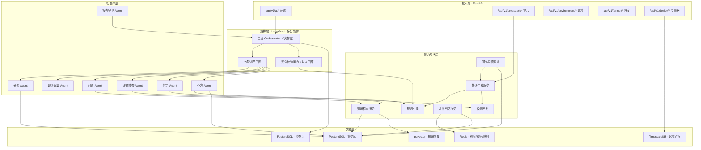
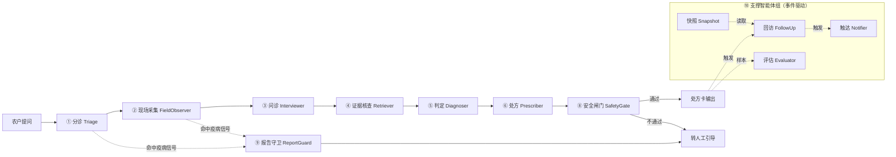
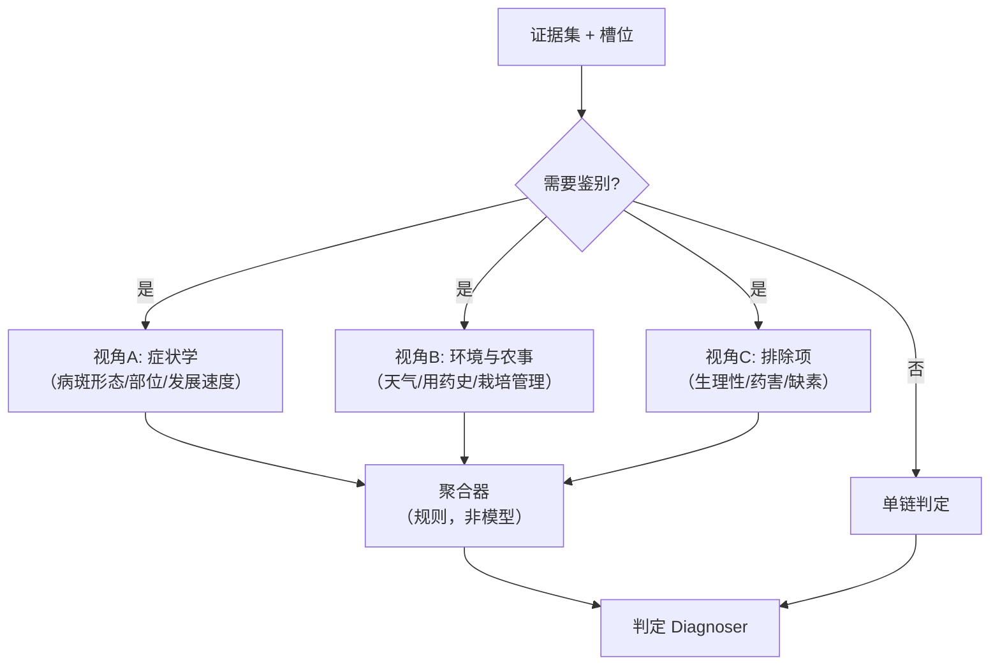
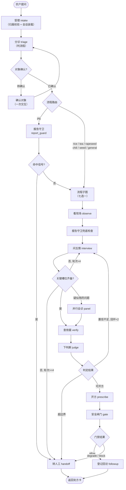
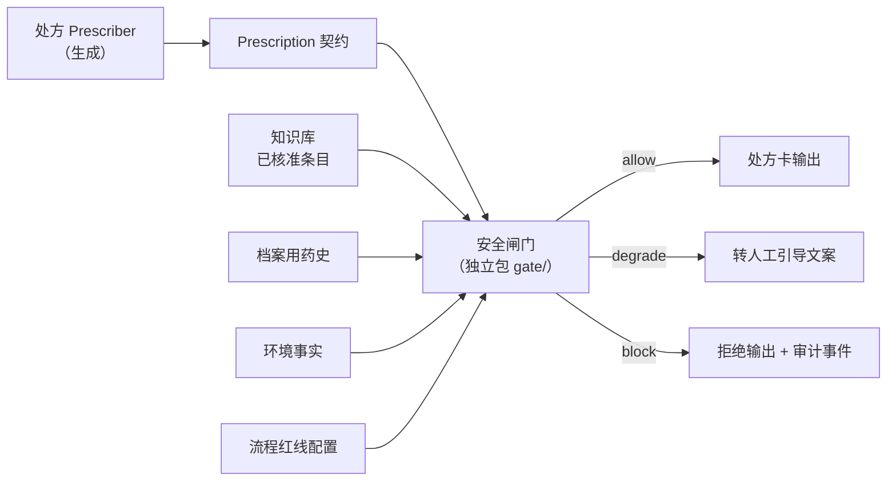
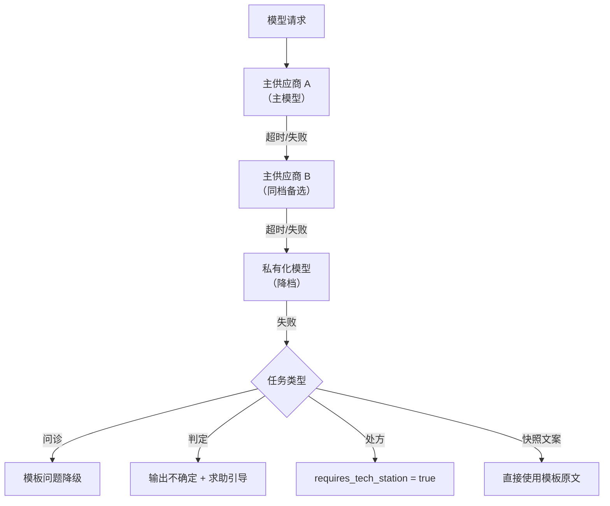
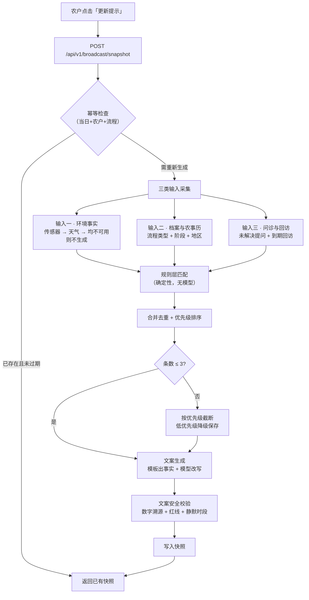
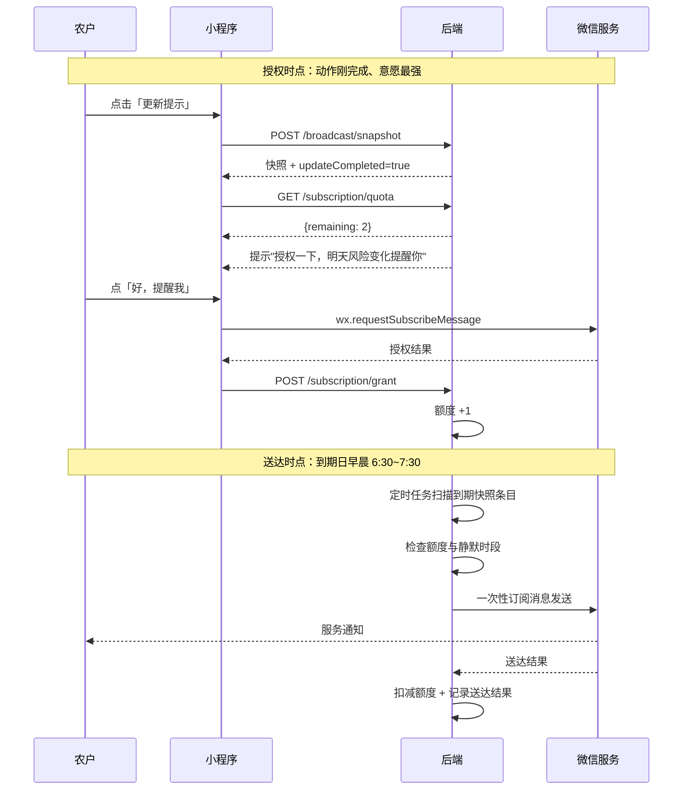
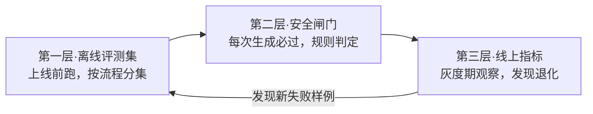

# 话农点金 · 多智能体协同技术实现方案

> 面向《话农点金_产品说明书_v2.0》的技术实现落地文档
>
> 文档版本：v1.0
> 编制日期：2026-09-23
> 技术方向：多智能体协同（Multi-Agent Collaboration）
> 后端主语言：Python 3.11+
> 上游依据：《话农点金_产品说明书_v2.0》（以下简称"产品说明书"）、《话农点金项目详细分析报告》

---

## 目录

- 一、文档说明
- 二、现状基线与改造范围
- 三、总体技术架构
- 四、技术选型总表
- 五、智能体职责与契约
- 六、协同机制设计
- 七、LangGraph 编排实现
- 八、安全校验闸门
- 九、流程配置与知识库
- 十、模型接入网关
- 十一、提示快照与主动触达
- 十二、数据模型设计方案
- 十三、接口设计
- 十四、质量评估与可观测性
- 十五、部署与工程规范
- 十六、实施路线图
- 十七、风险与对策
- 附录 A：核心 Schema 定义
- 附录 B：流程配置样例
- 附录 C：术语对照

---

# 一、文档说明

## 1.1 文档定位

本文档回答一个问题：**产品说明书要求的"六步问诊、七条流程、手速手动快照、安全红线不可协商"，用多智能体协同的方式在 Python 后端怎么落地。**

它不是概念综述，而是可直接进入开发的实现级方案，包含：智能体清单与边界、智能体之间的契约、编排图结构、安全闸门的规则实现、数据模型、接口清单、评测方案与实施顺序。

## 1.2 与产品说明书的对应关系

| 产品说明书要求 | 本文档对应章节 |
| --- | --- |
| 4.2 六步问诊状态机 | 六、七章（编排与协同） |
| 4.1.2 七条流程、受理即分流 | 七章 7.6、九章（配置化） |
| 4.2.3 功能点 5 处方卡 + 安全红线 | 八章（安全校验闸门） |
| 4.2.3 功能点 7 回访与效果确认 | 六章 6.5（事件驱动） |
| 4.3 首页提示快照与手动更新 | 十一章 |
| 4.6 一次性订阅消息与推送额度 | 十一章 11.4 |
| 4.4 传感器最简接入 | 十二章（数据模型）、十三章（接口） |
| 6.2 三层评估体系 | 十四章 |
| 9.1 分层与依赖约束 | 三章、十五章 |
| 9.2 十四条验收项 | 二章 2.3、十六章 |
| 9.4 数据模型调整 | 十二章 |

## 1.3 术语约定

| 术语 | 含义 |
| --- | --- |
| 智能体（Agent） | 一个有明确职责、明确输入输出契约、明确权限边界的执行单元 |
| 编排器（Orchestrator） | 决定"下一步谁执行"的控制权威，本方案中为 LangGraph 状态机 |
| 确定性节点 | 不调用大模型、由代码/规则完成的节点（路由、校验、落库） |
| 自治节点 | 调用大模型、在受限空间内做判断的节点（问诊、判定、改写） |
| 契约（Contract） | 智能体之间传递的结构化数据结构，由 Pydantic 模型强约束 |
| provenance（溯源） | 每条事实/数字的来源标识，用于审计与拦截 |
| fail-closed | 校验不通过时默认拒绝输出，而非默认放行 |
| 流程红线 | 每条流程专属的禁用输出清单，缺失即该流程不可用 |

## 1.4 设计三原则

**原则一：编排确定性优先于智能涌现。** 本产品的核心风险不是"回答得不够聪明"，而是"给出了一次越界的用药建议"。因此路由权、安全否决权、流程推进权全部交给确定性代码，大模型只在被划定的空间内自治。

**原则二：智能体之间传结构，不传自然语言。** 自然语言只出现在最终面向农户的展示层。链路内部一律使用 Pydantic 模型约束的结构化数据，避免"下游误解上游"这类不可测试的失效。

**原则三：红线与生成物理隔离。** 安全校验闸门不与被校验的生成节点共享会话上下文，不共享提示词，只读取生成结果与事实源做规则比对。让生成者自己校验自己，等于没有校验。

---

# 二、现状基线与改造范围

## 2.1 现有技术栈盘点

| 层 | 现状 | 评价 |
| --- | --- | --- |
| Web 框架 | FastAPI + Uvicorn | 保持 |
| ORM / 迁移 | SQLAlchemy 2.0 + Alembic | 保持，迁移链路需重建 |
| 数据库 | MySQL（主库）+ SQLite（LangGraph 检查点） | SQLite 检查点需替换 |
| 缓存 | Redis（可选，当前未强依赖） | 提升为核心依赖（额度、幂等、任务队列） |
| 编排 | LangGraph `>=0.2.0`，6 节点线性图 | 骨架保留，结构重排 |
| 检查点 | `AsyncSqliteSaver`，单连接、绑定事件循环 | 不满足多进程并发，必须替换 |
| 模型接入 | `ai_router` 下按作物三个类（水稻/烟草/通用），httpx 直连 | 需改为网关 + 七条流程配置 |
| 工具层 | MCP（`mcp`、`langchain-mcp-adapters`），`tools/knowledge.py` 为硬编码兜底 | 接口保留，实现替换为真实检索 |
| 播报 | `broadcast/` 规则引擎 + 农事历 + `BroadcastSkill` 兜底 | 收敛为"提示快照"生成器 |
| 小程序 | 原生小程序 + TypeScript，7 页面 | 保持结构，样式层收敛 |

## 2.2 现有 AI 链路的四个结构性缺口

对照产品说明书第九章，现有实现与目标态之间存在四个必须在架构层解决的缺口。它们不是"补几个函数"能消除的，而是编排骨架的问题。

**缺口一：路由时机错误。** 现有 `graph.py` 的节点序列是 `intake → collect_symptoms → collect_management → fetch_environment → diagnose → prescribe`，模型路由发生在 `diagnose` 节点内部（`resolve(crop_tag)`）。这意味着所有流程共用同一套追问脚本，只是最后换一张知识表。产品说明书 4.2.2 明确要求"**受理后第一件事是判流程，不是问问题**"，即路由必须前移到 `intake` 之后、第一次追问之前。

**缺口二：没有安全闸门。** `prescribe` 节点直接输出 `reply` 文本，用药内容由大模型自由生成，链路中不存在任何独立于生成的校验环节。产品说明书 6.2 要求"安全校验环节必须独立于生成环节实现，不能依赖大模型自我约束"，6.4 要求药剂名称/配比/用量必须来自已核准知识库。当前实现缺失这一整层。

**缺口三：没有流程配置层。** `ai_router` 用 Python 类承载作物差异（`rice.py`、`tobacco.py`、`general.py`），流程差异被写成代码分支。产品说明书 9.1 要求"**流程配置必须是数据而非代码分支**"，新增流程不应改动编排逻辑。当前结构下新增一条流程需新增一个类并修改 `registry.py`。

**缺口四：预报与问诊两套逻辑无交集。** `broadcast/generator.py` 独立于 `agent/` 运行，两者不共享事实快照，也不共享术语。产品说明书 5.9 要求首页提示文案从当前流程配置读取术语表与输出模板，保证同一件事在两处说法一致。当前实现做不到，且存在依赖未赋值字段的死规则（如大风、降雨规则）。

## 2.3 改造范围界定

**本次范围（做）**：

1. 编排骨架重排：新增 `triage` 前置于问诊，七条流程子图，条件边与受限回环。
2. 新增安全校验闸门：独立规则引擎，接入生成之后、返回之前。
3. 新增流程配置层：七条流程的六字段配置进库、版本化、可热加载。
4. 新增知识库检索层：分层知识库 + 混合检索 + 元数据强过滤。
5. 检查点替换：SQLite → PostgreSQL，支持多实例。
6. 提示快照服务：三类输入、幂等、去重、条数控制、执行回执。
7. 回访调度服务：按流程取值生成回访任务，接入首页提示与订阅消息。
8. 订阅与触达：授权额度模型、一次性订阅消息发送、送达结果记录。
9. 环境时序：设备配置、字段映射、时序读数三表 + 接入三步流程。
10. 模型网关：多供应商路由、超时降级、token 计量、调用审计。

**本次不做（明确排除）**：

1. 不做 Modbus 协议栈、不做现场配网、不做设备反向控制（产品说明书 7.1）。
2. 不实现"多智能体自由协商"式的自治群聊编排（原因见 3.3）。
3. 不做小程序现场扬声器播报（产品说明书 4.6.2 功能点 4）。
4. 不实现后台定时自动刷新首页提示（产品说明书 9.3）。
5. 不做模型微调与训练，模型能力全部通过 API 或预置模型权重获得。

---

# 三、总体技术架构

## 3.1 分层架构



分层职责与依赖约束，直接沿用产品说明书 9.1：

| 层 | 职责 | 硬约束 |
| --- | --- | --- |
| 接入层 | 路由、参数校验、身份校验 | 不写业务逻辑；所有数据访问强制带归属条件 |
| 编排层 | 状态推进、条件路由、回环控制、中断恢复 | 路由决策不含大模型调用 |
| 智能体层 | 单职责的受限自治执行 | 每个智能体必须有明确契约与失败行为 |
| 能力服务层 | 检索、规则、快照、调度、触达、模型 | 全部可替换、可 Mock |
| 数据层 | 事实存储与状态持久化 | 真实迁移链路，禁止启动时自动建表 |

## 3.2 智能体拓扑

十个智能体按三类划分。**分类的依据是"错误的后果由谁承担"**：

- **主链路智能体**：错误的后果是"答得不够好"，可容忍、可迭代。
- **守卫智能体**：错误的后果是"农户受害"，零容忍，因此拥有否决权。
- **支撑智能体**：不参与对话链路，错误后果是"提示不够准"，可降级、可重算。



## 3.3 为什么是"确定性编排 + 有限自治"

这是本方案最重要的架构决策，需要说明取舍过程。

**被否决的方案：自治式多智能体协商（自由群聊 / 角色辩论 / 动态委派）。**

否决理由有三条，且都与本产品的具体约束直接相关：

第一，**红线不可协商**。安全否决权如果来自某个大模型智能体的判断，它就变成了"可被说服的意见"而不是"不可绕过的闸门"。产品说明书 6.4 的四条红线是"任何迭代不得突破"，这在架构上只能由确定性规则实现。

第二，**流程必须可追溯可复现**。农户问"为什么给我这个建议"，产品需要能回答"因为你的档案是水稻、破口前 4 天、植保库条目 K-1023"。自由协商的编排下，路径不可复现，审计无从做起。产品说明书 6.2 第三层要求按流程分别统计指标，前提就是路径可控。

第三，**成本与延迟**。本产品按轮次收敛（目标 ≤ 4 轮），每次问诊都要在农户等待中完成。角色化协同框架的开销在社区实测中约占总 token 成本的 30%，且多轮自我协调会显著拉长首字延迟 [$TRAE_REF](https://00011000.com/articles/2026-ai-agent-framework-review)。在面向 62 岁农户的对话场景里，延迟直接等于流失。

**采用的方案：确定性编排为骨，有限自治为肉。**

LangGraph 的定位是"基于有向图的精细控制流"，其核心优势被明确归纳为完整的状态管理、跨多轮交互的持久内存、以及擅长处理复杂的条件流程 [$TRAE_REF](https://cloud.tencent.com/developer/article/2649756)。它提供的持久执行与人工介入能力（可从上次中断处自动恢复、在任意时点检查和修改智能体状态）正好对应本产品两个硬需求：**多轮问诊的断点续问**与**安全拦截后的转人工** [$TRAE_REF](https://langgraph.com.cn/index.html)。这些能力自研实现成本高且容易出错，因此保留 LangGraph 作为骨架是理性的。

**我们保留"多智能体"的实质**：职责隔离、契约通信、独立校验、受限并行。放弃的是"编排权交给模型"这一点。多智能体的价值在本产品中体现为**可测试的职责边界**与**可独立的否决权**，而不是"看起来像一群专家在讨论"。

---
# 四、技术选型总表

四项关键选型已确认，本章给出完整清单与理由。**"保持"项不是保守，而是把改造成本集中到真正需要动的地方。**

## 4.1 关键选型决策

| 决策项 | 选定方案 | 备选 | 决策理由 |
| --- | --- | --- | --- |
| 编排骨架 | LangGraph StateGraph + 子图 + checkpointer + interrupt | 纯自研状态机 / CrewAI / AutoGen | 现有代码已用 LangGraph，需保留检查点续问与人工介入能力；此类严格流程控制场景正是其定位 |
| 数据与检索存储 | PostgreSQL 统一栈（业务库 + 检查点 + pgvector + TimescaleDB） | MySQL + 独立 PG / MySQL + Milvus | 运维组件最少；checkpointer 官方支持；农业知识需元数据强过滤，同库过滤代价最低 |
| 模型策略 | 境内云 API 为主 + 私有化兜底 | 农业垂类私有化为主 / 多云混合路由 | 冷启动快、成本可控；网关抽象保证可替换；农业垂类作为可选增强 |
| 并行会诊 | 仅易混淆流程启用（茶、辣椒、杂草） | 全流程启用 / 完全不启用 | 覆盖青枯 vs 枯萎、侵染性 vs 生理性等高频误判，同时控制延迟与成本 |

## 4.2 完整技术栈

| 层 | 组件 | 版本/形态 | 说明 |
| --- | --- | --- | --- |
| 语言 | Python | 3.11+ | 保持；3.11 起 asyncio 与异常组能力成熟 |
| Web | FastAPI | ≥0.110 | 保持 |
| ASGI | Uvicorn | ≥0.27 | 保持，生产配 Gunicorn 多 worker |
| 校验 | Pydantic v2 | ≥2.6 | 保持；**新增用途：智能体契约与 JSON Schema 强制** |
| ORM | SQLAlchemy | 2.0 | 保持，改为 async 引擎 |
| 迁移 | Alembic | ≥1.13 | 保持，重建真实迁移链路 |
| 编排 | LangGraph | 锁定可用版本 | 升级并启用子图、interrupt、Postgres checkpointer |
| 检查点 | langgraph-checkpoint-postgres | 新增 | 替换 AsyncSqliteSaver |
| 主库 | PostgreSQL | 16+ | 替换 MySQL |
| 向量 | pgvector | 0.7+ | 新增，知识检索 |
| 时序 | TimescaleDB | PG 扩展 | 新增，环境读数 |
| 缓存 | Redis | 7+ | 升级为核心依赖 |
| 任务队列 | ARQ | 新增 | 与 async 栈一致，替代 Celery |
| HTTP 客户端 | httpx | ≥0.27,<0.28 | 保持（与 TestClient 兼容性约束） |
| 重试/熔断 | tenacity + 自研熔断器 | 新增 | 模型调用与外呼集成 |
| 可观测 | OpenTelemetry + Langfuse（私有部署） | 新增 | 链路追踪与提示词版本对比 |
| 日志 | structlog | 新增 | 结构化日志，便于审计检索 |
| 测试 | pytest + pytest-asyncio + respx | 保持并扩展 | 新增：评测集回归、红线用例 |
| 容器 | Docker + Docker Compose | 新增 | 开发与预发一致 |
| 反向代理 | Nginx | 新增 | TLS、域名策略、静态资源 |
| 小程序端 | 原生小程序 + TypeScript | 保持 | 不引入需高版本基础库的框架 |

## 4.3 为什么是 PostgreSQL 统一栈

三个具体理由，都指向同一个问题：**本产品的查询模式要求"向量相似度 + 强元数据过滤"同时生效。**

第一条，知识检索的过滤条件是刚需。茶树流程只能检索茶树上已登记的药剂，辣椒流程只能检索辣椒登记标签范围，水稻流程要排除抗药性暂停用药名单。如果向量库与业务库分离，过滤需要通过 ID 在两个系统间做二次筛选，要么先取大量向量候选再回业务库过滤（浪费召回预算），要么把过滤条件冗余进向量库（一致性风险）。pgvector 与业务表同库，可以用 SQL 的 `WHERE process_id = 'tea' AND region_code LIKE '42%' AND status = 'approved'` 与向量排序在一条语句内完成。

第二条，检查点与业务状态需要事务一致性。问诊过程同时写检查点（LangGraph 状态）与业务表（消息、处方卡、回访任务）。若两者在不同系统，中断恢复时会出现"检查点说已开方，业务表没有处方卡"这类不一致。同库同事务可以消除。

第三条，时序数据量在本产品规模下不需要专用 TSDB。按 100 万农户、每户 1 台设备、10 分钟一次上报估算，日增约 1.44 亿点位。这个量级用 TimescaleDB 的自动分区与压缩已经足够，且它本身就是 PG 扩展，无额外运维组件。产品说明书 4.4 明确 P0 传感器只覆盖 5 个指标，不存在高基数爆炸风险。

**需要注意的代价**：PostgreSQL 替换 MySQL 涉及全部模型与迁移重写，这是本次改造中工程量较大且不可回避的一项。但产品说明书 9.4 已列出"迁移改用真实迁移链路，现状首次迁移实际依赖启动建表，需重建"，迁移链路本来就要重做，因此合并进行不构成额外浪费。

## 4.4 模型分层策略

模型选择的核心判断是：**不同环节对能力的要求差三个数量级，用同一个模型是浪费。**

| 环节 | 任务特征 | 模型档位 | 选型考量 |
| --- | --- | --- | --- |
| 分诊 Triage | 分类 + 槽位抽取，输出枚举 | 小模型（7B 级或轻量 API） | 结果可被规则校验，不需要强推理 |
| 现场采集 | 图像候选 + 事实归纳 | 垂类图像模型 + 多模态 | 候选域按流程限定，需可控 |
| 问诊 Interviewer | 生成追问、解释为什么问、判断信息充分性 | 主模型（能力最强） | 直接影响体验与信息补全率 |
| 证据核查 | 检索改写 + 相关性判定 | 中等模型 + 重排序模型 | 重排序质量决定证据质量 |
| 判定 Diagnoser | 鉴别推理、易混淆项排除 | 主模型 | 准确性的核心环节 |
| 处方 Prescriber | 话术改写（不得新增事实） | 小模型 | 任务本质是改写，能力需求低 |
| 安全闸门 | 规则匹配 | **不使用大模型** | 确定性实现 |
| 快照文案 | 模板转述 | 小模型 | 同处方，改写任务 |

**私有化兜底的定位**：产品说明书 6.4 红线要求药剂信息来自已核准知识库，大模型只做改写。这意味着即使主模型不可用，规则层能力（阈值提示、农事历提示）也必须继续工作——产品说明书 6.3 兜底三明确要求"不允许整体页面不可用，因为提示能力本身不依赖大模型"。因此私有化模型不是"主力备份"，而是**确保红线链路在外部服务中断时仍可用**的保障。

农业垂类模型可作为可选增强：中国农业大学发布的神农大模型 3.0 以"轻量化 + 多智能体"架构推出 32B、7B、1B 三个版本，聚焦 36 个农业智能体，通过动态稀疏与增量压缩把算力需求缩小 50% [$TRAE_REF](http://www.stdaily.com/web/gdxw/2025-10/14/content_414779.html)。这类模型的价值在于农业语料的适配度与私有化部署的合规性，建议作为**第二阶段评估项**而非一期强依赖——一期应先把手 Qwen/DeepSeek 级通用模型 + 强知识库 + 强规则闸门的链路跑通并验证安全，再考虑是否用垂类模型替换主模型。

## 4.5 明确不引入的技术

| 不引入 | 原因 |
| --- | --- |
| CrewAI / AutoGen / MetaGPT | 定位为角色协同与快速原型，流程确定性与红线控制不满足本产品要求 |
| 图数据库（Neo4j 等） | 本产品知识关系为层级+标签，SQL 足够；引入图库无明确收益 |
| Elasticsearch | PG 全文检索（tsvector/zhparser）可满足当前规模；jieba + pg_bigm 亦可兜底 |
| Celery | ARQ 与 async 栈一致，避免同步 worker 与 async 应用的桥接复杂度 |
| 服务网格（Istio 等） | 当前服务数少，Nginx + 应用层策略足够 |
| 自研向量索引 | pgvector HNSW 已满足；自研维护成本高且无差异化收益 |
| 大模型微调（一期） | 红线要求事实来自知识库而非模型权重，微调反而增加不可控性；先积累评测集 |

---

# 五、智能体职责与契约

## 5.1 智能体总表

| 编号 | 智能体 | 类型 | 自治程度 | 输入 | 输出 | 失败行为 |
| --- | --- | --- | --- | --- | --- | --- |
| ① | 分诊 Triage | 主链路 | 低（分类） | 用户输入 + 档案 | `TriageResult` | 回退通用流程 |
| ② | 现场采集 FieldObserver | 主链路 | 低（归纳） | 环境读数 + 图片 | `ObservationResult` | 标记数据不可用 |
| ③ | 问诊 Interviewer | 主链路 | 中（生成问题） | 流程配置 + 已确认槽位 | `InterviewBatch` | 降级为模板问题 |
| ④ | 证据核查 Retriever | 主链路 | 中（检索改写） | 槽位 + 流程 + 地区 | `EvidenceSet` | 返回空集并标注未命中 |
| ⑤ | 判定 Diagnoser | 主链路 | 高（推理） | 证据集 + 槽位 | `DiagnosisResult` | 输出不确定 + 求助引导 |
| ⑥ | 处方 Prescriber | 主链路 | 低（组装+改写） | 已核准条目 + 判定 | `Prescription` | 转为求助引导 |
| ⑦ | 报告守卫 ReportGuard | 守卫 | 极低（规则优先） | 全量槽位 | `ReportDecision` | fail-closed（有疑即报） |
| ⑧ | 安全闸门 SafetyGate | 守卫 | 无（规则） | 处方 + 事实源 | `GateResult` | fail-closed（拒绝放行） |
| ⑨ | 并行会诊 Panel（可选） | 主链路 | 中 | 易混淆证据 | `PanelOpinion[]` | 转单链判定 |
| ⑩ | 支撑智能体组 | 支撑 | 低 | 事件 + 事实 | 快照/任务/消息/指标 | 静默降级，记录失败 |

**关键区分**：⑦⑧ 两个守卫智能体的失败行为是 fail-closed，即"不确定时选择更保守的一方"。其他智能体的失败行为是降级但仍然服务。这个区别体现了产品说明书 6.1 的定义——安全性优先级最高，且不接受用准确率来换。

## 5.2 契约设计总原则

所有契约用 Pydantic v2 定义，强制三项约束：

1. **枚举封闭**：`process_id`、`confidence_level`、`severity` 等必须是枚举，不接受自由字符串。大模型输出的任何自由文本必须经过解析落到枚举上，解析失败即视为契约违约。
2. **事实必带溯源**：任何数值型字段必须配套 provenance 字段。没有 provenance 的数字不允许进入处方与提示。
3. **区分"未知"与"缺失"**：`unknown`（用户明确答不出）与 `missing`（尚未询问）是两个不同状态。产品说明书 4.2.3 明确"未知是合法答案"，系统据此降低确定性表述，而不是反复逼问。

## 5.3 核心契约定义

### 5.3.1 共享状态 ConsultationState

这是黑板式共享状态的载体，也是 LangGraph 的 State 类型。

```python
class SlotValue(BaseModel):
    """单个信息槽位，带来源与状态。"""
    key: str                              # 如 "growth_stage"
    value: str | None = None
    status: Literal["filled", "unknown", "missing"] = "missing"
    source: Literal[
        "profile", "sensor", "weather", "user_answer", "image", "inferred"
    ]
    confidence: float | None = None
    asked_at_round: int | None = None


class EvidenceItem(BaseModel):
    """一条证据，必须带溯源。"""
    knowledge_id: str
    title: str
    content: str
    process_id: str
    region_scope: str | None
    effective_date: date | None
    kind: Literal["pest", "disease", "pesticide", "cultivation", "threshold"]
    score: float


class ConsultationState(TypedDict, total=False):
    # 身份与归属
    session_id: str
    user_id: str
    farm_plot_id: str | None
    # 流程
    process_id: ProcessId
    process_locked: bool
    # 进展
    stage: ConsultStage
    round: int
    slot_round: int
    # 事实
    slots: dict[str, SlotValue]
    observations: dict                  # 环境/图片归纳结果
    evidence: list[dict]                # EvidenceItem 序列化
    prescription_history: list[dict]    # 档案中的用药史
    # 产出
    diagnosis: dict | None
    prescription: dict | None
    gate_result: dict | None
    report_decision: dict | None
    # 会话
    messages: Annotated[list, add_messages]
    reply: str
    trace_id: str
```

`stage` 的取值直接对齐产品说明书 4.2.2 的六步：

```python
class ConsultStage(str, Enum):
    INTAKE = "intake"            # 受理
    TRIAGE = "triage"            # 判流程
    OBSERVE = "observe"          # 看现场
    INTERVIEW = "interview"      # 问五情
    VERIFY = "verify"            # 查依据
    JUDGE = "judge"              # 下判断
    PRESCRIBE = "prescribe"      # 开方
    GATE = "gate"                # 安全校验
    FOLLOWUP = "followup"        # 登记回访
    HANDOFF = "handoff"          # 转人工
    BLOCKED = "blocked"          # 安全拦截
```

### 5.3.2 分诊契约 TriageResult

```python
class TriageResult(BaseModel):
    process_id: ProcessId                          # rice/tea/rapeseed/chili/weed/pig/general
    object_confirmed: bool                         # 问诊对象是否已与农户确认
    object_label: str                              # 展示用：如"水稻·3亩"、"2号栏舍·120头"
    slot_gaps: list[str]                           # 进入问诊前需补齐的关键槽位
    profile_ready: bool
    fallback_reason: str | None = None             # 降级到 general 的原因
    handoff_to_report: bool = False                # 是否直接转报告守卫（养猪流程）
```

**硬约束**：本智能体**不得生成任何问题**。它的唯一产出是流程标识与缺口列表。这保证了"受理即分流"的纯粹性，也让它可被单元测试完全覆盖。

**对象确认规则**：产品说明书 4.2.2 要求"若档案为空或农户问的对象与档案不符，系统需先与农户确认对象"。判定方式为：档案流程与农户表述中的作物词做实体匹配（基于流程配置里的同义词表），不匹配时 `object_confirmed = False`，主图转入确认分支（一次确认对话），确认后更新 `process_id` 并锁定。

### 5.3.3 问诊契约 InterviewBatch

```python
class InterviewQuestion(BaseModel):
    slot_key: str
    text: str                                      # 面向农户的口语化问题
    why: str                                       # 为什么问这个（必填）
    options: list[str] | None = None               # 快捷选项
    answer_type: Literal["single", "multi", "text", "photo", "number"]


class InterviewBatch(BaseModel):
    questions: list[InterviewQuestion]             # 长度 1~2，硬校验
    stage_hint: str                                # 进度提示文案，如"正在了解情况 2/3"
    confidence_note: str | None = None             # 数据缺失时的显式标注
```

**硬约束**（对应产品说明书 4.2.2 关键设计规则）：

| 约束 | 实现方式 | 违反后果 |
| --- | --- | --- |
| 每轮 ≤ 2 问 | Pydantic `max_length=2` | 校验失败，裁剪至 2 |
| 必须解释为什么问 | `why` 必填且非空 | 校验失败，重试或降级模板 |
| 不得重复问已知项 | 生成前按 `slots` 过滤候选问题 | 过滤在生成之前，不依赖模型自律 |
| 每步要有进度提示 | `stage_hint` 必填 | 由代码按轮次计算，非模型生成 |
| "未知"合法 | options 固定包含跳过项 | 用户跳过即写 `status="unknown"` |

**追问候选池的构造**（关键实现细节）：不是把流程的全部必问清单丢给模型，而是先由代码完成三步筛选——剔除 `slots` 中已是 `filled` 的项、剔除可由档案/环境直接读取的项（如档案已有播种时间则不问）、按当前 `process_id` 加载该流程的必问清单并做关键词相关性排序，取 top-6 作为候选池交给模型生成问题文本。这样"跳过已知项"由代码保证，模型只负责把问题说得像人话。

### 5.3.4 判定契约 DiagnosisResult

```python
class DiagnosisResult(BaseModel):
    conclusion: str                                # 判断结论
    confidence_level: Literal["likely", "preliminary", "uncertain"]
    basis: list[str]                               # 判断依据，逐条
    uncertainty_source: list[str]                  # 不确定性来源
    excluded: list[str]                            # 显式排除的易混淆项
    terminology_profile: str                       # 命中的流程术语档，如 "tea"
    needs_more_info: list[str]                     # 需补的信息（触发回环）
    out_of_scope: bool                             # 是否超出能力边界
    boundary_reason: str | None = None
```

**硬约束**：

- `confidence_level` 是枚举，不是数值。产品说明书 4.2.3 功能点 4 明确"把握程度必须用农户听得懂的话表达，不能显示百分比分数"。内部可以保留置信度分数用于路由判断，但不得进入展示文案，展示层只读 `confidence_level` 的映射文案（"很可能是" / "初步判断" / "不确定"）。
- `excluded` 必填且非空（对有易混淆项的流程）。产品说明书第五章对每条流程都列出了"易混淆项（必须显式排除）"，如辣椒的青枯病 vs 枯萎病、茶的侵染性 vs 生理性。强制输出排除项，使模型必须做鉴别而不是直接匹配。
- `out_of_scope = True` 时，主图跳过处方环节直达转人工。产品说明书 4.2.2 要求"超出能力边界"时直接建议咨询农技站。

### 5.3.5 处方契约 Prescription

```python
class PrescriptionAction(BaseModel):
    order: int
    action: str                                    # 要做什么
    timing: str                                    # 什么时间做
    method: str                                    # 具体怎么做
    cautions: list[str]                            # 需要注意什么
    stop_conditions: list[str]                     # 什么情况需停止或求助


class Prescription(BaseModel):
    diagnosis_summary: str
    actions: list[PrescriptionAction]
    safety_interval_days: int | None               # 安全间隔期
    max_uses_per_season: int | None                # 每季最多使用次数
    pesticide_items: list[PesticideItem]           # 必须来自知识库
    soil_level_actions: list[str]                  # 土壤层面处置（辣椒流程必填）
    followup_plan: FollowupPlan
    facts_provenance: dict[str, str]               # 每个数字 → 来源 id
    requires_tech_station: bool                    # 是否需转农技站
    detail_terms: dict[str, str]                   # 术语 → 口语化改写对照
```

**`facts_provenance` 是本方案的核心机制之一**。字段结构为 `{"safety_interval_days": "knowledge:K-1023", "dose_per_mu": "knowledge:K-1023:field:dose"}`，每条处方中的数值都必须在此登记来源。安全闸门会做反向扫描：**处方文本中出现的任何数字，必须在 `facts_provenance` 中有对应键，否则拦截**。这把"模板出事实、模型只改写"从一句原则变成了可自动执行的检查。

**`pesticide_items` 的来源约束**：该列表只能由代码从知识库检索结果填充，模型无权写入。实现方式为：处方节点先做一次确定性检索（依据 `process_id` + 判定结论 + 地区 + 档案用药史），得到候选条目；模型只能对候选条目做"选择 + 排序 + 话术改写"，不能新增条目。若候选为空，`pesticide_items = []` 且 `requires_tech_station = True`。

### 5.3.6 门禁契约 GateResult

```python
class GateViolation(BaseModel):
    rule_id: str
    severity: Literal["block", "warn"]
    message: str
    field: str


class GateResult(BaseModel):
    passed: bool
    violations: list[GateViolation]
    checked_rules: list[str]                       # 实际执行的规则 id，供审计
    process_redlines_loaded: bool                  # 流程红线是否成功加载
    decision: Literal["allow", "degrade", "block"]
    degrade_output: str | None = None              # 降级文案（转农技站引导）
```

**三个 decision 语义**：

- `allow`：放行，处方卡正常返回。
- `degrade`：不通过但不属严重违规，输出替换为 `degrade_output`（标准转人工引导文案）。产品说明书 6.2 明确"校验不通过时，输出降级为建议联系当地农技站，而不是修改后输出"。
- `block`：命中硬红线（如推荐了禁限用药剂），拒绝输出并记录审计事件，同时触发知识条目复核工单。

**`process_redlines_loaded = False` 的处理**：产品说明书 9.3 明确"流程专属红线不可缺省：某条流程的红线配置缺失时，该流程应处于不可用状态，禁止以通用规则代替"。因此该字段为 False 时直接判定 `block`，而不是降级为通用规则继续输出。这是 fail-closed 的具体体现。

### 5.3.7 报告守卫契约 ReportDecision

```python
class ReportDecision(BaseModel):
    triggered: bool
    matched_signals: list[str]                     # 命中的识别信号
    trigger_source: Literal["signal", "group", "mass_death", "none"]
    mandatory_actions: list[str]                   # 立即隔离、消毒、报告
    contacts: list[ContactInfo]                    # 本地联系入口
    stop_consultation: bool                        # 是否中止问诊
```

**优先级**：该契约的判定**优先于问诊与判定环节**。实现上，报告守卫作为条件边的旁路监听者：在 `observe` 与 `interview` 节点之后各挂一次检查，命中即 `stop_consultation = True` 并跳转 `handoff`，已收集的问诊内容保留但不继续追问。

**必须纠正的认知盲区**（产品说明书 5.7）：不是只有群死群伤才需报告，个别猪只出现可疑症状同样触发报告义务。因此 `trigger_source = "signal"` 的判定条件极低——单个识别信号命中即触发。

---

# 六、协同机制设计

多智能体协同的关键不在于"有几个智能体"，而在于"它们之间怎么传递信息、由谁决定顺序、冲突怎么消解"。本章定义六种协同模式及其适用场景，每种模式都对应产品说明书中的具体约束。

## 6.1 六种协同模式总览

| 模式 | 结构 | 用在哪 | 对应产品说明书要求 |
| --- | --- | --- | --- |
| 主管式确定性编排 | Supervisor 为状态机，非模型 | 六步问诊主链路 | 4.2.2 六步问诊状态机 |
| 黑板式共享状态 | 共享 `slots` + `evidence`，各智能体读写自己的键 | 全链路信息汇集 | 4.2.3 功能点 2 追问引擎 |
| 受限并行会诊 | fork-join，N 路并行出意见，聚合后交规则裁定 | 易混淆项鉴别 | 第五章各流程"易混淆项" |
| 独立仲裁 | 与生成链路隔离的校验者 | 安全闸门、评估 | 6.2 安全校验闸门必须独立实现 |
| 事件驱动 | 事件总线 + 队列，与对话链路解耦 | 快照、回访、触达、评估 | 4.3 提示、4.2.3 功能点 7 回访、4.6 触达 |
| 转人工升级 | 生成结构化上下文包，移交外部主体 | 超边界、法定报告、安全拦截 | 6.3 兜底四 |

## 6.2 主管式确定性编排

**Supervisor 不是智能体，而是 LangGraph 的状态机本身。** 这是本方案与"自治式多智能体"最根本的区别：决定"下一个谁来执行"的逻辑写在条件边函数里，是纯 Python 代码，可单测、可断点、可回溯。

```python
def route_after_triage(state: ConsultationState) -> str:
    """分诊后的路由：纯函数，无 IO，无模型调用。"""
    triage = state.get("triage") or {}
    if triage.get("handoff_to_report"):
        return "report_guard"          # 养猪流程直接转报告守卫
    if not triage.get("object_confirmed"):
        return "confirm_object"        # 对象待确认，插入一次确认交互
    if triage.get("process_id") == ProcessId.PIG:
        return "report_guard"          # 养猪流程先过守卫再看现场
    return "observe"
```

**路由决策的四个约束**：

1. 边函数不得有 IO 与模型调用，只读 state，保证可确定性重放。
2. 每个分支必须有名字（`path_map` 全部列出），未覆盖的情形抛异常而非静默走默认分支。
3. 路由依据必须是 state 中的枚举或布尔，不得依赖自由文本。
4. 每条流程红线配置未加载时，路由直接指向 `handoff`（对应 `GateResult.process_redlines_loaded = False`）。

## 6.3 黑板式共享状态

本产品的信息汇集需求很适合黑板模型：不同来源的事实（档案、传感器、天气、用户回答、图片）都需要被后续的多个智能体读取，且每个事实有自己的可信度与时效。

**黑板的三条读写规则**：

| 规则 | 说明 | 实现 |
| --- | --- | --- |
| 单一写入者 | 每个槽位只有一个智能体有权写入 | 在流程配置中声明槽位的 `owner` |
| 只写不覆盖 | 已有 `filled` 的槽位不被后续覆盖，除非 `source` 优先级更高 | 写入前比对 `source` 优先级表 |
| 带状态写入 | 写入必须带 `status` 与 `source` | `SlotValue` 强约束 |

**来源优先级表**（高优先级可覆盖低优先级）：

| 优先级 | source | 例子 |
| --- | --- | --- |
| 1 | `profile` | 档案里农户填写的播种时间 |
| 2 | `sensor` | 土壤水分传感器读数 |
| 3 | `weather` | 天气服务降雨预报 |
| 4 | `user_answer` | 农户本轮回答 |
| 5 | `image` | 图片识别的候选结果 |
| 6 | `inferred` | 系统推算（如由播种时间推算生育期） |

**为什么档案优先级最高**：产品说明书 4.1.2 功能点 3 要求"农户可手动修正阶段，修正结果回写档案并优先于自动推算"。因此档案中的值具有最高权威，`inferred` 永远无法覆盖 `profile`。这条规则用代码实现，而非在提示词里提醒模型。

**多地块的处理**：产品说明书 4.1.2 功能点 2 要求支持多经营条目。黑板状态中 `farm_plot_id` 是必填字段，槽位键统一加地块前缀（如 `plot_1.growth_stage`），避免多地块农户的信息串味。当前问诊只针对一个地块，切换地块需开启新的 `session_id`。

## 6.4 受限并行会诊

**启用范围**：茶、辣椒、杂草三条流程。选择依据是这三条流程的"易混淆项"最多且误判后果最直接：

| 流程 | 启用并行会诊的鉴别任务 | 为什么必须并行 |
| --- | --- | --- |
| 茶 | 侵染性 vs 生理性（缺素/冻害/日灼/药害） | 两类处置方向完全相反，误判会导致无效用药或延误 |
| 辣椒 | 青枯病 vs 枯萎病 | 细菌性 vs 真菌性，用药完全不同，是"最常见失误来源" |
| 杂草 | 稗草/稻稗/千金子/菵草/看麦娘/节节麦/雀麦 | 草相决定药剂选择，且抗药性判断依赖草种确认 |

**并行结构**：fork-join，不是辩论。



**聚合器的裁定规则**（关键设计，这里是"不投票"的地方）：

```python
def aggregate_panel(opinions: list[PanelOpinion], config: ProcessConfig) -> PanelAggregate:
    """并行意见聚合：不投票，按流程配置的判据裁定。"""
    # 1. 硬判据优先：若任一视角给出流程配置中的"决定性特征"，
    #    且该特征与另一视角冲突，则取有决定性特征的一方
    decisive = [o for o in opinions if o.decisive_feature_hit]
    if len(decisive) == 1:
        return PanelAggregate(winner=decisive[0], resolution="decisive_feature")

    # 2. 排除项优先：排除项视角（视角C）若能明确排除某候选，
    #    该候选直接出局，不论其他视角支持度
    excluded = reduce_exclusions(opinions, config)
    remaining = [c for c in all_candidates(opinions) if c not in excluded]

    # 3. 仍不唯一 → 标记为分歧，交判定智能体在结论中显式说明不确定性
    if len(remaining) != 1:
        return PanelAggregate(
            candidates=remaining,
            resolution="unresolved",
            force_uncertain=True,       # 强制 confidence_level = "uncertain"
        )
    return PanelAggregate(winner=remaining[0], resolution="elimination")
```

**为什么"不投票"**：在农业鉴别诊断中，三个视角各说一个病名然后取"多数票"，在只有三个视角时会退化为主观权重。真正的鉴别依据是流程配置中写明的**决定性特征**（如辣椒的青枯病判据是"挤压切口渗出乳白色菌液"），这类特征是排除性的、可验证的，必须优先于统计式的意见聚合。

**`force_uncertain` 的意义**：当并行会诊无法收敛时，系统不做强行择一，而是把结论定性为"不确定"并给出观察 + 求助建议。这直接实现产品说明书 4.2.3 功能点 4 的要求——"当把握不足时，正确做法是给出观察 + 复查的动作，而不是给一个模糊的答案让农户自己猜"。

**成本控制**：三条流程才启用，且并行只在鉴别节点发生一次（不随轮次重复），聚合器为纯规则无模型消耗。实测口径下每轮问诊增加的成本与延迟应通过第 14 章的评测指标持续监控，超阈值则退回单链。

## 6.5 独立仲裁

安全闸门与评估智能体属于这一类。**独立性的实现方式有三个层次**：

| 独立性维度 | 生成链路 | 仲裁链路 |
| --- | --- | --- |
| 提示词 | 各自持有 system prompt | 不持有任何提示词（纯规则） |
| 上下文 | 共享会话消息 | 只读取结构化产出与事实表 |
| 模型 | 调用主模型 | 不调用模型 |
| 数据权限 | 读写业务表 | 只读知识库与配置表，无写权限 |
| 失败行为 | 降级继续 | fail-closed |

**为什么不用"第二个模型来审核第一个模型"**：这种做法在工程上会把红线交给概率性判断。产品说明书 6.2 明确"这一环节必须独立于生成环节实现，不能依赖大模型自我约束"。规则引擎的每一条规则都可以被写成测试用例，也可以被审计追溯；而模型审核无法给出确定的通过率保证。

## 6.6 事件驱动协同

支撑智能体组不参与对话链路，通过事件总线与 ARQ 队列异步执行。

| 事件 | 生产者 | 消费者 | 作用 |
| --- | --- | --- | --- |
| `prescription.created` | 处方节点（门禁通过后） | 回访服务、台账服务、评估服务 | 登记回访任务、写入台账、留取评测样本 |
| `consultation.closed` | 主图结束 | 评估服务、画像服务 | 统计收敛轮次、更新农户画像标签 |
| `snapshot.requested` | 小程序「更新提示」 | 快照生成服务 | 生成提示快照 |
| `followup.due` | 定时任务 | 触达服务、快照服务 | 到期回访进入首页提示 + 尝试推送 |
| `subscription.consumed` | 触达服务 | 额度服务 | 扣减推送额度 |
| `reach.failed` | 触达服务 | 指标服务 | 记录触达失败与原因分类 |

**异步化的三个理由**：

第一，**对话链路的延迟预算紧张**。农户在等回答，任何可以不在请求内完成的事都应该移出请求。回访登记、台账写入、评测样本留存都属于此类。

第二，**触达必须与生成解耦**。产品说明书 4.3 功能点 7 要求"推送内容必须是快照里已存在的条目，新生成的内容不得绕过快照直接推送"。事件驱动保证推送发生在快照落库之后，顺序上不可能违反。

第三，**失败隔离**。产品说明书 6.3 兜底五要求"推送失败不能影响任何已有功能"。异步 + 队列天然满足：触达服务失败只影响该条推送的记录，不影响问诊与提示生成。

**事件可靠性**：采用"事务性发件箱（Outbox）"模式——业务事务内写 `event_outbox` 表，由独立的投递进程读取并投递到队列，投递成功后标记。这样避免"事务提交了但事件丢了"的问题。

## 6.7 转人工升级

产品说明书定义了四类必须转人工的情形，本方案把它们统一为一种协同模式，但**输出内容不同**：

| 情形 | 触发点 | 输出内容 | 依据 |
| --- | --- | --- | --- |
| 超出能力边界 | `DiagnosisResult.out_of_scope = True` | 建议咨询当地农技站 + 可自行观察的要点 | 4.2.2、6.3 兜底四 |
| 安全拦截 | `GateResult.decision ∈ {degrade, block}` | 转人工引导文案，解释为什么不建议自行用药 | 6.2 第二层 |
| 连续未收敛 | 问诊轮次 ≥ 4 且关键槽位仍 missing | 建议携样本咨询农技站 | 4.2.2 |
| 法定报告义务 | `ReportDecision.triggered = True` | 立即隔离、消毒、报告 + 本地联系入口 | 5.7、6.3 兜底四 |

**结构化上下文包**：转人工时生成一份农户可携带的上下文摘要（问题描述、已确认信息、观察要点、已排除项），使农户到农技站后不需要从头复述。这个设计提升了"建议咨询农技站"这条兜底路径的实际价值——不是把农户推开，而是给他一份病历。

**注意产品说明书 6.3 的界定**：杂草防治流程的"药害纠纷鉴定"与养猪流程的"疫情报告"**不是兜底，而是正常分支**。前者输出农户可自行完成的现场固定动作（保护现场、拍照记录、留存药剂与包装），后者输出法定义务提示与报告对象，两者都不做责任或疫情的最终认定。

**A5 假设的落地**：产品说明书附录 A5 指出语音播报仅做"农户主动打开时朗读"。本方案在转人工场景额外利用这一点——转人工引导文案同时提供朗读按钮，照顾不便阅读的农户。

---

# 七、LangGraph 编排实现

## 7.1 主图结构



## 7.2 代码结构

```
backend/app/
├── agent/                          # 编排层
│   ├── state.py                    # ConsultationState / Stage / 枚举
│   ├── contracts/                  # 智能体契约（Pydantic）
│   │   ├── __init__.py
│   │   ├── triage.py               # TriageResult
│   │   ├── observation.py          # ObservationResult
│   │   ├── interview.py            # InterviewBatch / InterviewQuestion
│   │   ├── evidence.py             # EvidenceItem / EvidenceSet
│   │   ├── diagnosis.py            # DiagnosisResult
│   │   ├── prescription.py         # Prescription / PrescriptionAction
│   │   ├── gate.py                 # GateResult / GateViolation
│   │   └── report.py               # ReportDecision
│   ├── agents/                     # 智能体实现
│   │   ├── base.py                 # Agent 基类：契约校验 + 重试 + 降级
│   │   ├── triage.py
│   │   ├── field_observer.py
│   │   ├── interviewer.py
│   │   ├── retriever.py
│   │   ├── diagnoser.py
│   │   ├── prescriber.py
│   │   ├── panel.py                # 受限并行会诊
│   │   ├── report_guard.py
│   │   └── support/                # 支撑智能体
│   │       ├── snapshot.py
│   │       ├── followup.py
│   │       ├── notifier.py
│   │       └── evaluator.py
│   ├── graph/
│   │   ├── main.py                 # 主图组装
│   │   ├── routes.py               # 全部条件边函数（纯函数）
│   │   ├── subgraphs/              # 七条流程子图
│   │   │   ├── rice.py
│   │   │   ├── tea.py
│   │   │   ├── rapeseed.py
│   │   │   ├── chili.py
│   │   │   ├── weed.py
│   │   │   ├── pig.py
│   │   │   └── general.py
│   │   └── gate_graph.py           # 安全闸门子图
│   ├── checkpointer.py             # Postgres checkpointer 单例
│   └── budget.py                   # 轮次/成本预算守卫
├── gate/                           # 安全校验闸门（独立包，独立测试）
│   ├── rules/
│   │   ├── base.py                 # Rule 抽象与注册
│   │   ├── pesticide_whitelist.py  # 药剂白名单
│   │   ├── dosage_range.py         # 剂量区间
│   │   ├── safety_interval.py      # 安全间隔期
│   │   ├── medication_conflict.py  # 与用药史冲突
│   │   ├── region_fitness.py       # 地区适宜性
│   │   ├── provenance.py           # 数字溯源扫描
│   │   └── process_redline.py      # 流程专属红线
│   └── engine.py                   # 规则引擎（执行 + 结果聚合）
├── process_config/                 # 流程配置层
│   ├── loader.py                   # 加载 + 校验 + 版本管理
│   ├── models.py                   # ProcessConfig Pydantic 模型
│   └── seeds/                      # 七条流程的初始配置（YAML）
├── knowledge/                      # 知识库层
│   ├── repository.py               # 混合检索
│   ├── indexer.py                  # 索引构建
│   └── models.py                   # 知识条目模型
├── llm/                            # 模型网关
│   ├── gateway.py                  # 统一调用入口
│   ├── providers/                  # 供应商适配器
│   ├── router.py                   # 按任务类型路由模型
│   └── budget.py                   # token 计量
├── services/                       # 业务服务（保持现有结构）
└── integrations/                   # 外部集成（保持扩展）
```

**关键：`gate/` 是独立顶级包，不从 `agent/` 导入任何东西。** 这个约束用 CI 检查强制（见 15.4），确保它不会随着迭代被"顺手"耦合进生成链路。

## 7.3 状态机推进规则

**轮次与预算**（`agent/budget.py`）：

```python
class ConsultBudget(BaseModel):
    max_interview_rounds: int = 4        # 产品说明书 2.3：收敛轮次目标 ≤ 4
    max_judge_loops: int = 2             # 4.2.2：置信度不足反向补问最多 2 次
    max_questions_per_round: int = 2     # 4.2.2：每轮追问不超过 2 个问题
    max_slot_rounds: int = 6             # 单槽位重复追问上限，超限写 unknown
    max_tokens_per_consult: int = 24000  # 单次问诊 token 预算
```

**超预算的处理**：
- 轮次达 4 且未收敛 → 转人工，输出携带已确认信息。
- 单槽位被追问超过 2 次仍未填 → 强制写 `status = "unknown"`，不再追问。这条落实产品说明书 4.2.2"不允许为了凑齐信息而反复逼问同一个问题"。
- token 超预算 → 降级为小模型继续，并在日志中记录（不中断服务）。

**中断与恢复**：LangGraph 的 checkpointer 在每个节点后保存状态快照。本产品的三个恢复场景：

| 场景 | 恢复方式 |
| --- | --- |
| 农户中途退出，稍后继续 | 同一 `session_id` 装载检查点，从 `stage` 继续 |
| 模型服务超时 | 节点级重试（tenacity，指数退避，最多 2 次），失败则走降级分支 |
| 服务重启 | 检查点持久在 PG，重启后状态不丢 |

LangGraph 的持久执行能力使智能体可从上次中断处自动恢复，这正好覆盖了多轮问诊的断点续问需求 [$TRAE_REF](https://langgraph.com.cn/index.html)。

**人工介入（interrupt）的两个用法**：

产品说明书 9.3 要求"流程专属红线不可缺省"，且第四章定义了转人工路径。本方案用 LangGraph 的 `interrupt` 实现两类暂停：

第一类，**等待农户回答**。问诊节点生成问题后中断，等待下一次 HTTP 请求携带回答恢复。这是最基础的 human-in-the-loop。

第二类，**安全拦截后的确认**。当门禁给出 `degrade` 时，系统向农户展示转人工引导，并通过 `interrupt` 保存状态以便在农户选择"继续咨询"时恢复。LangGraph 的检查点器配合中断能力，使图在中断点保存完整状态快照，调用方可读取中断载荷（如待审查的内容）后再决定恢复或终止 [$TRAE_REF](https://cloud.tencent.com/developer/techpedia/2684)。这与本产品"高风险操作前必须经过人工审批"的模式一致——在涉及用药的输出前，先由农户知情确认 [$TRAE_REF](https://cloud.tencent.com/developer/techpedia/2684/21468)。

## 7.4 七条流程的子图

**每条流程一个子图，子图结构与主链路一致，差异全部来自配置。** 这是"流程配置是数据而非代码"的实现方式——子图文件本身极薄，只负责把配置注入通用节点：

```python
# agent/graph/subgraphs/tea.py
def build_tea_subgraph() -> StateGraph:
    """茶流程子图：结构与其他流程完全相同，差异全部来自 ProcessConfig。"""
    config = load_process_config(ProcessId.TEA)
    graph = StateGraph(ConsultationState)

    graph.add_node("observe", make_observe_node(config))
    graph.add_node("interview", make_interview_node(config))
    graph.add_node("verify", make_verify_node(config))
    graph.add_node("judge", make_judge_node(config))
    graph.add_node("prescribe", make_prescribe_node(config))

    graph.add_edge("observe", "interview")
    graph.add_conditional_edges("interview", route_after_interview, {...})
    graph.add_edge("verify", "judge")
    graph.add_conditional_edges("judge", route_after_judge, {...})
    graph.add_edge("prescribe", END)
    return graph
```

**七个工厂函数是共享的**（`make_observe_node` 等），`config` 决定行为。**新增一条流程的改动量**：新增一份 YAML 配置 + 一个 15 行的子图文件 + 路由表注册一行。不触碰任何智能体实现，不触碰闸门规则。

**流程间的差异点清单**（都通过配置表达）：

| 差异点 | 配置字段 | 各流程取值举例 |
| --- | --- | --- |
| 必问清单 | `required_slots` | 茶含 `last_pick_date`；辣椒含 `vascular_bundle`；杂草含 `adjacent_crop` |
| 禁用输出 | `redlines` | 稻含抗药性暂停名单；茶含禁限用清单；养猪含替代法定报告 |
| 术语表 | `terminology` | 茶用"叶发病率"；水稻用"病丛率/百丛虫量"；杂草用"经济阈值" |
| 时机判据 | `timing_rules` | 水稻天数窗口；茶采摘倒推；辣椒无窗口；养猪法定时限 |
| 输出模板 | `output_template` | 养猪风险提示在前；茶必含安全间隔期与采摘关系 |
| 农事历 | `calendar_source` | 水稻按生育期；茶按采摘轮次；杂草与通用为 null |
| 并行会诊 | `panel_enabled` | 茶/辣椒/杂草为 true，其余 false |
| 增强追问问题 | `offline_questions` | 水稻问水层；茶问遮阴度；辣椒问棚内湿度 |
| 回访时点 | `followup_policy` | 水稻按生育期窗口；辣椒药后 3~7 天；杂草药后 7~15 天 |
| 引用近义词表 | `object_aliases` | 用于分诊时的对象确认 |

**养猪流程的结构特例**：产品说明书 4.1.2 说明"其他流程以给答案为目标，养猪流程以不漏报为最高目标"。因此养猪子图在 `observe` 之前插入 `report_guard` 节点，且 `report_guard` 的输出优先级高于子图内部所有节点。这是七条流程中唯一有结构差异的一条，用条件边实现而非修改通用节点。

## 7.5 检查点实现

```python
# agent/checkpointer.py
from langgraph.checkpoint.postgres.aio import AsyncPostgresSaver

_saver: AsyncPostgresSaver | None = None
_pool = None

async def get_checkpointer() -> AsyncPostgresSaver:
    """PostgreSQL checkpointer 单例：支持多实例并发与事务一致性。"""
    global _saver, _pool
    if _saver is None:
        settings = get_settings()
        _pool = AsyncConnectionPool(
            settings.CHECKPOINT_DB_URL,
            min_size=2,
            max_size=20,
            kwargs={"autocommit": True, "row_factory": dict_row},
            open=False,
        )
        await _pool.open()
        _saver = AsyncPostgresSaver(_pool)
        await _saver.setup()
    return _saver
```

**替换现有实现的原因**：现有 `AsyncSqliteSaver` 创建单个 SQLite 连接并绑定事件循环（`checkpointer.py` 中通过 `_saver_loop` 判断重建）。这在单进程开发下可行，但在生产多 worker 部署下会有三个问题：多进程同时写同一个 SQLite 文件存在锁竞争；连接绑定事件循环，跨循环需重建（现有代码已显式处理这一点，说明实践中已遇到）；文件存储无法水平扩展。PostgreSQL checkpointer 用连接池解决这三项。

**表结构**：检查点表由 `AsyncPostgresSaver.setup()` 创建在独立 schema（默认 `public`，本方案建议独立 schema `checkpoint`）中，与业务表隔离但同库同事务。

---

# 八、安全校验闸门

安全闸门是本方案中唯一拥有否决权的组件，也是与现有实现差距最大的一环。产品说明书 6.2 明确要求它"必须独立于生成环节实现"，6.4 的四条红线"任何迭代不得突破"。

## 8.1 闸门在链路中的位置



**闸门的输入只有三类**：待校验的处方契约、事实源（知识库/档案/环境）、流程红线配置。它**不接收会话消息**，因此无法被对话中的表述影响；**不调用大模型**，因此每次判定都可复现。

## 8.2 规则清单

八类规则，全部实现为纯函数，注册在规则引擎中。

| 规则 id | 规则名 | 校验内容 | 违规等级 |
| --- | --- | --- | --- |
| `R-WHITELIST` | 药剂白名单 | `pesticide_items` 每一项的 `knowledge_id` 必须存在于已核准知识库，且 `status = approved` | block |
| `R-REGISTERED-CROP` | 登记作物匹配 | 药剂登记作物必须包含当前 `process_id` 对应作物（茶流程强制） | block |
| `R-DOSAGE` | 剂量区间 | 剂量必须落在知识条目给定的 `[min, max]` 区间内 | block |
| `R-INTERVAL` | 安全间隔期 | 必须显式给出 `safety_interval_days`，且与采摘/出栏计划不冲突 | block |
| `R-MAX-USE` | 每季次数 | `max_uses_per_season` 不得超出登记值，且与档案用药史累计不超限 | block |
| `R-CONFLICT` | 用药史冲突 | 与档案记录的近期用药不得存在重复用药或已知禁忌搭配 | block |
| `R-REGION` | 地区适宜性 | 建议必须与农户所在地区、当前生育阶段匹配 | degrade |
| `R-PROVENANCE` | 数字溯源 | 处方文本中的每个数字必须在 `facts_provenance` 中登记 | block |
| `R-REDLINE` | 流程专属红线 | 命中当前流程 `redlines` 配置的任一禁用项 | block |
| `R-REDLINE-LOAD` | 红线配置加载 | 流程红线配置必须成功加载 | block |
| `R-CAUTION` | 免责与建议性表述 | 输出不得为强制命令语气 | warn |
| `R-NO-DATA` | 无数据支撑数字 | 不得出现无事实来源的数值 | block |

## 8.3 规则实现示例

### 8.3.1 登记作物匹配（茶流程最高频拦截）

```python
# gate/rules/registered_crop.py
class RegisteredCropRule:
    """R-REGISTERED-CROP：药剂登记作物必须包含当前流程对应作物。

    茶流程要求最严：药剂需同时满足已登记 + 安全间隔期 + 残留限量三重条件。
    """
    rule_id = "R-REGISTERED-CROP"
    severity = "block"

    # 流程 → 登记作物名（植保口径）
    CROP_MAPPING = {
        ProcessId.TEA: "茶",
        ProcessId.RICE: "水稻",
        ProcessId.CHILI: "辣椒",
        ProcessId.RAPESEED: "油菜",
    }

    def check(self, ctx: GateContext) -> list[GateViolation]:
        registered = self.CROP_MAPPING.get(ctx.process_id)
        if registered is None:
            return []  # 杂草/通用/养猪不做作物登记匹配
        violations = []
        for item in ctx.prescription.pesticide_items:
            crops = ctx.knowledge.get_registered_crops(item.knowledge_id)
            if registered not in crops:
                violations.append(GateViolation(
                    rule_id=self.rule_id,
                    severity="block",
                    message=(
                        f"药剂《{item.name}》未在{registered}上登记"
                        f"（登记作物：{'、'.join(crops) or '无'}）"
                    ),
                    field=f"pesticide_items[{item.knowledge_id}]",
                ))
        return violations
```

### 8.3.2 安全间隔期与采摘计划冲突（茶流程专属）

```python
# gate/rules/safety_interval.py
class SafetyIntervalRule:
    """R-INTERVAL：安全间隔期必须明确，且不得与采摘节奏冲突。

    产品说明书 5.3：不得开出未核算安全间隔期与每季最多使用次数的方案；
    不得开出与采摘节奏冲突的方案——茶农面临的不只是减产，而是"采不了"。
    """
    rule_id = "R-INTERVAL"
    severity = "block"

    def check(self, ctx: GateContext) -> list[GateViolation]:
        violations = []

        # 1. 安全间隔期必须显式给出（杂草流程允许依据标签，但标签本身即知识条目）
        if ctx.prescription.pesticide_items and ctx.prescription.safety_interval_days is None:
            violations.append(GateViolation(
                rule_id=self.rule_id,
                severity="block",
                message="涉及用药但未给出安全间隔期",
                field="safety_interval_days",
            ))

        # 2. 茶流程：与下一轮采摘计划核对
        if ctx.process_id == ProcessId.TEA:
            next_pick = ctx.slots.get("next_pick_date")
            if ctx.prescription.pesticide_items and next_pick is None:
                violations.append(GateViolation(
                    rule_id=self.rule_id,
                    severity="block",
                    message="茶流程缺少下一轮采摘计划，无法核算安全间隔期",
                    field="slots.next_pick_date",
                ))
            elif next_pick and ctx.prescription.safety_interval_days:
                days_to_pick = (next_pick - ctx.today).days
                if days_to_pick < ctx.prescription.safety_interval_days:
                    violations.append(GateViolation(
                        rule_id=self.rule_id,
                        severity="block",
                        message=(
                            f"距下一轮采摘仅 {days_to_pick} 天，"
                            f"短于安全间隔期 {ctx.prescription.safety_interval_days} 天"
                        ),
                        field="safety_interval_days",
                    ))
        return violations
```

### 8.3.3 数字溯源扫描

这是把产品说明书 6.4 第 4 条"不出现无数据支撑的数字"变成自动检查的关键规则。

```python
# gate/rules/provenance.py
import re

class ProvenanceRule:
    """R-PROVENANCE：处方文本中的每个数字必须在 facts_provenance 中登记。

    实现方式：对输出的展示文本做数字抽取（含中文数字与单位），
    逐个核对是否在 provenance 表中有对应键。未登记即拦截。
    """
    rule_id = "R-PROVENANCE"
    severity = "block"

    # 单位白名单：这些词后面的数字属于必须溯源的"事实性数字"
    UNIT_PATTERN = re.compile(
        r"(\d+(?:\.\d+)?)\s*(亩|克|毫升|千克|公斤|升|%|℃|天|小时|次|头|株|丛|片)"
    )
    # 允许出现的非事实性数字（序号、步骤编号）
    STRUCTURAL = {"1", "2", "3", "4", "5"}

    def check(self, ctx: GateContext) -> list[GateViolation]:
        violations = []
        text = ctx.gate_payload.rendered_text
        registered_values = set(ctx.prescription.facts_provenance.keys())

        for match in self.UNIT_PATTERN.finditer(text):
            number, unit = match.group(1), match.group(2)
            token = f"{number}{unit}"
            if token in registered_values or number in self.STRUCTURAL:
                continue
            violations.append(GateViolation(
                rule_id=self.rule_id,
                severity="block",
                message=f"文本中出现的数值「{token}」无事实来源登记",
                field="facts_provenance",
            ))
        return violations
```

**实现要点**：`STRUCTURAL` 集合用于豁免步骤序号这类结构性数字。豁免清单必须极短且有明确语义，否则会变成漏洞。建议在 CI 中加一条测试，断言 `STRUCTURAL` 集合大小不超过 5。

## 8.4 流程红线配置化

红线的差异很大，必须由配置承载而非代码分支。

```yaml
# process_config/seeds/tea.yaml（节选）
process_id: tea
version: 3
redlines:
  - id: TEA-01
    desc: 不得推荐未在茶树上登记的农药
    rule: R-REGISTERED-CROP
    severity: block
  - id: TEA-02
    desc: 不得触碰禁限用品种
    rule: R-REDLINE
    severity: block
    data:
      forbidden: ["乙酰甲胺磷", "丁硫克百威", "乐果", "氰戊菊酯"]
      reference: "NY/T 4803 附录B"
  - id: TEA-03
    desc: 不得开出未核算安全间隔期与每季最多使用次数的方案
    rule: R-INTERVAL,R-MAX-USE
    severity: block
  - id: TEA-04
    desc: 不得开出与采摘节奏冲突的方案
    rule: R-INTERVAL
    severity: block
  - id: TEA-05
    desc: 出口茶园不得忽略输入国标准
    rule: R-REGION
    severity: degrade
terminology:
  prevalence_metric: 叶发病率     # 茶流程用叶发病率，不用株发病率
  must_include: ["安全间隔期", "与下一轮采摘的时间关系"]
panel_enabled: true
```

**版本化与热更新**：配置表带 `version` 字段，每次修改插入新版本而非覆盖。闸门加载时按 `process_id` 取当前生效版本，并在 `GateResult.checked_rules` 中记录版本号，使任何一次拦截都可追溯到配置版本。加载失败（文件损坏、校验不通过）即 `R-REDLINE-LOAD` 违规 → `block`。

**"红线缺失即不可用"的落地**：产品说明书 9.3 明确这条要求。实现为启动时校验——七条流程中任一条的 `redlines` 为空或加载失败，该流程在路由表中被标记为不可用，入口处直接返回转人工引导，而不是降级为通用规则。这是 fail-closed 在配置层的体现。

## 8.5 审计与复盘

每一次闸门判定都写入 `gate_audit` 表：

| 字段 | 说明 |
| --- | --- |
| `id` | 主键 |
| `session_id` / `user_id` | 归属 |
| `process_id` / `config_version` | 流程与配置版本 |
| `decision` | allow / degrade / block |
| `violations` | JSON，命中的违规明细 |
| `checked_rules` | 实际执行的规则 id 列表 |
| `prescription_snapshot` | 处方 JSON 快照（用于复盘） |
| `created_at` | 时间 |

**三条复盘用途**：

1. **block 事件必须人工复核**。每个 block 都触发一条知识条目复核工单，检查是"知识库缺条目"还是"模型越界"。前者补知识，后者调提示词。
2. **degrade 率监控**。某条流程 degrade 率持续偏高，说明该流程的知识库覆盖不足，而不是模型不行。
3. **checked_rules 反查漏配**。定期核对 `checked_rules` 是否覆盖该流程 `redlines` 声明的全部规则 id，发现"声明了但没执行"的配置错误。

---

# 九、流程配置与知识库

## 9.1 流程配置模型

```python
class ProcessId(str, Enum):
    RICE = "rice"
    TEA = "tea"
    RAPESEED = "rapeseed"
    CHILI = "chili"
    WEED = "weed"
    PIG = "pig"
    GENERAL = "general"


class SlotSpec(BaseModel):
    """必问槽位的规格声明。"""
    key: str
    label: str                                  # 内部用语
    display_label: str                          # 农户看的口语化标签
    group: Literal["种情", "肥情", "墒情", "苗情", "病虫情", "管理"]
    required: bool = True
    owner: str                                  # 唯一有权写入的智能体
    source_hint: list[str] = []                 # 可自动填充的来源
    options: list[str] | None = None
    ask_order: int = 0


class ProcessConfig(BaseModel):
    process_id: ProcessId
    version: int
    display_name: str
    role_definition: str                        # 角色定位
    required_slots: list[SlotSpec]              # 必问清单
    redlines: list[RedlineSpec]                 # 禁用输出
    terminology: TerminologySpec                # 术语表
    timing_rules: list[TimingRule]              # 时机判据
    output_template: OutputTemplateSpec         # 输出模板
    calendar_source: str | None                 # 农事历来源，null 表示不建
    followup_policy: FollowupPolicy             # 回访时点
    offline_questions: list[OfflineQuestion]    # 无传感器时的增强追问
    panel_enabled: bool = False                 # 是否启用并行会诊
    object_aliases: list[str] = []              # 用于对象确认
    confusable_items: list[ConfusablePair]      # 易混淆项（必须显式排除）
    banned_topics: list[str] = []               # 禁用话题（如发布病虫害预报）
```

**术语表的结构**：

```python
class TerminologySpec(BaseModel):
    internal_terms: dict[str, str]       # 术语 → 内部定义（给模型与知识库用）
    colloquial_map: dict[str, str]       # 术语 → 农户能懂的说法
    display_metrics: list[str]           # 本流程优先使用的指标口径
```

**关键：`internal_terms` 与 `colloquial_map` 是两套**。产品说明书 4.7.3 功能点 5 明确"第五章各流程的术语表是给模型与知识库用的内部规范，不是给农户看的展示文案，两者必须分开"。展示层渲染时必须经过 `colloquial_map` 替换，例如"墒情"→"地里的干湿"、"生育期"→"庄稼长到哪个阶段"、"置信度"→"有多大把握"。

**`confusable_items` 直接生成判定契约的 `excluded` 字段**：

```python
class ConfusablePair(BaseModel):
    candidates: list[str]                     # 易混淆的候选集
    decisive_features: dict[str, list[str]]   # 每个候选的决定性特征
    must_exclude: bool = True                 # 是否强制在输出中显式排除
```

辣椒流程的配置实例：

```yaml
confusable_items:
  - candidates: ["青枯病", "枯萎病"]
    decisive_features:
      青枯病:
        - "叶片保绿而急速萎蔫"
        - "维管束黄褐色"
        - "挤压切口渗出乳白色菌脓"
      枯萎病:
        - "无菌脓"
        - "维管束变色伴蓝白色霉状物"
    must_exclude: true
```

这份配置同时被三处使用：问诊智能体据此生成关键追问（是否渗出菌脓）、并行会诊聚合器据此做排除裁定、判定智能体据此填充 `excluded` 字段。**一份配置驱动三处行为**，避免了在三个地方各写一遍判据。

## 9.2 知识库分层

知识库按四层组织，与产品说明书 4.2.3 功能点 8 的要求对应——"每条流程包含四项内容"。

| 层 | 内容 | 对应产品说明书 | 关键字段 |
| --- | --- | --- | --- |
| L1 流程知识 | 问诊脚本、必问清单、易混淆项 | 第五条流程的脚本骨架 | `process_id` |
| L2 农时知识 | 生育阶段节点、关键农事 | 4.1.2 功能点 3 农事历 | `process_id`, `stage`, `region_code`, `month` |
| L3 处置知识 | 已核准措施、药剂、剂量、安全间隔期、禁限用 | 4.2.3 功能点 5 处方卡 | `process_id`, `target`, `pesticide`, `status` |
| L4 阈值知识 | 防治指标、经济阈值、虫量阈值 | 第五章各流程"专属量化指标" | `process_id`, `metric`, `region_code` |

**L3 处置知识是红线的基础**，其条目必须经过核准流程。表结构建议：

| 字段 | 说明 |
| --- | --- |
| `knowledge_id` | 唯一标识，如 `K-1023` |
| `process_id` | 归属流程 |
| `kind` | disease / pest / pesticide / cultivation / threshold |
| `title` | 条目标题 |
| `content` | 正文（用于检索与改写） |
| `pesticide_name` | 药剂名（kind=pesticide 时） |
| `registered_crops` | 登记作物列表 |
| `dosage_min` / `dosage_max` / `dosage_unit` | 剂量区间 |
| `safety_interval_days` | 安全间隔期 |
| `max_uses_per_season` | 每季最多次数 |
| `forbidden_combinations` | 禁忌搭配 |
| `region_scope` | 适用范围（省/市编码前缀） |
| `effective_date` / `expire_date` | 生效期 |
| `status` | draft / approved / deprecated / suspended |
| `source_ref` | 权威来源引用 |
| `embedding` | vector(1024) |

**`status` 的四个取值对应不同语义**：`approved` 才可被检索使用；`suspended` 表示临时停用（如抗药性暂停用药名单），检索时强制排除；`deprecated` 保留用于历史处方追溯；`draft` 不参与检索。**抗药性暂停用药的实时性**要求把这类变动建模为 `status = suspended` 而非删除条目，因为历史问诊记录需要能追溯到当时为什么没推荐某药。

## 9.3 混合检索实现

```python
class KnowledgeRepository:
    """知识检索：BM25 + 向量混合，元数据强过滤，重排序。"""

    async def search(self, query: KnowledgeQuery) -> list[EvidenceItem]:
        # 1. 元数据过滤（SQL 层，先缩小候选集）
        filters = self._build_filters(query)

        # 2. 并行两路召回
        vector_task = self._vector_recall(query.text, filters, top_k=20)
        keyword_task = self._keyword_recall(query.text, filters, top_k=20)
        vector_hits, keyword_hits = await asyncio.gather(vector_task, keyword_task)

        # 3. RRF 融合
        fused = self._reciprocal_rank_fusion(vector_hits, keyword_hits)

        # 4. 重排序（cross-encoder 或轻量模型）
        reranked = await self._rerank(query.text, fused[:30], top_k=query.top_k)

        # 5. 组装证据（带 provenance）
        return [self._to_evidence(item, query) for item in reranked]

    def _build_filters(self, query: KnowledgeQuery) -> dict:
        """强过滤条件：流程、状态、地区、生效期、目标。"""
        return {
            "process_id": query.process_id,          # 硬过滤，绝不跨流程
            "status": "approved",                    # 仅已核准
            "region_scope": self._region_match(query.region_code),
            "effective_now": True,
            "kind": query.kinds,
        }
```

**为什么 process_id 是硬过滤而不是软排序**：产品说明书第五章反复强调术语与判据不能跨流程混用（"在茶农面前说病株率"是明确的失败模式）。如果只做软排序，茶流程的查询仍可能召回辣椒的药剂条目，而后续的重排序未必能纠正。硬过滤从候选集层面消除这个风险。

**`_region_match` 的回退规则**：产品说明书 4.1.2 功能点 1 要求"缺失时系统需按上一级行政区回退，并在界面上明示"。检索侧对应实现为：先按县级匹配，召回为空则以市级重试，再以省级重试，最终以全国通用条目兜底。**每次回退都在 `EvidenceItem.region_scope` 中保留实际命中的级别**，使界面能准确标注"当前按 XX 市通用农时提示"。

## 9.4 提示词组织

七条流程的提示词不写成一段大文本，而是**结构化拼装**：

```python
def build_interviewer_prompt(config: ProcessConfig, state: ConsultationState) -> list[dict]:
    """拼装问诊智能体的提示词：结构化字段注入，便于按流程差异化。"""
    system = [
        # 1. 角色定位（按流程）
        f"你是{config.role_definition}。",
        # 2. 输出契约（共用，强制 JSON）
        f"你必须输出符合以下 JSON Schema 的内容：{InterviewBatch.model_json_schema()}",
        # 3. 硬规则（共用）
        "每轮最多问 2 个问题。每个问题必须说明为什么问。",
        "不得询问已经知道答案的信息。",
        # 4. 术语规范（按流程）
        f"使用以下术语：{format_terms(config.terminology.display_metrics)}",
        f"面向农户的表述必须口语化：{format_colloquial(config.terminology.colloquial_map)}",
        # 5. 禁用输出（按流程红线）
        f"严禁输出：{format_redlines(config.redlines)}",
        # 6. 易混淆项（按流程）
        f"你必须主动追问下列鉴别点：{format_confusables(config.confusable_items)}",
    ]
    # 7. 候选问题池（代码筛选，非模型生成）
    candidates = select_candidate_slots(config, state, top_k=6)
    user = [
        f"已确认信息：{format_slots(state['slots'])}",
        f"当前环境事实：{format_observations(state.get('observations'))}",
        f"候选追问方向（从中选择，不得超出）：{format_candidates(candidates)}",
    ]
    return [{"role": "system", "content": "\n".join(system)},
            {"role": "user", "content": "\n".join(user)}]
```

**关键设计**：候选追问方向由代码筛选后注入，模型只能在给定范围内选择问题方向。这使"跳过已知项"与"不漏必问项"两个要求由代码保证，模型只负责语言表达。这也是产品说明书 9.1 要求的"配置与编排代码分离"在提示词层的实现。

**提示词版本管理**：每次提示词模板变更记录版本号，与 `process_config.version` 绑定。评估服务在统计指标时按版本分组，使"改了提示词之后效果变好了还是变差了"可被量化回答。

## 9.5 知识库建设排期

产品说明书 9.5 建议按流程分批交付，知识库建设是其中的关键投入。

| 阶段 | 流程 | 知识库建设重点 | 数据来源 |
| --- | --- | --- | --- |
| 一期 | 水稻 | 病虫害谱、量化指标（病级/病指/百丛虫量）、抗药性暂停名单、共养区禁忌 | 已完成的专项调研 + 本地植保站资料 |
| 一期 | 茶 | 禁限用清单、登记药剂、安全间隔期、叶发病率防治指标 | 专项调研 + NY/T 4803 |
| 一期 | 辣椒 | 易混淆项判据、土壤层面处置、登记标签范围 | 专项调研 |
| 一期 | 杂草防治 | 草相鉴别特征、经济阈值、抗药性轮换、后茬长残留限制 | 专项调研 |
| 一期 | 养猪 | 强制免疫程序、法定时限链、禁用兽药、识别信号 | 专项调研 + 《动物防疫法》 |
| 二期 | 油菜 | 专属病虫害谱、菌核病防治窗口、后茬关系、安全间隔期 | **待专项调研** |
| 兜底 | 通用农业 | 通用农事知识（无专属阈值、无药剂条目） | 现有资料 |

**油菜流程的红线处理**：产品说明书 5.4 明确"在补齐之前，本流程不得输出药剂推荐类内容"。实现方式是在 `rapeseed.yaml` 中把 L3 处置知识的检索开关设为 `disabled`，并加一条红线 `RAPE-01: 禁止输出药剂推荐`。这样即使知识库中误入了油菜药剂条目，闸门也会拦截。

---

# 十、模型接入网关

## 10.1 网关职责

现有实现中 `ai_router/base.py` 直接用 httpx 调用单一端点，存在四个问题：无法按任务类型选模型、无统一超时与熔断、无 token 计量、无调用审计。网关解决这四项。

| 职责 | 说明 |
| --- | --- |
| 统一入口 | 所有模型调用经 `gateway.chat(task_type, messages, schema)` |
| 任务路由 | 按 `task_type` 选择模型档位（见 4.4） |
| 结构化输出 | 强制 JSON Schema，解析失败自动重试并降级 |
| 超时熔断 | 按供应商独立熔断，熔断期间自动切换备选 |
| 计量与审计 | 记录 token、耗时、模型、任务类型、是否降级 |
| 内容审计 | 记录输入输出的哈希，用于事后追溯（不留原文，保护隐私） |

## 10.2 供应商适配

```python
class ModelProvider(Protocol):
    """模型供应商适配接口。"""
    name: str

    async def chat(
        self,
        model: str,
        messages: list[dict],
        response_schema: type[BaseModel] | None = None,
        timeout: float = 30.0,
    ) -> ModelResponse: ...


class ModelResponse(BaseModel):
    content: str | None
    parsed: BaseModel | None
    model: str
    provider: str
    prompt_tokens: int
    completion_tokens: int
    latency_ms: int
    is_fallback: bool = False
    error: str | None = None
```

**结构化输出的三层保障**：

1. 优先使用供应商的原生结构化输出能力（如 JSON mode 或 function calling）。
2. 退化到"提示词约束 + 解析"，解析失败用 `pydantic` 的错误信息构造一次修复提示，重试一次。
3. 仍失败则走该智能体的降级路径（问诊降级为模板问题、判定降级为不确定结论）。

**为什么不做"解析失败就用正则硬抽"**：农业场景下错误的字段值比没有字段值更危险。契约违约应当触发降级，而不是让不完整的数据流入下游。

## 10.3 降级链路



**关键：规则层能力不依赖大模型。** 产品说明书 6.3 兜底三要求"规则层能力（阈值提示、农事历提示）继续提供，界面提示智能问答暂时不可用"。因此快照生成器在设计上必须支持"零模型模式"——全部提示条目直接用模板原文输出，仅损失文案的口语化程度，不损失事实准确性。这一点在实现上意味着**模板必须本身可读**，不能假设后续一定有模型润色。

## 10.4 成本控制

| 手段 | 说明 |
| --- | --- |
| 分层模型 | 小模型承担改写与分类，主模型只用于问诊与判定 |
| 提示词缓存 | 流程配置与知识条目部分做前缀缓存，降低重复输入成本 |
| 上下文裁剪 | 只注入相关槽位与证据，不把全部历史消息送入 |
| 并行会诊限流 | 仅三条流程启用，且仅鉴别节点触发一次 |
| 单次预算 | `max_tokens_per_consult` 超限即降档 |
| 计量看板 | 按流程、按智能体、按任务的 token 成本明细 |

**上下文裁剪的具体做法**：`messages` 字段只保留最近 N 轮对话（建议 6 轮），更早的对话压缩为"已确认信息摘要"注入。这既控制 token，也避免长上下文导致的指令遵循退化——对"每轮只问两个问题"这类硬约束，长上下文会显著降低遵循度。

---

# 十一、提示快照与主动触达

首页提示与主动触达是两条独立链路，产品说明书 1.3 决策八明确说明"这一条与决策二并不矛盾"——决策二约束生成时机（手动更新），决策八约束送达方式（主动触达）。本章把两者分开实现。

## 11.1 提示快照生成链路



## 11.2 三类输入的实现

**输入一：环境事实。** 三级回退严格实现，**任何一级都不得用推测值填充**。

```python
async def collect_env_facts(user_id: str, plot_id: str | None) -> EnvFacts:
    """环境事实采集：三级回退，不可用即返回 empty（该路提示不生成）。"""
    # 优先级 1：自有传感器
    reading = await sensor_service.latest(user_id, plot_id)
    if reading and reading.is_fresh(minutes=30):
        return EnvFacts(source="sensor", values=reading.values,
                        observed_at=reading.observed_at)
    if reading and reading.is_within_hours(24):
        # 参考值：可用但必须标注"数据为 XX 小时前"
        return EnvFacts(source="sensor_stale", values=reading.values,
                        observed_at=reading.observed_at,
                        staleness_note=f"数据为 {reading.age_hours()} 小时前")

    # 优先级 2：天气服务
    weather = await weather_service.current(user_id)
    if weather:
        return EnvFacts(source="weather", values=weather.values,
                        observed_at=weather.observed_at)

    # 优先级 3：均不可用 → 不生成环境风险类提示
    return EnvFacts(source="none", values={}, observed_at=None)
```

**关键：`source="none"` 时环境风险类提示条目在生成阶段即被拦截**，不进入文案环节。产品说明书 4.3.2 明确"天气数据也不可用时，该路提示条目不生成，而不是用推测值生成"。这与门禁的 `R-NO-DATA` 规则形成双保险。

**输入二：档案与农事历。** 两条流程不参与此路：

```python
NO_CALENDAR_PROCESSES = {ProcessId.WEED, ProcessId.GENERAL}

async def collect_calendar_tasks(profile: FarmerProfile, today: date) -> list[RuleResult]:
    """农事历节点提示：杂草防治与通用农业不生成此类提示。"""
    tasks = []
    for entry in profile.entries:
        if entry.process_id in NO_CALENDAR_PROCESSES:
            continue  # 产品说明书 4.3.2：无生育期概念，不生成农时节点类提示
        stage = resolve_stage(entry, today)      # 由流程类型+起始时间+地区推算
        tasks += query_calendar(entry.process_id, stage, profile.region, today)
    return tasks
```

**输入三：问诊与回访。** 这是"让首页记得住农户"的关键通路。

```python
async def collect_consult_signals(user_id: str) -> list[RuleResult]:
    """问诊信号：未解决提问 + 到期回访。"""
    signals = []
    # 1. 处于观察期的问诊（有结论但未闭环且未到回访时点）
    observing = await consult_repo.list_observing(user_id)
    for c in observing:
        if c.needs_followup_check(today):
            signals.append(build_followup_prompt(c))
    # 2. 到期未回访的处方卡
    due = await followup_repo.list_due(user_id, today)
    for f in due:
        signals.append(build_followup_rule(f))
    return signals
```

## 11.3 优先级与条数控制

**排序依据**（产品说明书 4.3.3 功能点 3 定义的三个维度）：

```python
def priority_key(item: RuleResult) -> tuple:
    """排序键：紧急程度 → 时效性 → 与当前关注点相关度。"""
    return (
        -SEVERITY_WEIGHT[item.severity],           # urgent > notice > reminder
        -item.timeliness_score,                    # 越紧迫越高
        -item.relevance_score,                     # 与近期提问/回访的相关度
    )
```

**条数控制规则**：

| 规则 | 实现 |
| --- | --- |
| 普通提示 ≤ 3 条 | 截断后仅展示 top-3，其余标记 `suppressed=True` 保留 |
| 紧急提示不受限 | `severity=urgent` 不参与截断 |
| 紧急判定严格 | `urgent` 的判定条件写在规则配置中且需双条件命中，避免贬值 |
| 被抑制条目可追溯 | `suppressed` 记录在快照中，供产品复盘"哪些内容长期被压制" |

**紧急条件严格化的具体做法**：以水稻为例，`urgent` 要求同时满足"阈值严重偏离（非临界）"与"当前处于敏感生育期"。单条件只给 `notice`。这是对产品说明书"必须严格控制判定条件，避免紧急贬值"的直接实现。

## 11.4 幂等与快照稳定性

```python
async def generate_snapshot(db: Session, user_id: str, plot_id: str | None) -> Snapshot:
    """生成提示快照：幂等 + 当日有效。"""
    today = date.today()
    key = f"snapshot:{user_id}:{plot_id or 'default'}:{today.isoformat()}"

    # Redis 分布式锁 + 幂等键
    async with redis_lock(key, timeout=30):
        existing = await snapshot_repo.get_today(db, user_id, plot_id, today)
        if existing and not existing.invalidated:
            # 同日重复点击：合并去重后返回增强版，而非重新生成
            return existing
        snapshot = await _build_snapshot(db, user_id, plot_id, today)
        await snapshot_repo.save(db, snapshot)
        return snapshot
```

**同日重复点击的处理**（产品说明书 4.3.3 功能点 1 要求"需有合并去重与合理的频次提示"）：

- 第一次点击：正常生成。
- 同日再次点击：**不重新生成全部内容**，而是检查三类输入是否出现新信号（如新到期的回访），若有则合并；若无则返回原快照并提示"今日提示已是最新"。
- 频次提示：同日第三次点击起，按钮下方显示"今日已更新 N 次，明天会有新内容"。

这样既避免"反复点击看到重复内容而失去信任"，也保留了真实有新信息时更新的能力。

## 11.5 跨日弱化

```python
class SnapshotView(BaseModel):
    items: list[PromptItem]
    generated_at: datetime
    display_status: Literal["today", "yesterday", "stale"]
    days_ago: int
```

产品说明书 4.3.3 功能点 1 要求"跨日后标记为'昨日提示'并弱化展示"。实现为 `display_status` 由代码按 `generated_at` 与当前日期计算，前端据此降透明度并提示更新，后端不做内容变更。

## 11.6 主动触达链路



## 11.7 推送额度模型

```python
class SubscriptionQuota(BaseModel):
    user_id: str
    granted_total: int          # 累计获得授权次数
    consumed_total: int         # 累计已消费次数
    remaining: int              # 剩余可用额度
    last_grant_at: datetime | None
    last_consume_at: datetime | None
```

**四条硬规则**（对应产品说明书 4.6.2 功能点 3）：

| 规则 | 实现 |
| --- | --- |
| 授权一次、消费一次 | 每次发送成功即 `consumed_total += 1`，额度不足则拒绝发送 |
| 无额度不得调用推送接口 | 发送前强制校验 `remaining > 0`，否则直接记录 `reach_failed` |
| 失败不得静默丢弃 | 未授权/额度耗尽/接口失败三类分别记录原因 |
| 长期无额度不反复索要 | 连续 N 天无额度则授权入口降级为弱提示，仅保留小程序内提示位 |

## 11.8 推送达成的顺序约束

**推送内容必须来自已落库的快照。** 实现上通过数据约束保证：`reach_record.snapshot_item_id` 是外键，指向 `prompt_item` 表。推送服务不接受"直接传入文案"的调用方式，只能通过 `snapshot_item_id` 取内容。

这直接实现产品说明书 4.3.3 功能点 7 与 8.7 的要求——"保证收到消息打开小程序看到的是同一条内容，不会出现对不上的情况"。

## 11.9 静默时段

```python
QUIET_HOURS = (22, 6)          # 22:00 ~ 06:00 不产生新的主动提醒
BEST_WINDOWS = [(6, 30, 7, 30), (18, 0, 19, 0)]   # 最佳触达窗口

def is_sendable(now: datetime) -> bool:
    """触达时段判断：农户主动查看不受限，仅约束主动推送。"""
    if QUIET_HOURS[0] <= now.hour or now.hour < QUIET_HOURS[1]:
        return False
    return any(start_h <= now.hour < end_h for start_h, _, end_h, _ in BEST_WINDOWS)
```

**注意这里刻意允许晚间推送**。产品说明书 4.6.2 指出"调研显示超过 40% 的线上农技服务发生在晚 8 点至早 8 点之间，晚间 20:00–22:00 是登录高峰"，因此"允许在晚间推送，但必须避开静默时段——这与白天工作时间推送更礼貌的常规判断相反"。`BEST_WINDOWS` 中 18:00~19:00 正是傍晚窗口。

## 11.10 回访调度

回访时点按流程取值（产品说明书附录 A4）：

| 流程 | 回访时点 | 实现方式 |
| --- | --- | --- |
| 水稻 | 生育期窗口（两次施药之间） | 由 `timing_rules` 推算，需农事历支持 |
| 茶 | 安全间隔期结束 + 下一轮采摘计划 | 由处方卡 `safety_interval_days` 与 `next_pick_date` 计算 |
| 辣椒 | 药后 3~7 天 | 固定间隔，取中位 5 天 |
| 杂草 | 药后 7~15 天（含后茬观察） | 两次回访：7 天查药效，15 天查后茬 |
| 养猪 | 处置时限与检疫节点 | 按法定时限链 |
| 通用 | 观察建议指定时点 | 由处方卡 `followup_plan` 给出 |

**杂草流程的特殊回访**：产品说明书 4.2.3 功能点 7 指出"杂草防治流程还有一类特殊回访：药害纠纷的**保护现场**提示，因为药害鉴定要求保留典型性状，错过表现期将无法鉴别起因"。实现为：当问诊进入药害鉴定分支时，`followup_plan` 的首次回访时点设为 **T+0（立即）**，内容为现场固定动作清单，而非效果询问。

```python
def build_followup_plan(process_id: ProcessId, prescription: Prescription,
                        branch: str | None) -> FollowupPlan:
    """回访计划：按流程取值，药害分支立即触发。"""
    if branch == "herbicide_damage":
        return FollowupPlan(tasks=[
            FollowupTask(due_offset_days=0, kind="preserve_scene",
                         content_rule="weed.damage_evidence_checklist"),
        ])
    policy = load_process_config(process_id).followup_policy
    return FollowupPlan(tasks=policy.build_tasks(prescription))
```

---

# 十二、数据模型设计方案

本章给出表结构建议，对应产品说明书 9.4 的调整项清单。**所有表统一带 `user_id` 归属字段，所有查询强制带归属条件**，这是产品说明书 9.2 第 1 条验收项的落地方式。

## 12.1 表清单总览

| 分类 | 表名 | 对应产品说明书调整项 |
| --- | --- | --- |
| 流程配置 | `process_config` | 新增流程配置表 |
| 流程配置 | `process_redline` | 新增流程红线表 |
| 知识库 | `knowledge_item` | 隐含要求（药剂白名单基础） |
| 知识库 | `knowledge_region` | 地区适用范围 |
| 设备 | `device_config` | 新增设备配置表 |
| 设备 | `field_mapping` | 新增字段映射表 |
| 环境 | `env_reading`（时序） | 新增环境时序表 |
| 问诊 | `consultation` | 处方卡与回访表 |
| 问诊 | `consultation_message` | 保持并调整 |
| 问诊 | `prescription_card` | 新增处方卡表 |
| 问诊 | `followup_task` | 新增回访表 |
| 提示 | `prompt_snapshot` | 提示增加条数、优先级、执行状态 |
| 提示 | `prompt_item` | 同上 |
| 触达 | `subscription_quota` | 新增订阅授权与推送额度表 |
| 触达 | `reach_record` | 新增触达记录与失败原因 |
| 闸门 | `gate_audit` | 新增（审计要求） |
| 事件 | `event_outbox` | 新增（异步可靠性） |
| 档案 | `farmer_profile` / `farm_entry` | 作物字典按七条流程重建 |
| 档案 | `medication_record` | 历史用药记录（安全红线一部分） |
| 评测 | `eval_case` / `eval_run` | 支撑评估体系 |

## 12.2 流程类型与档案模型调整

**关键变更：作物字典按七条流程重建，杂草防治作为问题类型单列。**

```python
class FarmerProfile(Base):
    __tablename__ = "farmer_profile"
    id = mapped_column(String(36), primary_key=True)
    user_id = mapped_column(String(36), unique=True, nullable=False, index=True)
    province = mapped_column(String(20))
    city = mapped_column(String(20))
    district = mapped_column(String(20))
    town = mapped_column(String(30))               # 可选到乡镇
    region_level_actual = mapped_column(String(10)) # 实际填写到哪一级，用于回退标注
    completeness = mapped_column(Numeric(5, 2), default=0)  # 档案完整度
    contact_pref = mapped_column(JSON)             # 触达偏好


class FarmEntry(Base):
    """经营条目：支持多条目（农户可能同时种水稻和油菜）。"""
    __tablename__ = "farm_entry"
    id = mapped_column(String(36), primary_key=True)
    user_id = mapped_column(String(36), nullable=False, index=True)
    process_id = mapped_column(String(20), nullable=False)   # 七选一
    object_type = mapped_column(String(10), nullable=False)  # crop / livestock / issue
    capacity = mapped_column(Numeric(10, 2))                 # 面积（亩）或存栏（头）
    capacity_unit = mapped_column(String(10))
    variety = mapped_column(String(50))                      # 品种，选填
    start_date = mapped_column(Date)                         # 播种/进舍时间，选填
    current_stage = mapped_column(String(30))                # 自动推算
    stage_overridden = mapped_column(Boolean, default=False) # 是否人工修正
    shed_code = mapped_column(String(30))                    # 养猪流程：栏舍编号
    active = mapped_column(Boolean, default=True)
```

**`object_type` 三值的语义**（对应产品说明书 4.1.2 设计说明四）：

| 值 | 含义 | 例子 |
| --- | --- | --- |
| `crop` | 种植作物，绑定地块，有生育期 | 水稻、茶、油菜、辣椒 |
| `livestock` | 养殖对象，绑定栏舍，无生育期 | 养猪 |
| `issue` | 跨作物的问题类型，不绑定地块 | 杂草防治 |

**杂草防治不进 `farm_entry` 的主作物位**，而是在提问入口提供直达按钮，问诊时以 `process_id = weed` 开启会话，`farm_plot_id` 可为空。这落实产品说明书 4.1.2 的"A1 假设"。

**"其他"类型的处理**：农户选择"其他"时 `process_id = general` 且 `variety` 记录具体作物名（用于收集新流程优先级依据），同时在 `object_type` 记 `crop`。产品说明书 4.1.4 明确"农户选择'其他'时填写的作物名称，就是新流程优先级的判断依据"。

## 12.3 用户标识与归属安全

**必须在模型层统一归属约束。** 现有实现存在"AI 诊断的数据写入未校验归属"的问题（产品说明书 9.2 第 1 条）。建议引入强制机制：

```python
class OwnedMixin:
    """所有业务表统一带归属字段。"""
    user_id = mapped_column(String(36), nullable=False, index=True)


class OwnedRepository:
    """归属安全的仓储基类：所有查询强制注入归属条件。"""
    model: type[OwnedMixin]

    def _base_query(self, db: Session, user_id: str):
        # 无 user_id 参数则抛异常，杜绝"忘记加过滤"
        if not user_id:
            raise OwnershipError("缺少归属参数，拒绝执行查询")
        return db.query(self.model).filter(self.model.user_id == user_id)
```

**配套的静态检查**：CI 中扫描 `app/services/` 与 `app/api/`，禁止直接使用 `db.query(Model)` 形式（除白名单的表），强制走 `OwnedRepository`。这条检查是产品说明书 9.2 第 1 条验收项的工程保障——仅靠代码评审无法长期维持。

## 12.4 问诊与处方卡

```python
class Consultation(Base):
    __tablename__ = "consultation"
    id = mapped_column(String(36), primary_key=True)      # = session_id
    user_id = mapped_column(String(36), nullable=False, index=True)
    farm_entry_id = mapped_column(String(36), index=True)
    process_id = mapped_column(String(20), nullable=False)
    process_locked = mapped_column(Boolean, default=False)
    title = mapped_column(String(60))
    stage = mapped_column(String(20))                     # 当前阶段
    rounds = mapped_column(Integer, default=0)
    status = mapped_column(String(20))                    # observing / resolved / followup / escalated / blocked
    triage_snapshot = mapped_column(JSON)                 # 分诊结果快照
    slots_snapshot = mapped_column(JSON)                  # 最终槽位快照
    created_at = mapped_column(DateTime, server_default=func.now())
    updated_at = mapped_column(DateTime, onupdate=func.now())


class PrescriptionCard(Base):
    __tablename__ = "prescription_card"
    id = mapped_column(String(36), primary_key=True)
    user_id = mapped_column(String(36), nullable=False, index=True)
    consultation_id = mapped_column(String(36), index=True)
    diagnosis = mapped_column(JSON)                       # DiagnosisResult
    actions = mapped_column(JSON)                         # list[PrescriptionAction]
    pesticide_items = mapped_column(JSON)
    safety_interval_days = mapped_column(Integer)
    max_uses_per_season = mapped_column(Integer)
    facts_provenance = mapped_column(JSON)                # 数字溯源表
    gate_result = mapped_column(JSON)                     # 门禁结果
    gate_config_version = mapped_column(Integer)
    requires_tech_station = mapped_column(Boolean, default=False)
    ledger_saved = mapped_column(Boolean, default=False)  # 是否已存入台账
    created_at = mapped_column(DateTime, server_default=func.now())


class FollowupTask(Base):
    __tablename__ = "followup_task"
    id = mapped_column(String(36), primary_key=True)
    user_id = mapped_column(String(36), nullable=False, index=True)
    consultation_id = mapped_column(String(36), index=True)
    prescription_card_id = mapped_column(String(36), index=True)
    kind = mapped_column(String(30))                      # effect_check / preserve_scene / quarantine
    due_at = mapped_column(DateTime, nullable=False, index=True)
    status = mapped_column(String(20), default="pending") # pending / done / skipped
    result = mapped_column(String(20))                    # improved / unchanged / worse
    result_note = mapped_column(Text)
    closed_at = mapped_column(DateTime)
```

**`gate_result` 存入处方卡的原因**：产品说明书 4.5 要求历史详情页能按流程渲染关键信息块，问诊复盘也需要知道当时的校验结论。存入门禁结果使"为什么当时建议咨询农技站"可被追溯。

## 12.5 提示与触达

```python
class PromptSnapshot(Base):
    __tablename__ = "prompt_snapshot"
    id = mapped_column(String(36), primary_key=True)
    user_id = mapped_column(String(36), nullable=False, index=True)
    farm_entry_id = mapped_column(String(36), index=True)
    snapshot_date = mapped_column(Date, nullable=False, index=True)
    generated_at = mapped_column(DateTime, nullable=False)
    env_source = mapped_column(String(20))                # sensor / sensor_stale / weather / none
    revision = mapped_column(Integer, default=1)          # 同日第几次更新
    invalidated = mapped_column(Boolean, default=False)


class PromptItem(Base):
    __tablename__ = "prompt_item"
    id = mapped_column(String(36), primary_key=True)
    user_id = mapped_column(String(36), nullable=False, index=True)
    snapshot_id = mapped_column(String(36), index=True)
    source_kind = mapped_column(String(20))               # env_risk / calendar / followup
    severity = mapped_column(String(10))                  # urgent / notice / reminder
    callout = mapped_column(String(30))                   # 呼告（对象）
    fact = mapped_column(Text)                            # 事实
    impact = mapped_column(Text)                          # 影响
    action = mapped_column(Text)                          # 行动
    facts_provenance = mapped_column(JSON)
    rule_id = mapped_column(String(40))
    priority_score = mapped_column(Numeric(8, 3))
    suppressed = mapped_column(Boolean, default=False)    # 被截断
    executed = mapped_column(Boolean, default=False)      # 执行勾选（北极星指标）
    executed_at = mapped_column(DateTime)


class SubscriptionQuota(Base):
    __tablename__ = "subscription_quota"
    user_id = mapped_column(String(36), primary_key=True)
    granted_total = mapped_column(Integer, default=0)
    consumed_total = mapped_column(Integer, default=0)
    remaining = mapped_column(Integer, default=0)
    last_grant_at = mapped_column(DateTime)
    last_consume_at = mapped_column(DateTime)
    reject_streak = mapped_column(Integer, default=0)     # 连续拒绝次数，用于降级索要


class ReachRecord(Base):
    __tablename__ = "reach_record"
    id = mapped_column(String(36), primary_key=True)
    user_id = mapped_column(String(36), nullable=False, index=True)
    prompt_item_id = mapped_column(String(36), ForeignKey("prompt_item.id"), nullable=False)
    channel = mapped_column(String(20))                   # subscribe_once / in_app
    status = mapped_column(String(20))                    # delivered / failed
    fail_reason = mapped_column(String(30))               # no_grant / quota_exhausted / api_error / quiet_hours
    attempted_at = mapped_column(DateTime, nullable=False)
    delivered_at = mapped_column(DateTime)
```

**`prompt_item_id` 外键的强制意义**：产品说明书 4.3.3 功能点 7 要求推送内容必须是快照里已存在的条目。用外键从数据层保证这一点，比在代码里约定更可靠。

**`fail_reason` 的四类区分**直接对应产品说明书 9.4 的"新增触达记录与失败原因字段——区分未授权、额度耗尽、推送失败三类情况，用于发现触达断点"。本方案增加第四类 `quiet_hours`，用于区分"因时段被延迟"（可重试）与真实失败。

## 12.6 环境数据三表

```python
class DeviceConfig(Base):
    __tablename__ = "device_config"
    id = mapped_column(String(36), primary_key=True)
    user_id = mapped_column(String(36), nullable=False, index=True)
    device_sn = mapped_column(String(60), unique=True, nullable=False, index=True)
    farm_entry_id = mapped_column(String(36))
    vendor_template_id = mapped_column(String(36))        # 使用的厂商模板
    protocol_type = mapped_column(String(20), default="http_direct")
    online_status = mapped_column(String(20))
    last_report_at = mapped_column(DateTime)
    bound_at = mapped_column(DateTime, server_default=func.now())
    unbound_at = mapped_column(DateTime)


class FieldMapping(Base):
    """字段映射：把设备原始字段翻译成标准指标。

    与设备配置分离，使同品牌设备可共用预置模板。
    """
    __tablename__ = "field_mapping"
    id = mapped_column(String(36), primary_key=True)
    device_id = mapped_column(String(36), ForeignKey("device_config.id"), index=True)
    raw_field = mapped_column(String(40), nullable=False)   # 如 "t1"
    standard_metric = mapped_column(String(30), nullable=False)  # soil_temp / air_temp / ...
    unit = mapped_column(String(10))
    scale_factor = mapped_column(Numeric(12, 6), default=1)
    offset_value = mapped_column(Numeric(12, 6), default=0)
    data_type = mapped_column(String(10))
    sample_raw = mapped_column(Text)                        # 样例报文中的原始片段


class VendorTemplate(Base):
    """厂商报文模板：覆盖主流型号，使第二步粘贴动作可省略。"""
    __tablename__ = "vendor_template"
    id = mapped_column(String(36), primary_key=True)
    vendor_name = mapped_column(String(60), nullable=False)
    model_pattern = mapped_column(String(80))               # 型号匹配规则
    sample_payload = mapped_column(Text, nullable=False)    # 样例报文
    field_spec = mapped_column(JSON, nullable=False)        # 字段 → 指标预映射
```

**时序表**（TimescaleDB hypertable）：

```sql
CREATE TABLE env_reading (
    id           BIGSERIAL,
    user_id      VARCHAR(36)  NOT NULL,
    device_id    VARCHAR(36),
    farm_entry_id VARCHAR(36),
    metric       VARCHAR(30)  NOT NULL,
    value        NUMERIC(12,4) NOT NULL,
    unit         VARCHAR(10),
    source       VARCHAR(20)  NOT NULL,   -- sensor / weather / user_report
    observed_at  TIMESTAMPTZ  NOT NULL,
    quality      VARCHAR(10)  NOT NULL,   -- ok / suspect / stale
    created_at   TIMESTAMPTZ  DEFAULT now(),
    PRIMARY KEY (id, observed_at)
);
SELECT create_hypertable('env_reading', 'observed_at', chunk_time_interval => INTERVAL '7 days');
CREATE INDEX ON env_reading (user_id, metric, observed_at DESC);
```

**`quality` 字段的三值**：产品说明书 4.4.3 功能点 2 要求"异常数据应被标记并排除在阈值判断之外，而不是直接丢弃或直接使用"。`suspect` 表示超范围被标记但不参与阈值判断，`stale` 表示超时效，`ok` 为正常。三条规则：

| 检查 | 处理 |
| --- | --- |
| 数值范围合法性 | 超范围标 `suspect`，保留原始值供排查，不参与阈值判断 |
| 时间戳有效性 | 超出 24 小时标 `stale`，仅用于看板参考展示 |
| 设备归属校验 | 不匹配直接拒绝（403），不落库 |

## 12.7 关键关联外键

产品说明书 9.4 指出"现状为无外键设计，需评估补齐以保障一致性"。建议补齐以下外键（按优先级）：

| 外键 | 保障的一致性 | 优先级 |
| --- | --- | --- |
| `prompt_item.snapshot_id → prompt_snapshot.id` | 提示条目不脱离快照 | 高 |
| `reach_record.prompt_item_id → prompt_item.id` | 推送内容必来自快照 | 高 |
| `followup_task.prescription_card_id → prescription_card.id` | 回访必对应处方 | 高 |
| `prescription_card.consultation_id → consultation.id` | 处方必对应问诊 | 高 |
| `field_mapping.device_id → device_config.id` | 映射不脱离设备 | 中 |
| `farm_entry.user_id → user.id` | 条目归属 | 中 |

**不补齐的低价值外键**：与知识库表的关联建议不加数据库级外键，因为知识条目会随版本迭代而 `deprecated`，保留历史引用需要允许"引用已废弃条目"（用于历史处方追溯）。这类关联用应用层校验。

## 12.8 迁移策略

产品说明书 9.4 明确"迁移改用真实迁移链路，现状首次迁移实际依赖启动建表，需重建"。当前 `backend/alembic/versions/` 下已有 `0001_initial.py` 与 `0002_broadcast.py`，但存在"首次迁移实际依赖启动建表"的问题。

**重建方式**：

1. 以现有 `models/` 为基准，用 `alembic revision --autogenerate` 生成基线迁移，**人工核对**每个字段的类型、索引、约束。
2. 删除启动时自动建表的代码路径（`Base.metadata.create_all`），改为启动时校验表结构版本是否与代码期望一致，不一致则拒绝启动。
3. 后续所有变更必须通过迁移脚本，CI 中加检查：`alembic upgrade head` 与 `alembic downgrade -1` 均能成功执行。

**从 MySQL 迁到 PostgreSQL 的数据迁移**：由于本次同时更换数据库，需要一次性数据迁移脚本（导出 MySQL → 转换为 PG 兼容 → 导入）。建议在开发阶段就使用 PG，避免"先迁移结构再迁移数据"的双重风险。若必须保留历史数据，迁移脚本需处理三类差异：JSON 字段类型、布尔值表示、时间戳时区。

---

# 十三、接口设计

## 13.1 接口清单

| 模块 | 方法 | 路径 | 说明 |
| --- | --- | --- | --- |
| 问诊 | POST | `/api/v1/ai/chat` | 发起或继续问诊（含恢复中断） |
| 问诊 | GET | `/api/v1/ai/consult/{id}` | 获取问诊详情（含阶段与槽位） |
| 问诊 | POST | `/api/v1/ai/chat/upload` | 上传图片，返回可用地址 |
| 问诊 | GET | `/api/v1/ai/history` | 历史列表（支持流程筛选、分页） |
| 问诊 | DELETE | `/api/v1/ai/history/{id}` | 删除历史（归属校验） |
| 处方 | POST | `/api/v1/ai/prescription/{id}/ledger` | 存入农事台账 |
| 回访 | GET | `/api/v1/followup/pending` | 待回访列表 |
| 回访 | POST | `/api/v1/followup/{id}/result` | 回填效果 |
| 提示 | POST | `/api/v1/broadcast/snapshot` | 生成/更新快照（手动触发） |
| 提示 | GET | `/api/v1/broadcast/snapshot` | 获取当日快照 |
| 提示 | POST | `/api/v1/broadcast/items/{id}/execute` | 勾选已执行（可取消） |
| 触达 | GET | `/api/v1/subscription/quota` | 查询剩余额度 |
| 触达 | POST | `/api/v1/subscription/grant` | 记录一次授权 |
| 环境 | GET | `/api/v1/environment/board` | 环境看板（含来源标注） |
| 设备 | POST | `/api/v1/device/bind` | 第一步：绑定设备编号 |
| 设备 | POST | `/api/v1/device/parse-sample` | 第二步：解析样例报文 |
| 设备 | POST | `/api/v1/device/mapping` | 第三步：保存字段映射 |
| 设备 | GET | `/api/v1/device/list` | 设备列表与在线状态 |
| 设备 | DELETE | `/api/v1/device/{id}` | 解绑 |
| 设备 | POST | `/api/v1/device/report/{sn}` | **设备上报入口**（非小程序调用） |
| 档案 | GET | `/api/v1/farmer/profile` | 获取档案与完整度 |
| 档案 | PUT | `/api/v1/farmer/profile` | 更新档案（渐进式） |
| 档案 | GET | `/api/v1/farmer/entries` | 经营条目列表 |
| 档案 | POST | `/api/v1/farmer/entries` | 新增条目 |
| 档案 | POST | `/api/v1/farmer/medication` | 新增用药记录 |
| 认证 | POST | `/api/v1/auth/login` | 微信登录（生产必须真实校验） |
| 认证 | POST | `/api/v1/auth/logout` | 登出（令牌真正失效） |

## 13.2 问诊接口详细设计

```python
class ChatRequest(BaseModel):
    sessionId: str | None = None          # 为空表示新会话
    farmEntryId: str | None = None        # 问诊对象
    message: str | None = None            # 文字输入
    imageUrl: str | None = None           # 图片输入
    voiceUrl: str | None = None           # 语音输入（转写后）
    processHint: str | None = None        # 入口直达（如杂草防治按钮）
    answers: list[SlotAnswer] | None = None   # 结构化快捷选项回答


class SlotAnswer(BaseModel):
    slotKey: str
    value: str
    status: Literal["filled", "unknown"] = "filled"


class ChatResponse(BaseModel):
    sessionId: str
    stage: ConsultStage
    stageLabel: str                       # 口语化进度文案
    progress: ProgressInfo                # {current: 2, total: 3}
    reply: str                            # 面向农户的回复文本
    questions: list[QuestionView] | None  # 追问（含快捷选项与"为什么问"）
    prescription: PrescriptionView | None # 处方卡
    environmentNote: str | None           # "暂无环境数据，判断基于你的描述"
    handoff: HandoffView | None           # 转人工信息（含联系方式与朗读入口）
    quotaPrompt: QuotaPromptView | None   # 订阅授权请求（在关键节点）
    degraded: bool = False                # 是否处于降级状态
```

**`handoff` 字段的设计**：转人工不是错误响应，而是正常业务结果。因此用 200 + `handoff` 字段表达，而非错误码。这保证前端渲染路径统一，也避免"转人工被当成异常"从而在前端被吞掉。

**`environmentNote` 必填场景**：产品说明书 4.2.3 功能点 6 要求"界面必须明确标注当前没有环境数据，以下判断基于你描述的情况"。因此该字段在 `env_source ∈ {none, sensor_stale}` 时必须返回。

## 13.3 设备上报接口

**这个接口不属于小程序，因此不用小程序令牌体系，用设备密钥。**

```python
@router.post("/device/report/{device_sn}")
async def device_report(
    device_sn: str,
    payload: dict,
    x_device_secret: str = Header(..., alias="X-Device-Secret"),
    db: Session = Depends(get_db),
):
    """设备 HTTP 直报入口。

    校验顺序：密钥 → 设备存在 → 归属 → 字段映射 → 数值范围。
    任何一步失败都记录但不抛 5xx（避免设备重试风暴）。
    """
    device = await device_repo.get_by_sn(db, device_sn)
    if device is None or not verify_secret(device, x_device_secret):
        raise DeviceAuthError()                        # 403

    mappings = await mapping_repo.list_by_device(db, device.id)
    readings = parse_payload(payload, mappings)        # 按映射解析

    accepted, rejected = [], []
    for r in readings:
        if not in_valid_range(r.metric, r.value):
            r.quality = "suspect"                      # 标记而非丢弃
            rejected.append(r)
        else:
            accepted.append(r)

    await env_repo.bulk_insert(db, accepted + rejected)
    await device_repo.touch_last_report(db, device.id, now())
    return {"accepted": len(accepted), "flagged": len(rejected)}
```

**三个设计要点**：

第一，**设备密钥而非小程序令牌**。产品说明书 7.4 要求"设备上报需校验设备归属，防止数据串号或被伪造"。设备密钥在绑定时下发，与设备编号共同校验。

第二，**异常数据标记而非拒绝**。产品说明书 4.4.3 功能点 2 明确"异常数据（明显超范围）应被标记并排除在阈值判断之外，而不是直接丢弃或直接使用"。

第三，**不返回 5xx**。设备端通常是简单固件，收到 5xx 会触发重试风暴。业务失败用 200 + 计数字段表达，仅鉴权失败用 403。

## 13.4 三步接入接口

```python
class BindRequest(BaseModel):
    deviceSn: str
    farmEntryId: str | None = None


class BindResponse(BaseModel):
    deviceId: str
    vendorTemplateMatched: bool
    templateId: str | None = None
    nextStep: str = "provide_sample"


class ParseSampleRequest(BaseModel):
    deviceId: str
    payload: str                              # 农户粘贴的样例报文


class ParseSampleResponse(BaseModel):
    parsed: bool
    fields: list[DetectedField]               # 系统解析出的字段
    inferError: str | None = None             # 解析失败时的友好提示


class DetectedField(BaseModel):
    rawField: str                             # "t1"
    sampleValue: str                          # "26.3"
    inferredMetric: str | None = None         # 系统推断（可能为空）
    candidates: list[str]                     # 可选项供农户点选
    confidence: float


class MappingSaveRequest(BaseModel):
    deviceId: str
    mappings: list[MappingItem]               # 农户点选结果


class MappingItem(BaseModel):
    rawField: str
    standardMetric: str
    unit: str
```

**第二步的智能推断**：`ParseSampleResponse.fields` 中的 `inferredMetric` 来自两层——先匹配厂商模板（若 `vendorTemplateMatched`），再按字段名启发式（`t1`/`temp` → 温度，`h1`/`hum` → 湿度）与数值范围启发式（0~50 且小数一位 → 可能是温度；0~100 整数 → 可能是湿度）。农户只需确认或改选，不需要理解单位换算。

## 13.5 认证与令牌

**修复的两个既有缺陷**（产品说明书 9.2 第 2、3 条）：

```python
class AuthService:
    async def login(self, db: Session, code: str) -> TokenPair:
        settings = get_settings()
        # 生产环境密钥缺失必须直接失败，不得降级为模拟登录
        if not settings.WECHAT_APP_ID or not settings.WECHAT_APP_SECRET:
            if settings.ENV == "production":
                raise ConfigError("生产环境缺少微信密钥，拒绝启动登录流程")
            return await self._mock_login(db, code)     # 仅开发环境
        # 真实 code2session 校验
        session = await self._code2session(code)
        ...

    async def logout(self, db: Session, token: str) -> None:
        """登出：令牌真正失效，写入吊销名单。"""
        jti = self._decode_jti(token)
        await token_revoker.revoke(db, jti, ttl=self._remaining_ttl(token))

    async def verify(self, db: Session, token: str) -> User:
        """校验链路必须包含吊销检查。"""
        payload = self._decode(token)
        if await token_revoker.is_revoked(db, payload["jti"]):
            raise TokenRevokedError()
        ...
```

**环境隔离的实现**：新增 `ENV` 配置项（`development` / `staging` / `production`），生产环境的启动检查包含"微信密钥非空"与"不使用 mock LLM"，任一不满足则进程退出。这比运行时报错更安全——避免服务以不安全的配置对外提供服务。

---

# 十四、质量评估与可观测性

对应产品说明书 6.2 的三层评估体系。三层不是并列关系，而是**三层过滤**：越靠前的层拦截成本越低、拦截越绝对。



## 14.1 第一层：离线评测集

**核心原则：评测集按流程分集，且必须带"期望结论"与"期望禁区"。**

多智能体系统的评测难点在于"链路变长后错误归因难"。因此评测集不只是输入输出对，而是**每道题标注期望命中的智能体与期望触发的闸门规则**。

```python
# tests/eval/schema.py
class EvalCase(BaseModel):
    case_id: str
    process_id: ProcessId                      # 属于哪条流程
    scene: str                                 # 场景描述，如"茶园高温干旱"
    inputs: EvalInputs                         # 症状输入、管理记录、环境读数
    expect: EvalExpectation

class EvalExpectation(BaseModel):
    # 1. 受理分流必须正确（对应 2.2 缺口一）
    expect_process: ProcessId
    # 2. 问诊必须问到的槽位（漏问即失败）
    must_ask_slots: list[str] = []
    # 3. 结论允许的取值集合（不要求逐字一致）
    allowed_conclusions: list[str]
    # 4. 期望触发的闸门规则（空集表示不应拦截）
    expect_gate_rules: list[str] = []
    # 5. 禁止出现的表述（安全红线，出现即失败）
    forbidden_phrases: list[str] = []
    # 6. 引用来源必须落在允许集合内
    allowed_sources: list[str] = ["process_config", "knowledge_base", "env_reading"]
```

**分集与规模**：七条流程各自成集。`general`（通用兜底）流程的评测集单独加权——它是兜底路径，一旦分流出错，大量问题会落在这里，是"错误蓄水池"，必须重点测。

**执行方式**：用 `pytest` + 参数化跑全量集，产出报告写入 `tests/eval/reports/{date}.json`，与上次报告对比，**结论一致率下降即阻断发布**（CI 门禁）。

```python
# tests/eval/test_offline_eval.py
@pytest.mark.parametrize("case", load_cases(ProcessId.TEA))
@pytest.mark.asyncio
async def test_case(case: EvalCase, eval_runner: EvalRunner):
    result = await eval_runner.run(case)         # 固定 temperature=0，固定知识库版本
    assert result.process_id == case.expect.process
    assert set(case.expect.must_ask_slots) <= set(result.asked_slots)
    assert result.conclusion_key in case.expect.allowed_conclusions
    assert set(case.expect.expect_gate_rules) <= set(result.gate.rules_hit)
    for phrase in case.expect.forbidden_phrases:
        assert phrase not in result.final_text
```

**评测集维护**：线上第三层发现的失败样例，经人工确认后回流为新的 `EvalCase`，形成闭环。评测集是资产，需纳入版本管理并规定"新增失败样例必须在 3 个工作日内补充"。

## 14.2 第二层：安全闸门即评测关卡

第八章的闸门同时承担评测职责。它的特殊性在于**它在运行时执行，而不是在测试时执行**——每一次真实生成都要过。

因此闸门需要双轨验证：

| 验证方式 | 时机 | 目的 |
| --- | --- | --- |
| 规则单测 | CI | 每条规则的正例/反例（如 `SafetyIntervalRule` 必须能拦住间隔不足的案例） |
| 影子模式 | 灰度期 | 闸门判定结果只记录不拦截，用于校准规则误杀率 |
| 强制拦截 | 全量 | 灰度期结束后转为 `fail-closed` |

**影子模式是必要的过渡期**：闸门写的规则难以一次准确，直接全量开启会大面积误杀。灰度期把 `GateResult` 写入 `gate_audit` 表，人工抽查"被拦但不该拦"的比例。误杀率低于阈值后再切换为强制拦截。

```python
class GateService:
    async def review(self, draft: Prescription, ctx: GateContext) -> GateResult:
        result = self.engine.evaluate(draft, ctx)
        await self.audit.record(draft, ctx, result)
        if self.settings.GATE_MODE == "shadow":
            return GateResult(passed=True, shadowed=result)     # 只记不拦（仅灰度期）
        return result
```

生产环境启动检查中增加一条：`GATE_MODE` 不允许为 `shadow`（与 `ENV == "production"` 冲突时直接退出）。

## 14.3 第三层：线上指标

线上指标的选取标准是**能反映产品目标**，而不是"能采到的都采"。

**产品级指标**（对应产品说明书的验收项）：

| 指标 | 计算方式 | 说明 |
| --- | --- | --- |
| 分流准确率 | 人工抽检 `consultation` 表的 `process_id` | 2.2 缺口一是否闭合 |
| 闸门拦截率 | `gate_audit` 中 `passed=false` 占比 | 过高说明生成侧质量差，过低需警惕 |
| 一次性订阅达成率 | `reach_record` 中 `wake_up=true` 占已推送 | 主动触达是否有效 |
| 快照点击率 | `prompt_snapshot` 关联的点击事件 | 首页快照是否被看 |
| 追问轮次分布 | `consultation.rounds` 直方图 | 超过 3 轮占比高说明槽位设计有问题 |
| 转人工率 | `handoff` 事件占比 | 兜底能力是否够 |

**链路级指标**（每个智能体独立观测）：

- 各节点耗时（P50 / P95），定位"慢在哪一步"
- 各节点模型 token 消耗与成本（`llm_call` 表）
- 各节点失败率与重试次数
- 检查点写入耗时（LangGraph checkpoint 是隐式成本，量大时不可忽略）

**"超 3 轮问诊"是最重要的单一指标**：产品说明书要求最多 3 轮，这个指标一旦升高，直接说明槽位设计或提问话术有问题，比任何模型指标都灵敏。

## 14.4 可观测性实现

**技术栈**：OpenTelemetry（链路追踪）+ Langfuse（LLM 专用观测，私有化部署）+ structlog（结构化日志）。

Langfuse 支持完全私有化部署，其部署栈与云版本一致，可运行在自有基础设施乃至隔离集群中 [$TRAE_REF](https://langfuse.com/self-hosting)[$TRAE_REF](https://langfuse.com/handbook/chapters/open-source)；同时它基于 OpenTelemetry，可以把自身的 span 上报到自建的 collector [$TRAE_REF](https://langfuse.com/self-hosting/configuration/observability)。这与本项目"敏感农事数据不外流"的要求一致。

**Trace 结构设计**：一次问诊 = 一个 trace，每个智能体 = 一个 span，每次模型调用 = 一个 generation。

```python
# observability/tracing.py
async def traced_node(name: str, fn, state: ConsultationState) -> ConsultationState:
    with tracer.start_as_current_span(name) as span:
        span.set_attribute("consultation.id", state.consultation_id)
        span.set_attribute("process.id", state.process_id.value if state.process_id else "unknown")
        span.set_attribute("node.round", state.round)
        try:
            result = await fn(state)
            span.set_attribute("node.ok", True)
            return result
        except Exception as exc:
            span.set_attribute("node.ok", False)
            span.record_exception(exc)
            raise
```

**必须写入 trace 的字段**（事后复盘的关键证据）：

- `consultation_id` / `process_id` / `round`
- 命中的槽位与问出的问题 ID
- 引用的知识条目 ID 与来源类型（`facts_provenance` 对应）
- 闸门判定结果与命中的规则名
- 模型名、供应商、token 数、耗时、是否降级

**敏感信息处理**：trace 中不写完整农户手机号、不写原始设备 ID 明文。用 `ObservabilityMasker` 统一脱敏，避免"为了可观测把隐私写进了日志"。

## 14.5 模型输出质量抽检

模型输出无法用规则完全判定，需保留人工抽检通道：

- **每日抽检**：从当日 `prescription_card` 中按流程分层抽样（每条流程至少 3 例），人工标注"可用 / 需修正 / 不可用"。
- **标注结果入库**：`prescription_card.quality_label` 字段，作为闸门规则迭代与提示词优化的依据。
- **触发条件**："不可用"占比连续两日高于阈值时，触发提示词版本回退。

这一步无法自动化，也不能省——它是"模板出事实、模型只改写"原则的最后一道验证。如果抽检频繁发现模型改写了事实性内容，说明提示词的约束不够，而不是闸门不够。

---

# 十五、部署与工程规范

对应产品说明书 9.1 的分层与依赖约束。

## 15.1 部署拓扑

**演进路径：单机 Docker Compose → 云上容器服务。** 不一开始上 K8s——项目尚在验证期，K8s 的运维成本会拖慢迭代。

**阶段一：单机 Docker Compose**（验证期）

```
docker-compose.yml
├─ api           # FastAPI (uvicorn, 4 workers)
├─ worker        # ARQ worker（触达、快照、知识构建）
├─ postgres      # PostgreSQL 16 + pgvector + TimescaleDB
├─ redis         # 额度、幂等、任务队列
├─ langfuse      # 可观测性（含其依赖）
└─ caddy         # TLS 终止与反向代理
```

**阶段二：云上容器服务**（放量后）

`api` 与 `worker` 独立扩缩容，因为两者负载特征完全不同：`api` 是短时高频、受问诊并发驱动；`worker` 是定时批量（每日快照、跨日弱化、知识构建），受调度驱动。混在一起会导致"夜里快照任务把白天问诊的 CPU 吃光"。

**数据库不做读写分离**：本项目读多写少且数据量级可控，读写分离带来的主从延迟会引入"刚下的处方卡查不到"这类难以排查的问题，收益不成正比。

## 15.2 分层与依赖约束

这是本方案最重要的工程纪律。分层不是为了"架构好看"，而是为了让第八章的安全闸门**物理上无法被绕过**。

```
┌──────────────────────────────────────────────┐
│ api/            routers, schemas, deps       │  只做参数校验与编排调用
├──────────────────────────────────────────────┤
│ services/       业务编排（ConsultationService 等）│  唯一允许跨层调用的层
├──────────────────────────────────────────────┤
│ agent/          LangGraph 图、节点、状态        │  调用 gate/ 与 kb/，不直接写库
│ gate/           规则引擎、rules/               │  不依赖 agent/ 与 services/
│ kb/             检索、索引、rerank             │  不依赖 agent/
│ model_gateway/  供应商适配、降级、计量           │  不依赖业务层
├──────────────────────────────────────────────┤
│ process_config/ YAML 配置与加载器              │  纯数据，无依赖
├──────────────────────────────────────────────┤
│ db/             models, repositories          │  最底层
└──────────────────────────────────────────────┘
```

**四条硬性依赖规则**（CI 强制检查，违反即构建失败）：

1. `gate/` 不得 import `agent/` 或 `services/`。闸门必须独立可测、可单独部署，这是"生成与校验物理隔离"的落地方式。
2. `agent/` 不得直接 import `db.models`，只能通过 `services/` 传入的 repository 接口。原因是智能体需要能被单测（喂假数据），一旦耦合 ORM 就无法脱离数据库测试。
3. `model_gateway/` 不得 import 任何业务模块。网关是通用组件，反向依赖会让它无法被其他项目复用。
4. 任何模块不得直接 `db.query(Model)`，必须走 `repositories/`。这是项目现状中的一个既有问题，需在本方案实施期内统一整改。

**CI 检查脚本**（`scripts/check_layers.py`）：

```python
FORBIDDEN_IMPORTS = {
    "app.gate":        ["app.agent", "app.services"],
    "app.agent":       ["app.db.models"],
    "app.model_gateway": ["app.agent", "app.services", "app.gate"],
}

def check() -> list[str]:
    violations = []
    for module, forbidden in FORBIDDEN_IMPORTS.items():
        for path in walk_module(module):
            for imp in parse_imports(path):
                if any(imp.startswith(f) for f in forbidden):
                    violations.append(f"{path}: 非法依赖 {imp}")
    # 全局规则：任何文件不得直接使用 db.query
    for path in walk_module("app"):
        if "db.query(" in read(path):
            violations.append(f"{path}: 禁止直接使用 db.query，请走 repositories")
    return violations
```

这个脚本接入 CI，与 `ruff` / `mypy` 并列，**不允许 `# noqa` 跳过**。

## 15.3 配置管理

**原则：流程知识进 YAML，环境差异进环境变量，代码里不留业务常量。**

| 类型 | 存放位置 | 示例 |
| --- | --- | --- |
| 流程定义（槽位、术语、红线） | `process_config/seeds/*.yaml` | 茶树禁用农药清单、安全间隔期 |
| 环境差异 | 环境变量 / `Settings` | 数据库地址、模型密钥、`ENV` |
| 阈值常量 | `Settings` 中显式命名 | `MAX_COLLECT_ROUNDS`、`GATE_MODE` |
| 供应商模板 | 数据库表 `vendor_template` | 支持农户补充，不能只靠代码 |

**为什么流程定义必须进 YAML**：产品说明书要求七条流程，未来必然要加第八、第九条流程。如果流程定义写在代码里，每加一条流程都要改代码、走发版、回归测试全部流程。写进 YAML 后，新增流程只需：写一个配置文件 + 配一个知识库 + 补一份评测集。

## 15.4 测试策略

| 层级 | 范围 | 要求 |
| --- | --- | --- |
| 单元测试 | `gate/rules/*`、`kb/` 检索、`process_config` 加载 | 覆盖每条闸门规则的正例与反例 |
| 契约测试 | 各智能体输入输出 | 用附录 A 的 Schema 构造，验证字段与枚举边界 |
| 图测试 | 主图与七个子图 | 用 LangGraph 的 `ainvoke` 跑通路径，断言节点访问顺序 |
| 集成测试 | 端到端问诊 | 覆盖"受理分流 → 问诊 → 诊断 → 处方 → 闸门"全链路 |
| 评测测试 | 离线评测集 | CI 门禁，一致率下降则阻断 |

**图测试是重点**：多智能体系统的多数 bug 是编排 bug（该走的分支没走、循环没有出口），而非业务 bug。必须对每个子图单独测"路径正确性"，而不能只测最终输出。

```python
@pytest.mark.asyncio
async def test_tea_subgraph_asks_all_required_slots():
    app = build_tea_subgraph()
    traced = []
    async for event in app.astream(initial_state, stream_mode="updates"):
        traced.extend(event.keys())
    assert traced[0] == "intake"                  # 受理即分流，不得先问再分流
    assert "collect_symptoms" in traced
    assert traced.index("collect_symptoms") < traced.index("diagnose")
```

## 15.5 版本与发布

- **流程配置版本化**：`process_config` 每次修改递增 `config_version`，并写入 `consultation.config_version`，保证历史问诊可复现。
- **提示词版本化**：提示词模板存库并版本化，`prompt_snapshot` 记录生成时的提示词版本。
- **模型版本化**：`llm_call` 记录模型名与版本，模型升级后可对比升级前后的抽检质量。
- **灰度发布**：闸门先影子模式，模型先小流量，流程配置先单条流程。

**可复现性是审计的前提**：一次历史问诊必须能用"当时的流程配置 + 当时的提示词版本 + 当时的知识库快照"完整重放。做不到这一点，出现纠纷时无法自证。

---

# 十六、实施路线图

对齐产品说明书 9.5 的五步推进建议。**本文档的技术改造全部内嵌在这五步之内**，不单独开一条"技术重构线"——两条线并行会导致接口反复变更。

每步的完成标准是"可独立验证"，而不是"代码写完"。

## 16.1 五步与技术改造的映射

| 步骤 | 产品说明书要求 | 本文档技术改造 | 完成标志 |
| --- | --- | --- | --- |
| 第一步 底座归位 | 数据归属、令牌、登录降级、会话回滚、迁移链路 | 十二章数据模型、十三章 13.5 认证、十五章 15.2 分层约束 | 十四条验收项中第 1、2、3、7、8 条通过 |
| 第二步 流程与问诊重构 | 七条流程配置 + 六步状态机 + 处方卡与安全校验 | 五章契约、六章协同、七章编排、八章闸门、九章配置 | 十四条验收项中第 4、5、11 条通过 |
| 第三步 提示与触达 | 提示快照、条数控制、订阅消息、推送额度 | 十一章全章、十二章 12.5 | 十四条验收项中第 6、14 条通过 |
| 第四步 适老化 | 字号、行距、热区、层级压缩 | 公共样式层（前端，本文档不含） | 十四条验收项中第 12、13 条通过 |
| 第五步 传感器 | 三步接入、数据接收、环境看板 | 十二章 12.6、十三章 13.3/13.4 | 设备可上报并被问诊引用 |

## 16.2 第一步：底座归位

**这一阶段不产生用户可见变化，但不能跳过。** 它决定了后续所有功能的安全性。

技术动作：

1. **存储切换**：MySQL → PostgreSQL 16（+ pgvector + TimescaleDB）。此步与数据模型调整合并做，避免"先迁库再改表"的两次迁移成本。
2. **迁移链路重建**：清理启动时自动建表逻辑，全部改为 Alembic 显式迁移。**这是硬要求**——自动建表会导致"开发机能跑、生产缺字段"这类问题，且迁移历史不可追溯。
3. **检查点迁移**：`AsyncSqliteSaver` → `AsyncPostgresSaver`，解决现有单连接绑定事件循环的问题（见 7.5）。
4. **归属校验统一**：建立 `OwnedRepository` 基类，所有查询强制带 `user_id` 条件。这是验收项第 1 条，必须在校验层一次性解决，不能靠各接口自觉。
5. **令牌吊销接入**：`token_revoker` 接入 `verify` 链路（见 13.5）。
6. **环境隔离**：`ENV` 配置项 + 启动检查（见 13.5、14.2）。

**风险提示**：此步涉及全量数据迁移，需先在 staging 环境用生产数据副本演练一次，记录耗时与数据校验结果。

## 16.3 第二步：流程与问诊重构

**这是工作量最大的一步，建议按流程分批交付。**

技术动作顺序（严格按此顺序，不可颠倒）：

1. **先建 `ProcessId` 与流程配置 Schema**（9.1）。配置是所有后续工作的事实来源。
2. **再建七条流程的 YAML 配置**，含各自的红线（8.4）。红线缺失的流程必须处于不可用状态，不能以通用规则代替（产品说明书 9.3 明确要求）。
3. **然后重构主图**，把路由提前到 `intake` 之后。这是产品说明书称为"最不可妥协的一点"的改造。
4. **接着建七个子图**，先从调研最充分的五条流程开始：水稻、茶、辣椒、杂草防治、养猪。
5. **最后加安全闸门**，先影子模式运行。
6. **油菜流程**待调研补齐后接入；**通用农业流程**作为兜底同期上线。

**分批交付的并行建议**：知识库建设（9.5）可与本步并行，因为知识库不依赖编排代码。但流程配置必须在知识库之前定稿，否则知识条目的 `process_id` 归类会返工。

## 16.4 第三步：提示与触达

技术动作：

1. 提示快照生成链路（11.1）——三类输入、优先级、条数控制、幂等。
2. 一次性订阅消息链路（11.6）——注意顺序约束：必须**先达成订阅再推送**，不能先推后补（见 11.8）。
3. 推送额度模型（11.7）与静默时段（11.9）。
4. 回访调度接入（11.10），把问诊回访接入首页。

**为什么触达必须放在第三步而不是更晚**：产品说明书指出它是北极星指标（执行率）的前提。提示送不到农户手上，第二、三步的优化都缺少真实反馈数据。

## 16.5 第四步与第五步

**第四步适老化**：前端工作为主，但后端需配合两处：一是提示文案的字数上限（提示快照生成时控制，避免前端截断）；二是问诊问题的选项数量上限（槽位设计时控制，并列选项不超过产品说明书要求）。

**第五步传感器**：三步接入流程（13.4）、设备上报校验（13.3）、环境看板数据接口。**此步是增强项，缺席不影响前四步可用性**——这也从实施顺序上印证了"传感器是可选增强层"的决策。

技术上的关键约束：`env_reading` 表必须在第一步就建好（TimescaleDB hypertable 的建立需要与库初始化同期），但设备接入逻辑可以等到第五步。**表先建、逻辑后补**，避免后期再改时序表结构。

---

# 十七、风险与对策

## 17.1 技术风险

| 风险 | 影响 | 对策 |
| --- | --- | --- |
| 安全闸门规则难以一次写准，全量开启导致大面积误杀 | 农户拿到被拦截的处方，体验断裂 | 影子模式灰度 + 人工抽查误杀率，达标后再转强制拦截（14.2） |
| 流程扩展到第八、第九条时配置层抽象不足 | 新增流程仍需改代码，配置化的价值落空 | 第二步先只写配置不写流程代码，用第二条流程验证抽象是否成立 |
| LangGraph 检查点数据增长过快 | 磁盘与查询性能下降 | 设置检查点保留策略（已完成问诊只保留终态，中间态定期清理） |
| 多智能体链路变长后错误归因困难 | 线上问题定位耗时 | 每个节点独立 span + `gate_audit` 记录完整判定依据（14.4） |
| 私有化模型能力不足，兜底降级后质量明显下降 | 兜底路径不可用 | 降级链逐级验证，兜底层必须单独跑评测集（10.3） |
| 知识库检索召回不准导致处方偏离 | 直接伤害农户 | 硬过滤元数据（`status=approved`）+ cross-encoder 重排 + 引用来源必须可追溯（9.3） |
| TimescaleDB 在数据量增长后写入成为瓶颈 | 环境数据延迟 | 表结构预留分区（按设备 + 时间），数据量达阈值前完成分片评估 |
| 现有代码整改引入回归 | 已上线功能受损 | 第一步的整改必须配集成测试，不允许"改完再看" |

## 17.2 产品与合规风险

| 风险 | 影响 | 对策 |
| --- | --- | --- |
| 模型改写事实性内容（如篡改农药名称、剂量） | 安全红线被突破 | "模板出事实、模型只改写" + 闸门校验 `facts_provenance` + 每日人工抽检（14.5） |
| 推送额度耗尽导致触达中断 | 北极星指标失去数据来源 | 额度表实时扣减 + 剩余额度监控告警（11.7） |
| 静默时段外推送引发投诉 | 合规风险 | 静默时段强制校验（11.9），推送时间窗限定在 6:30~7:30 与 18:00~19:00 |
| 农事数据外流 | 合规与信任风险 | 境内云 API 为主 + 私有化兜底；可观测性私有化部署（14.4） |
| 跨日提示未弱化，农户以为提示失效 | 使用意愿下降 | 跨日弱化逻辑（11.5）并写入快照生成测试用例 |
| 流程红线配置缺失却仍对外服务 | 无红线的流程可能输出违规内容 | 启动时校验七条流程红线完整性，缺失则拒绝该流程路由（8.4） |

## 17.3 组织与排期风险

| 风险 | 对策 |
| --- | --- |
| 油菜流程调研未完成导致排期不定 | 先以通用农业流程兜底，配置层预留占位（产品说明书附录 A 的 A7） |
| 知识库内容建设滞后于代码 | 知识库建设与第二步并行，且流程配置必须先定稿 |
| 角色划分与术语表依赖农技专家投入 | 把专家投入集中在流程配置定稿阶段，避免全程占用 |

---

# 附录 A：核心 Schema 定义

本附录汇总全文提到的关键 Schema，供开发直接参照。所有模型基于 Pydantic v2，枚举一律使用封闭集合（禁止自由字符串）。

## A.1 流程与枚举

```python
class ProcessId(str, Enum):
    RICE = "rice"              # 水稻
    TEA = "tea"                # 茶
    RAPESEED = "rapeseed"      # 油菜（结构待调研，先占位）
    CHILI = "chili"            # 辣椒
    WEED = "weed"              # 杂草防治（跨作物的问题类型）
    PIG = "pig"                # 养猪
    TOBACCO = "tobacco"        # 烟草（保留与否待定，见产品说明书附录 A 的 A9）
    GENERAL = "general"        # 通用农业兜底流程

class ConsultStage(str, Enum):
    INTAKE = "intake"                    # 受理
    COLLECT_SYMPTOMS = "collect_symptoms"
    COLLECT_MANAGEMENT = "collect_management"
    FETCH_ENVIRONMENT = "fetch_environment"
    DIAGNOSE = "diagnose"
    PRESCRIBE = "prescribe"
    CLOSED = "closed"

class Severity(str, Enum):
    NORMAL = "normal"
    URGENT = "urgent"                    # 紧急级不受条数限制

class SourceType(str, Enum):
    PROCESS_CONFIG = "process_config"    # 流程配置（最高优先级）
    KNOWLEDGE_BASE = "knowledge_base"
    ENV_READING = "env_reading"
    MODEL_INFERENCE = "model_inference"  # 最低优先级，不可单独支撑处方
```

## A.2 问诊状态

```python
class SlotValue(BaseModel):
    slot_id: str
    value: str
    source: SourceType
    confidence: float = Field(ge=0.0, le=1.0)
    raw_text: str | None = None          # 农户原始表述，保留用于复盘

class EvidenceItem(BaseModel):
    """一条支撑结论的证据。处方中每条建议都必须能追溯到 EvidenceItem。"""
    source: SourceType
    ref_id: str                          # 知识条目 ID / 配置键 / 读数 ID
    title: str
    content: str
    effective_date: date | None = None

class ConsultationState(TypedDict):
    """LangGraph 主图共享状态（黑板）。"""
    consultation_id: str
    user_id: str
    process_id: ProcessId | None
    stage: ConsultStage
    round: int
    symptoms: dict[str, SlotValue]
    management: dict[str, SlotValue]     # fertilize/pesticide/water/weather
    environment: list[EvidenceItem]
    triage: TriageResult | None
    diagnosis: DiagnosisResult | None
    prescription: Prescription | None
    gate: GateResult | None
    budget: ConsultBudget
    errors: Annotated[list[str], operator.add]
```

## A.3 分流与问诊

```python
class TriageResult(BaseModel):
    process_id: ProcessId
    confidence: float = Field(ge=0.0, le=1.0)
    matched_signals: list[str]           # 命中的分流信号（作物名、问题类型词）
    fallback_used: bool = False          # 是否落到 general 兜底
    reason: str | None = None

class InterviewQuestion(BaseModel):
    question_id: str
    slot_id: str
    text: str                            # 面向农户的话术
    options: list[str] = []              # 并列选项，数量受适老约束
    required: bool = False

class InterviewBatch(BaseModel):
    stage: ConsultStage
    questions: list[InterviewQuestion]
    missing_slots: list[str]
    can_proceed: bool                    # 是否可进入下一阶段
```

## A.4 诊断与处方

```python
class DiagnosisResult(BaseModel):
    conclusion_key: str                  # 结论键（枚举，非自由文本）
    conclusion_text: str
    confidence: float = Field(ge=0.0, le=1.0)
    evidences: list[EvidenceItem]
    alternative_keys: list[str] = []     # 备选结论，用于"易混淆流程"的仲裁

class PrescriptionAction(BaseModel):
    action_type: str                     # 用药 / 施肥 / 灌溉 / 处置 / 观察
    target: str                          # 药剂名或措施名
    dosage: str | None = None
    method: str | None = None
    safety_interval_days: int | None = None
    ref_id: str                          # 必填：来源证据 ID

class Prescription(BaseModel):
    actions: list[PrescriptionAction]
    followup_plan: FollowupPlan | None = None
    facts_provenance: dict[str, str]      # 字段路径 -> 证据 ref_id
    draft_text: str                       # 模型产出，未经闸门
    final_text: str | None = None         # 过闸门后的定稿
```

## A.5 闸门

```python
class GateViolation(BaseModel):
    rule_name: str
    severity: Severity
    message: str
    field_path: str | None = None

class GateResult(BaseModel):
    passed: bool
    rules_hit: list[str] = []
    violations: list[GateViolation] = []
    shadowed: "GateResult | None" = None  # 影子模式下的真实判定结果

class GateContext(BaseModel):
    process_id: ProcessId
    config_version: str
    redlines: RedlineConfig               # 该流程的专属红线，缺失即不可用
    env_evidence: list[EvidenceItem]
```

## A.6 触达

```python
class PromptItem(BaseModel):
    item_id: str
    severity: Severity
    priority_key: int                    # 排序用，越大越靠前
    title: str
    body: str
    process_id: ProcessId | None
    action_hint: str | None = None

class PromptSnapshot(BaseModel):
    snapshot_id: str
    user_id: str
    items: list[PromptItem]              # 普通提示不超过 3 条，紧急级不受限
    generated_at: datetime
    prompt_version: str
    config_version: str
    valid_until: date                    # 跨日弱化的判据

class ReportDecision(BaseModel):
    """决定是否值得主动触达农户。"""
    should_reach: bool
    severity: Severity
    reason: str
    required_quota: int = 1

class SubscriptionQuota(BaseModel):
    user_id: str
    granted_count: int                   # 累计授权次数
    consumed_count: int                  # 已消耗次数
    remaining: int                       # 剩余可推送次数
    updated_at: datetime
```

---

# 附录 B：流程配置样例

以茶树流程为例（节选），展示"流程配置是数据而非代码分支"的落地形态。完整配置含七条流程。

```yaml
# process_config/seeds/tea.yaml
process_id: tea
config_version: "1.3.0"
display_name: 茶树
role: 茶园管理顾问
status: approved                  # 未 approved 的流程不得被路由进入

# ---- 分流信号：受理阶段据此判断是否进入本流程 ----
triage_signals:
  crop_keywords: [茶, 茶树, 茶叶, 茶园, 普洱, 龙井, 铁观音, 白茶, 乌龙]
  problem_keywords: [茶小绿叶蝉, 茶尺蠖, 茶饼病, 炭疽病, 采摘, 修剪, 茶园施肥]

# ---- 必问清单：按阶段组织，漏问即评测失败 ----
required_slots:
  collect_symptoms:
    - { slot_id: tea_symptom_part,   text: 茶树的哪个部位出问题了, options: [嫩芽, 叶片, 枝干, 根部], required: true }
    - { slot_id: tea_symptom_pattern, text: 是什么样子的, options: [有虫, 有斑点, 发黄, 枯萎, 卷曲], required: true }
    - { slot_id: tea_symptom_scope,  text: 大概有多少茶树这样, options: [几棵, 一小片, 大片], required: true }
  collect_management:
    - { slot_id: tea_last_pesticide, text: 最近一次打药是什么时候, required: true }
    - { slot_id: tea_last_pick,      text: 上次采摘是哪天, required: true }
    - { slot_id: tea_fertilize,      text: 最近施过什么肥, required: false }

# ---- 术语表：把农户口头表述映射到标准术语 ----
terminology:
  - { farmer_says: 起油,     standard: 茶饼病 }        # 部分方言/口语表述
  - { farmer_says: 火蜢,     standard: 茶小绿叶蝉 }
  - { farmer_says: 白毛,     standard: 白粉病 }

# ---- 时机判据：提示快照生成时判断"什么时候该提醒" ----
timing_rules:
  - { id: tea_pick_window,   when: { season: spring_pick }, prompt: 春茶采摘期临近，注意采摘前安全间隔期 }
  - { id: tea_rain_alert,    when: { weather: continuous_rain }, prompt: 连续降雨，注意茶园排水与病害预防 }

# ---- 红线：本流程专属，缺失则该流程不可用 ----
redlines:
  forbidden_pesticides:            # 茶树禁用农药
    - 氰戊菊酯
    - 水胺硫磷
    - 三氯杀螨醇
  registered_only: true            # 只允许输出已登记于茶树的农药
  safety_interval:
    default_days: 7
    by_pesticide:
      联苯菊酯: 7
      虫螨腈: 10
      茚虫威: 7
  forbidden_phrases:               # 出现即闸门拦截
    - 可放心随意加大用量
    - 与食品同储
    - 无需安全间隔期

# ---- 混淆边界：与本流程容易混淆的流程（触发并行会诊） ----
confusable_with:
  - process_id: weed
    condition: 症状描述为"地里有草"且作物关键词不明确
  - process_id: general
    condition: 未匹配到任何茶树专属信号

# ---- 输出模板：模板出事实，模型只改写 ----
output_template:
  section_order: [现状判断, 处置建议, 用药安全提示, 回访安排]
  max_chars: 400                   # 配合适老化，避免前端截断

# ---- 回访计划 ----
followup_plan:
  triggers:
    - { after_action: 用药, after_days: 7,  ask: 药后效果如何 }
    - { after_action: 修剪, after_days: 14, ask: 新芽长势如何 }
  window_based: true               # 结合采摘计划与安全间隔期确定
```

---

# 附录 C：术语对照

## C.1 中文术语

| 术语 | 含义 |
| --- | --- |
| 受理即分流 | 问诊第一环节即确定流程归属，而非先收集症状再判断。对应产品说明书 9.2 第 11 条 |
| 六步问诊 | 受理 → 收集症状 → 收集管理记录 → 获取环境 → 诊断 → 处方 |
| 七条流程 | 水稻、茶、油菜、辣椒、杂草防治、养猪、通用农业。各自一份配置 |
| 安全校验闸门 | 独立于生成链路之外的规则校验层，可拦截模型输出。不生成内容，只判定 |
| 红线 | 流程专属的禁用输出与安全约束，缺失则流程不可用 |
| 提示快照 | 首页提示在某次生成时的完整快照，当日内有效，跨日弱化 |
| 一次订阅达成率 | 已推送中农户点击进入的比例，反映主动触达是否有效 |
| 模板出事实、模型只改写 | 事实性内容（药名、剂量、间隔期）由模板填充，模型只负责语言润色 |
| 影子模式 | 闸门只记录判定结果不拦截的灰度运行方式 |
| 并行会诊 | 对易混淆流程同时向多个流程智能体提问，再由仲裁者裁决 |

## C.2 技术术语

| 术语 | 含义 |
| --- | --- |
| LangGraph | 本项目采用的编排框架，以图结构描述智能体与状态流转 |
| StateGraph | LangGraph 的图定义类型，节点为智能体，边为流转条件 |
| 子图 | 嵌套在主图内的独立图。本项目用七个子图承载七条流程 |
| 黑板 | 多智能体共享状态，本项目即 `ConsultationState` |
| 检查点 | 图执行状态的持久化快照。本项目使用 Postgres 检查点 |
| `interrupt` | LangGraph 的中断机制，用于人工介入与状态外置 |
| 混合检索 | BM25 关键词召回 + 向量召回，经 RRF 融合后重排 |
| RRF | Reciprocal Rank Fusion，倒数排序融合 |
| cross-encoder | 交叉编码器重排模型，精度高于向量相似度 |
| 结构化输出 | 用 JSON Schema 约束模型输出格式，禁止自由文本 |
| 降级链 | 主模型不可用时逐级切换到备选模型或规则的机制 |
| Transactional Outbox | 事务性发件箱。业务数据与待发事件同事务写入，保证事件不丢 |
| fail-closed | 校验不通过时默认拒绝，而非默认放行 |
| 归属校验 | 所有数据访问强制带上 `user_id` 条件，防止越权 |
| OTel | OpenTelemetry，链路追踪标准 |
| hypertable | TimescaleDB 的时序分区表 |

---

## 文档结束

本方案的可执行性判断标准有三条，实施过程中应持续对照：

1. **新增第九条流程时，是否可以不改编排代码**——检验配置化是否真正落地。
2. **任意一条历史问诊，是否可以完整复现**——检验版本化与检查点是否有效。
3. **任何一次模型输出，是否必然经过闸门**——检验安全隔离是否物理成立。

三条都成立，方案成立；任一条不成立，说明该处退化为"看起来是架构、实际是约定"。
